# MalOps — AuraWiper (Wiper) Writeup

**Category:** Wiper · **Level:** Easy · **Tools:** IDA Pro, PE-bear, FLOSS
**Platform:** MalOps.io · **Lab:** Windows 10 FLARE-VM · **Questions:** 15 (all solved, 10/10 each)

**Scenario (summary):** A fictional incident at *Meridian Cold Chain Logistics*, a refrigerated-freight operator that loses 340 endpoints in under twenty minutes on 08 March 2026 at 03:14 CET. There is no ransom note, no C2 beacon and no negotiation portal; the machines show "no bootable device" and the recovery partitions are gone. One workstation was pulled from the network mid-execution. As the reverse engineer, you analyse the binary, which still carries the developer's fingerprints.

> ⚠️ Defensive/educational analysis of a public training sample. Never run it outside an isolated, snapshotted VM — it overwrites the boot sector and deletes boot files.

---

## Table of Contents

- [Sample & Setup](#sample--setup)
- [Q1 — PDB path](#q1--last-part-of-the-pdb-path)
- [Q2 — Mutexes](#q2--mutex-values-in-main)
- [Q3 — Persistence mechanisms](#q3--number-of-persistence-mechanisms)
- [Q4 — Monitoring-tool killer](#q4--address-of-the-monitoring-tool-killer)
- [Q5 — Process-termination invocations](#q5--times-the-process-termination-function-is-invoked)
- [Q6 — Destructive payload function](#q6--address-of-the-destructive-payload-function)
- [Q7 — Privilege](#q7--windows-privilege-modified)
- [Q8 — Registry policy key](#q8--registry-key-that-blocks-the-user)
- [Q9 — Media Control Interface API](#q9--api-for-the-media-control-interface)
- [Q10 — Random-string display function](#q10--address-of-the-random-string-display-function)
- [Q11 — lpText array](#q11--offset-of-the-lptext-array)
- [Q12 — MBR overwrite function](#q12--address-of-the-mbr-overwrite-function)
- [Q13 — System-file deletion function](#q13--address-of-the-system-file-deletion-function)
- [Q14 — Native API for the hard error](#q14--native-api-that-triggers-the-hard-error)
- [Q15 — ErrorStatus value](#q15--errorstatus-value)
- [Answer sheet](#answer-sheet)
- [Function map](#function-map)
- [Detection ideas](#detection-ideas)
- [Key takeaways](#key-takeaways)

---

## Sample & Setup

The ZIP (password `infected`) holds one PE named by its 64-hex-character hash:
`521e714bdc7fdbdc9789aaac1beec6ca63b936e613bc606e2c341d1d8ced64d0.bin`

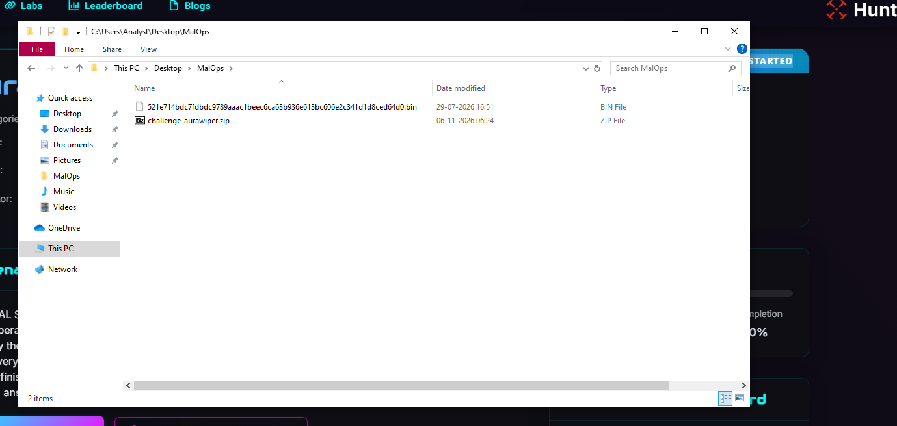

**Tool order on FLARE-VM:** PE-bear (headers, strings) → FLOSS (decoded strings) → IDA Pro (imports, xrefs, pseudocode). Snapshot the VM first.

---

## Q1 — Last part of the PDB path

**Question:** What is the last part of the PDB file path embedded in the malware sample?
**Answer:** `SF-Verif.pdb`

**Concept:** The PDB path is a debug artifact the compiler leaves behind. It leaks the developer's folder layout and project name.

**Manual method:** PE-bear → **Strings** tab → search `.pdb`.

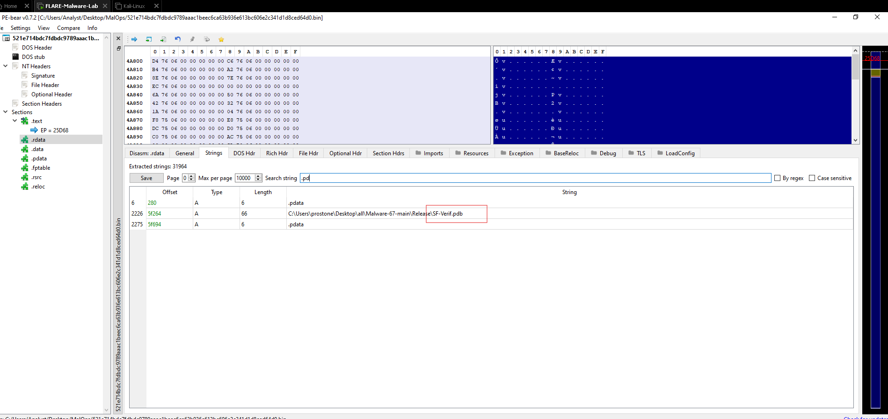

Full path at file offset `0x5F264`:
`C:\Users\prostone\Desktop\all\Malware-67-main\Release\SF-Verif.pdb`

**Cross-check with FLOSS.** My first run failed because PE-bear still held the file; close it and re-run:

```cmd
floss.exe 521e714b...64d0.bin > Floss_out.txt
```

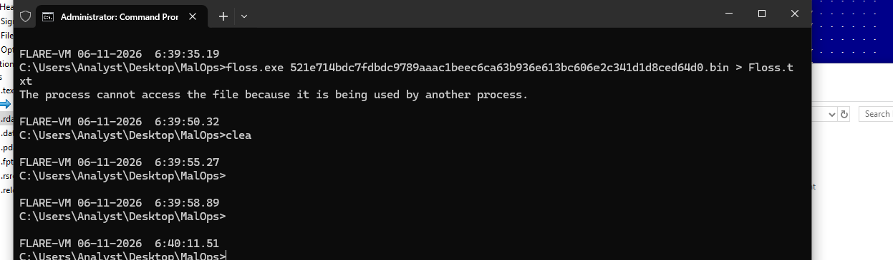
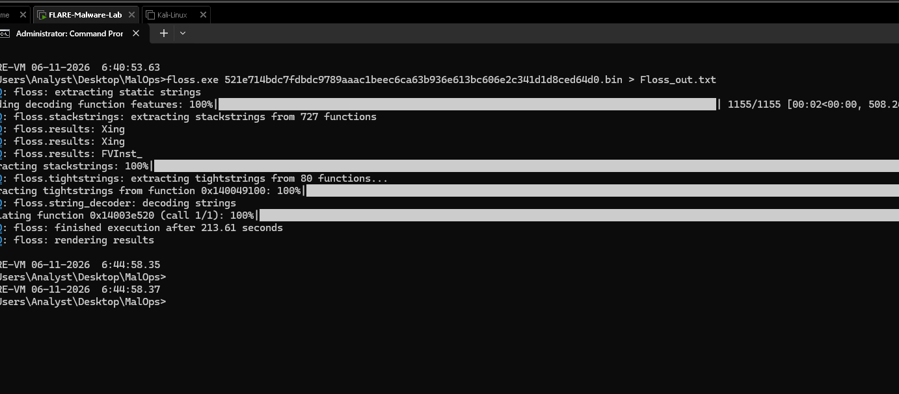
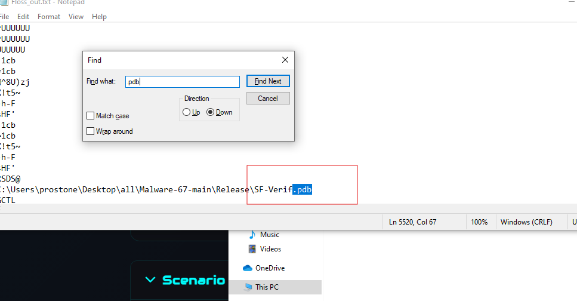

**Pattern:** `Release\<Name>.pdb` under a user's Desktop = unstripped debug path. Search `.pdb` first in every triage.

---

## Q2 — Mutex values in `main`

**Question:** The wiper checks two mutex values in the main function. What are those values?
**Answer:** `Global\SFV67PayloadLeader, Global\SFVDeployOnce`

**Concept:** `CreateMutexA` then `GetLastError`; if it returns `0xB7` (`ERROR_ALREADY_EXISTS`), another copy is running.

**Manual method:** IDA **Functions** window → search `main` → read the graph.

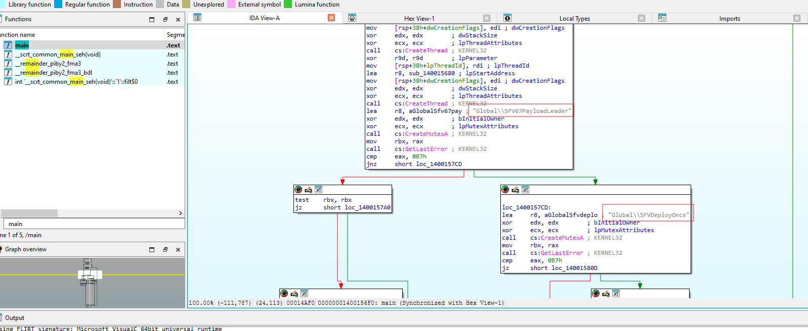

`main` creates two threads, then `CreateMutexA("Global\SFV67PayloadLeader")` and later `CreateMutexA("Global\SFVDeployOnce")`, each followed by `GetLastError` and `cmp eax, 0B7h`.

**Pattern:** `CreateMutexA` → `GetLastError` → `cmp eax, 0B7h` = single-instance check. `Global\` makes it session-wide.

---

## Q3 — Number of persistence mechanisms

**Question:** How many persistence mechanisms are implemented by AuraWiper?
**Answer:** `4`

**Concept:** On Windows, persistence and tampering sit in registry keys (`Run`, `Winlogon\Shell|Userinit`, policies), services and scheduled tasks. The imports show whether the sample can touch the registry at all.

**Manual method:** IDA **Imports** → filter `Reg` → `X` for xrefs.

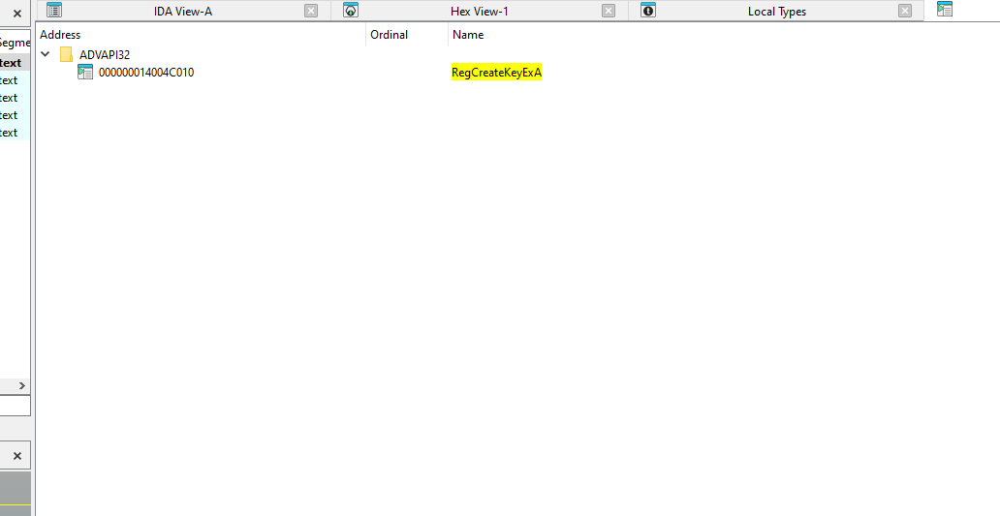
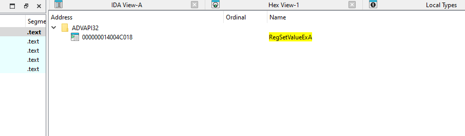
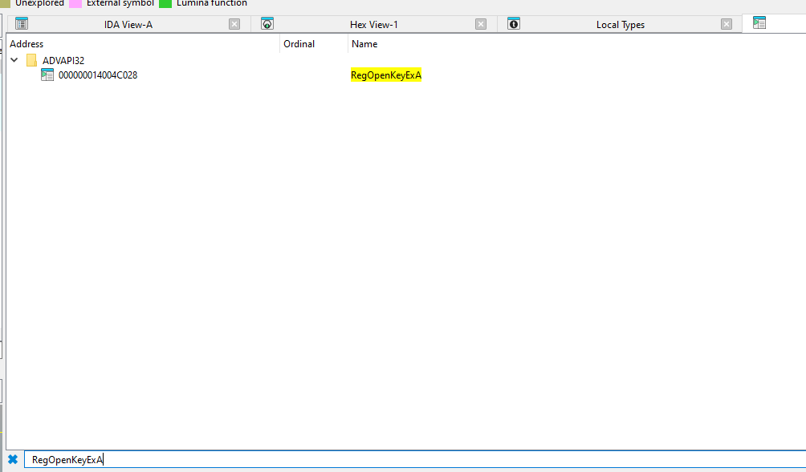
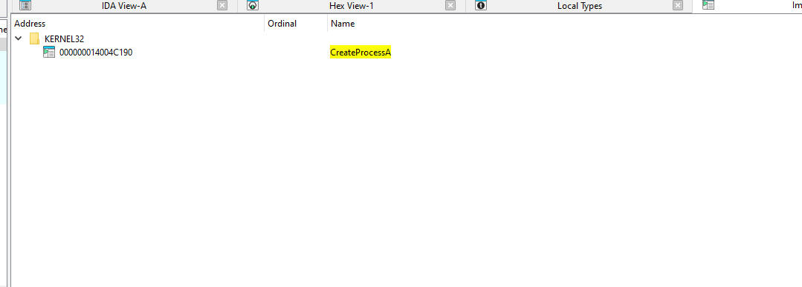

Registry writes in `sub_14000F4B0` (values `ColorPrevalence`, `EnableTransparency`, `AccentColor`, `AccentColorMenu`, `StartColorMenu`; the key path is truncated in IDA's operand column):

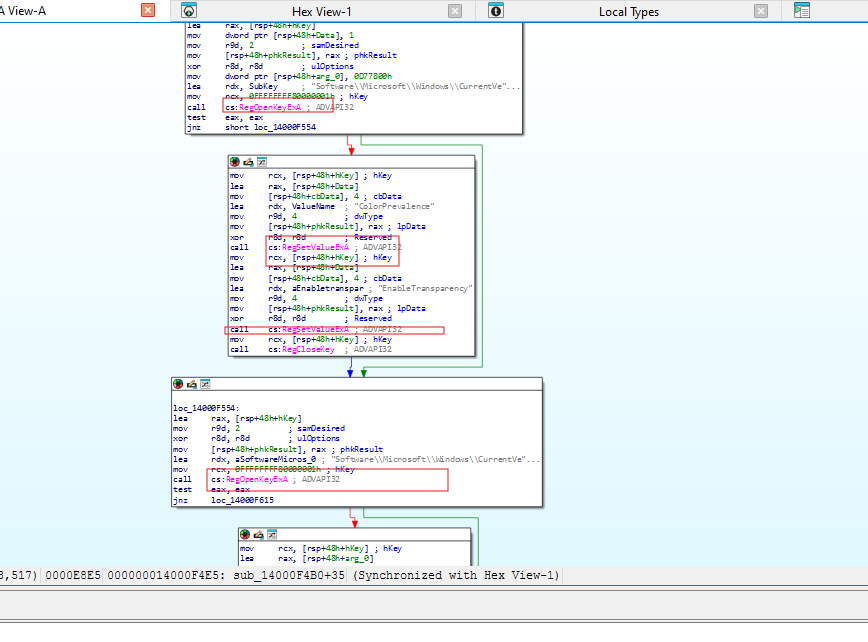
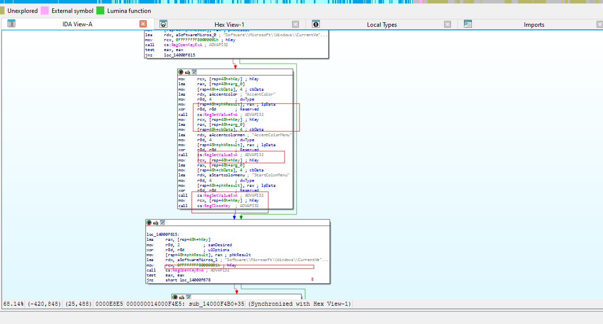

Other registry-related strings in `.rdata`: `…\Winlogon` with value name `Shell`, and a `REG ADD "HKLM\SOFTWARE\Policies\Microsoft\Windows Defender"` command that sets `DisableAntiSpyware`, `DisableRealtimeMonitoring`, `DisableBehaviorMonitoring` and `DisableOnAccessProtection`.

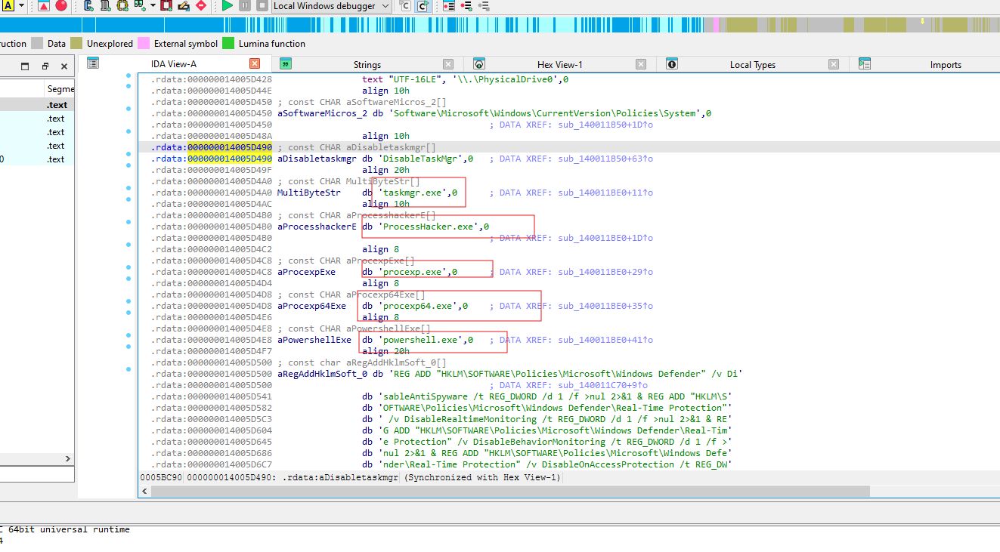
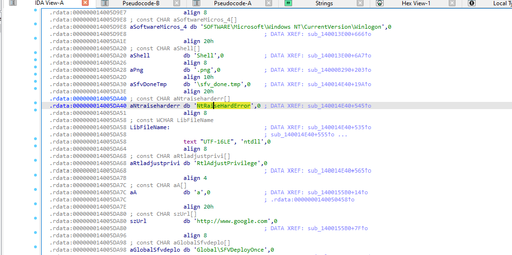

> **Evidence note:** the platform confirms **4**. My screenshots show the registry, Winlogon and Defender evidence above but no single view listing all four, so I do not name them here. Add that screenshot if you have it.

---

## Q4 — Address of the monitoring-tool killer

**Question:** What is the virtual address of the function responsible for terminating common system monitoring tools by process name?
**Answer:** `0x140011BE0`

**Manual method:** Strings window → search `taskmgr` → `X` on the string → the referencing function.

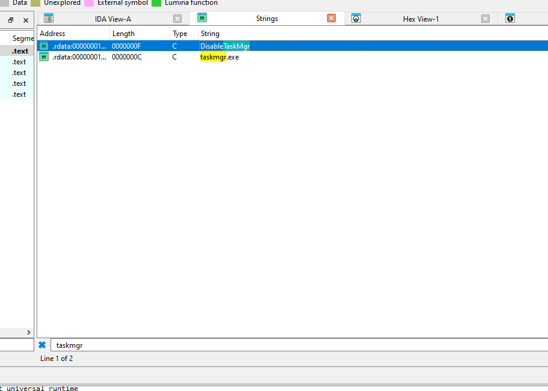

The names `taskmgr.exe`, `ProcessHacker.exe`, `procexp.exe`, `procexp64.exe`, `powershell.exe` sit together in `.rdata` and are referenced from `sub_140011BE0`:


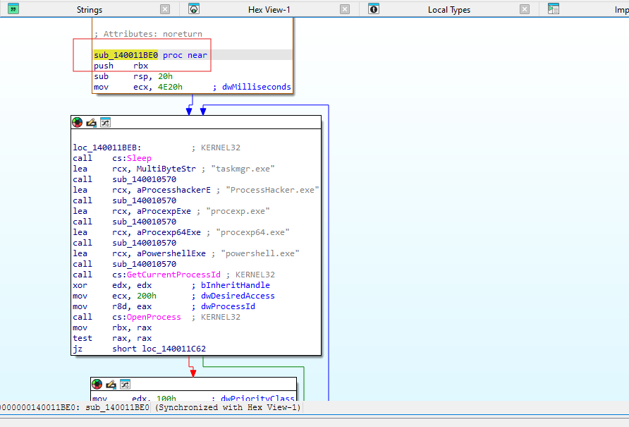
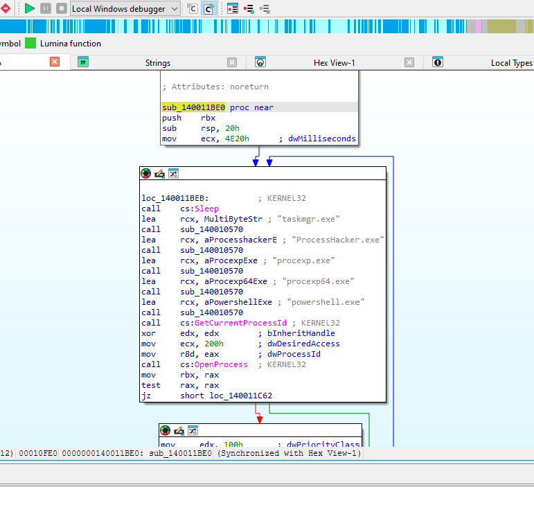

```asm
sub_140011BE0 proc near            ; Attributes: noreturn
    push rbx
    sub  rsp, 20h
    mov  ecx, 4E20h                ; 20 000 ms
loc_140011BEB:
    call cs:Sleep
    lea  rcx, "taskmgr.exe"        ; call sub_140010570
    lea  rcx, "ProcessHacker.exe"  ; call sub_140010570
    lea  rcx, "procexp.exe"        ; call sub_140010570
    lea  rcx, "procexp64.exe"      ; call sub_140010570
    lea  rcx, "powershell.exe"     ; call sub_140010570
    call cs:GetCurrentProcessId
    ... OpenProcess(0x200, ...)
```

It is a `noreturn` watchdog loop: sleep 20 s, kill the five tools, repeat. `main+1D9` passes its address to a thread (`lea rcx, sub_140011BE0`).

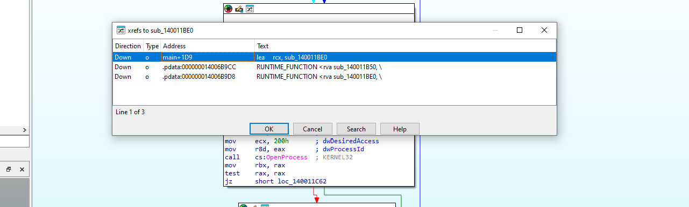

**Pattern:** a function that sleeps, calls the same helper with a list of tool names and never returns = anti-monitoring watchdog.

---

## Q5 — Times the process-termination function is invoked

**Question:** How many times does AuraWiper invoke the process-termination function?
**Answer:** `8` (5 + 3)

**Concept:** "Invoke count" = number of call sites (xrefs) to the helper that terminates processes by name.

**Helper:** `sub_140010570(LPCCH name)` — snapshot, enumerate, match, terminate:

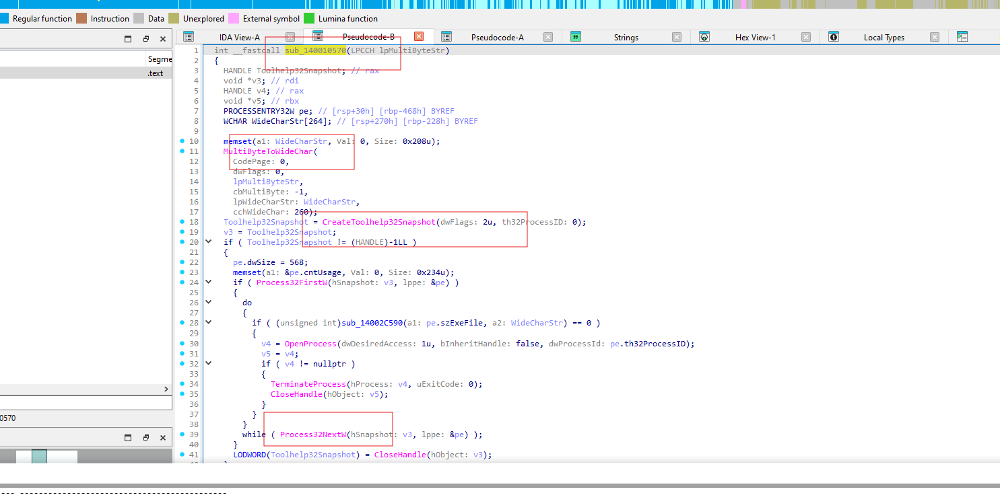

```c
CreateToolhelp32Snapshot(2, 0);
Process32FirstW(...);
do {
    if (sub_14002C590(pe.szExeFile, WideCharStr) == 0) {
        h = OpenProcess(1 /*PROCESS_TERMINATE*/, false, pe.th32ProcessID);
        if (h) { TerminateProcess(h, 0); CloseHandle(h); }
    }
} while (Process32NextW(...));
```

**Counting:**
- **5** calls are visible in `sub_140011BE0`: taskmgr, ProcessHacker, procexp, procexp64, powershell (screenshots 15 and 17).
- **+3** further calls to the same helper make the platform total **8**. These three call sites are **not in my screenshots**; get them by selecting `sub_140010570` and pressing `X` (xrefs) in IDA, and add that screenshot here.

**Correction:** an earlier draft of this writeup said 5. That counted only the call sites inside `sub_140011BE0`; the platform answer is 8.

**Pattern:** to count invocations, never count inside one function; list the helper's xrefs and count every caller site.

---

## Q6 — Address of the destructive payload function

**Question:** What is the virtual address of the function that implements the wiper's destructive payload?
**Answer:** `0x140014E40`

`sub_140014E40` is the final-act routine: it hides the console, enables the shutdown privilege, resolves `RtlAdjustPrivilege` and `NtRaiseHardError` from ntdll, raises the hard error and writes `C:\Windows\Temp\clean.bat`.

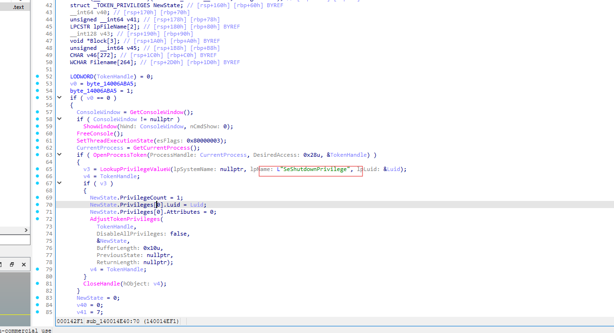
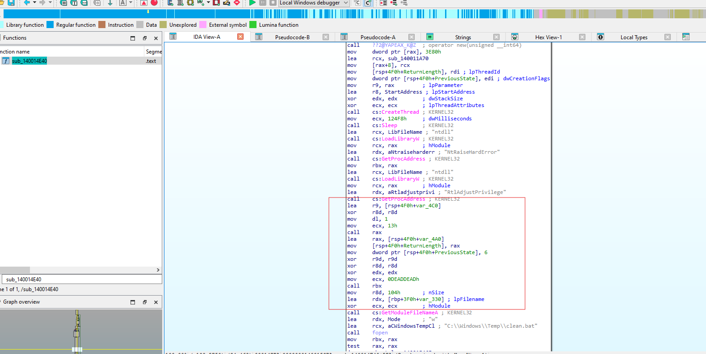
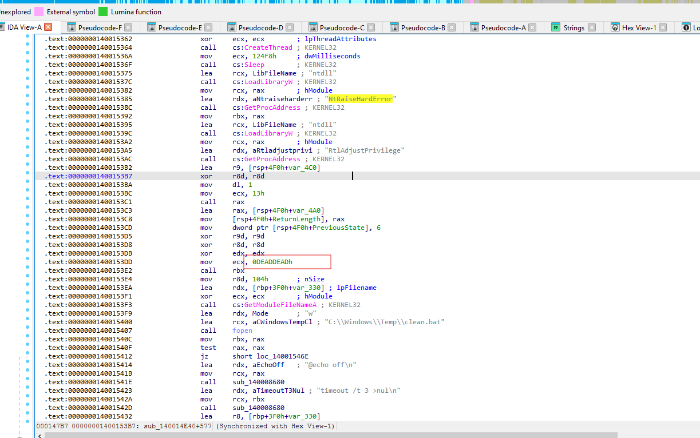

Steps seen in the code: `GetConsoleWindow` → `ShowWindow(…,0)` → `FreeConsole` → `SetThreadExecutionState(0x80000003)` → privilege adjustment → `CreateThread` → `Sleep(0x124F8)` (75 s) → `LoadLibraryW("ntdll")` + `GetProcAddress` → `RtlAdjustPrivilege(0x13, …)` → `NtRaiseHardError(0xDEADDEAD, …)` → `GetModuleFileNameA` + `fopen("C:\Windows\Temp\clean.bat","w")` writing `@echo off` / `timeout /t 3 >nul` (rest not visible).

**Pattern:** the function that combines privilege escalation, dynamic ntdll resolution, a crash call and a cleanup script is usually the payload's finale. Confirm by following xrefs from `main`'s thread starts.

---

## Q7 — Windows privilege modified

**Question:** Which Windows privilege does AuraWiper attempt to modify?
**Answer:** `SeShutdownPrivilege`


```c
OpenProcessToken(GetCurrentProcess(), 0x28u, &TokenHandle);
LookupPrivilegeValueW(0, L"SeShutdownPrivilege", &Luid);
NewState.PrivilegeCount = 1; NewState.Privileges[0].Luid = Luid;
AdjustTokenPrivileges(TokenHandle, false, &NewState, 0x10u, 0, 0);
```

`0x28` = `TOKEN_ADJUST_PRIVILEGES | TOKEN_QUERY`. Later `RtlAdjustPrivilege(0x13, …)` repeats the request via the native API (privilege ID `0x13` is `SeShutdownPrivilege`).

**Pattern:** `OpenProcessToken` → `LookupPrivilegeValueW` → `AdjustTokenPrivileges` is the standard privilege-enable sequence; the string literal names the privilege.

---

## Q8 — Registry key that blocks the user

**Question:** AuraWiper creates a registry policy key to prevent the user from terminating the wiper process. Which registry key is responsible for this?
**Answer:** `HKCU\Software\Microsoft\Windows\CurrentVersion\Policies\System\DisableTaskMgr`
*(platform-confirmed full path)*

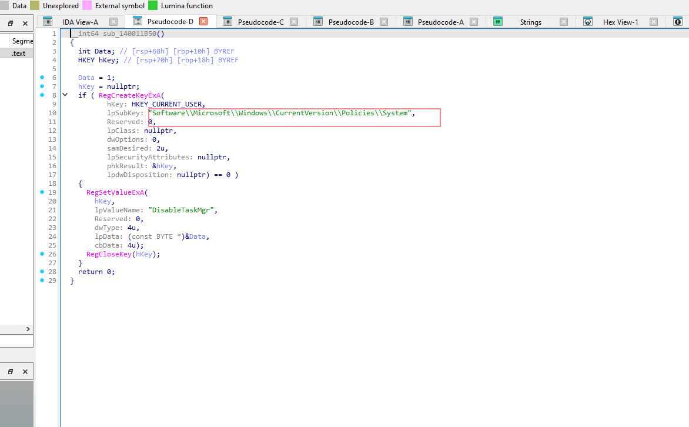
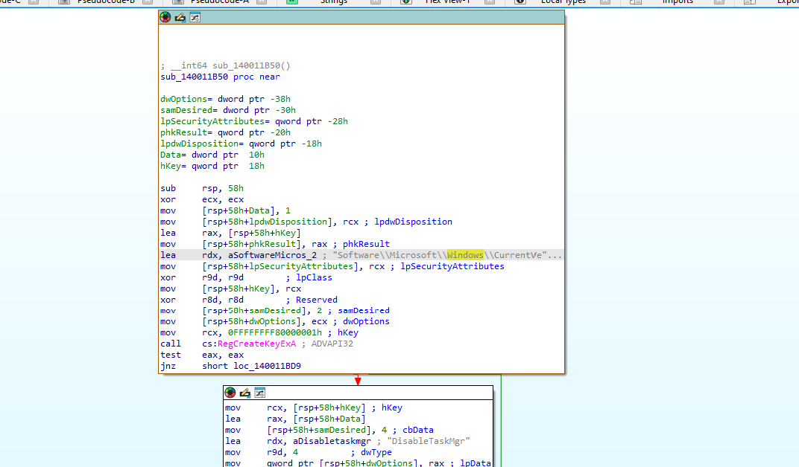

```c
Data = 1;
RegCreateKeyExA(HKEY_CURRENT_USER,
    "Software\\Microsoft\\Windows\\CurrentVersion\\Policies\\System", ...);
RegSetValueExA(hKey, "DisableTaskMgr", 0, REG_DWORD, &Data, 4);
RegCloseKey(hKey);
```

`mov rcx, 0FFFFFFFF80000001h` is the predefined `HKEY_CURRENT_USER` handle.

**Pattern:** `0xFFFFFFFF8000000x` = predefined root (`…0001` HKCU, `…0002` HKLM). `Policies\System\DisableTaskMgr = 1` greys out Task Manager.

---

## Q9 — API for the Media Control Interface

**Question:** Which Windows API handles communication with the Media Control Interface?
**Answer:** `mciSendStringA`

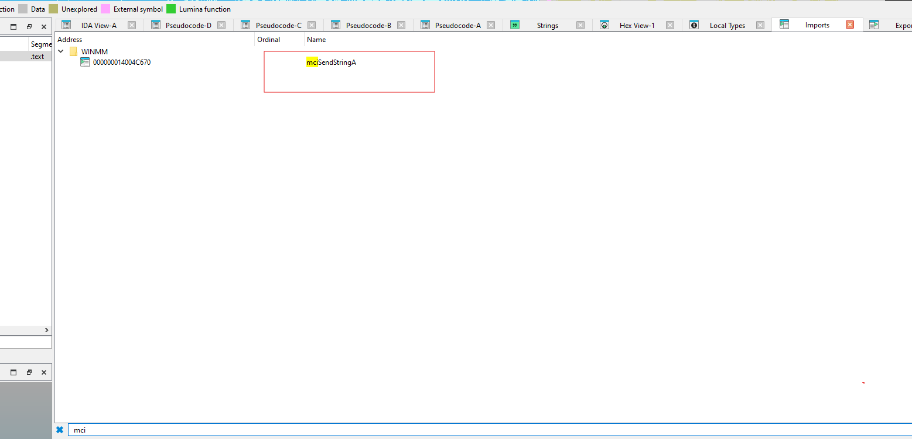

It is imported from `WINMM.dll` at `0x14004C670`. Searching `mci` in the Imports window is the quick way to find it.

**Pattern:** `winmm.dll` imports (`mciSendString*`, `PlaySound`) mean audio/video playback, here part of the taunting "effects".

---

## Q10 — Address of the random-string display function

**Question:** What is the virtual address of the function responsible for displaying random strings?
**Answer:** `0x14000FC00`

**Method:** Imports → `MessageBox` → `X`.

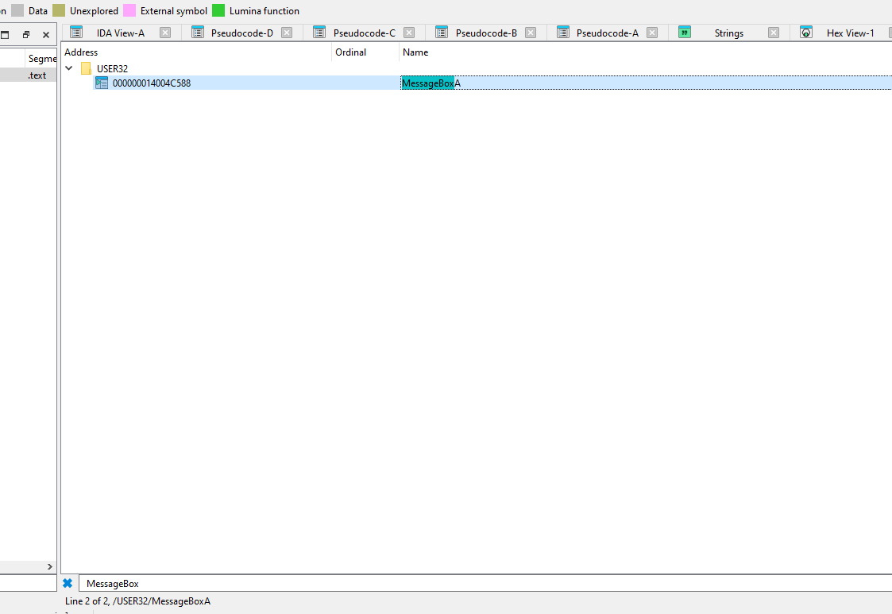
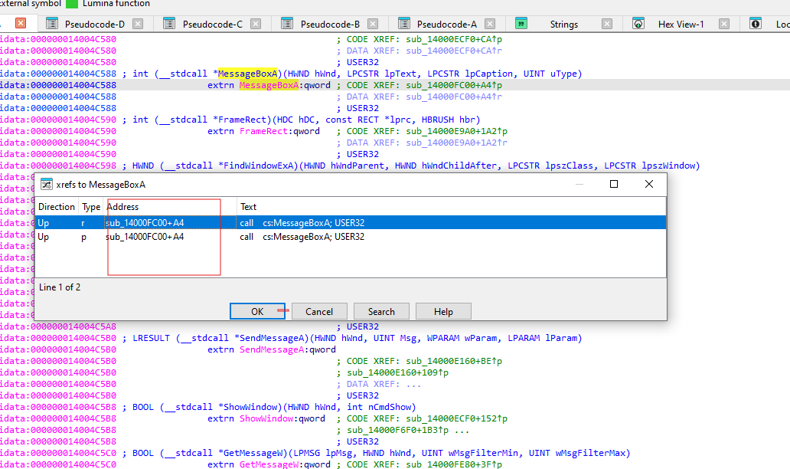

The only caller is `sub_14000FC00+0xA4`.

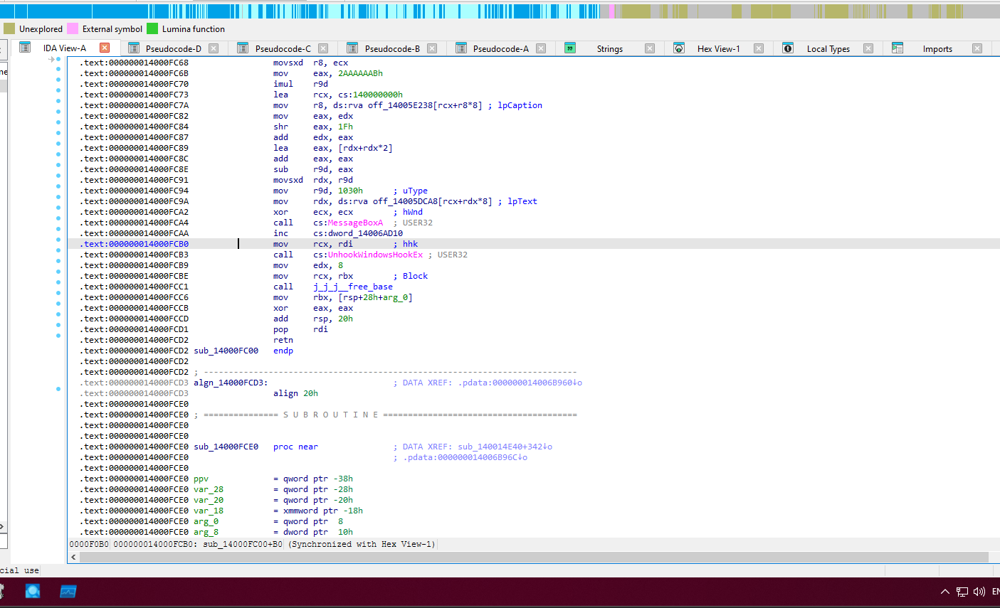

Caption and text are looked up from two pointer tables with an index computed by a divide-by-6 magic-number sequence (`mov eax, 2AAAAAABh` / `imul`), so one of six messages is shown (my reading; I did not dump the tables). `uType = 0x1030` (`MB_ICONEXCLAMATION | MB_SYSTEMMODAL`).

**Pattern:** `2AAAAAABh` is the compiler's reciprocal for dividing by 6; an index into a pointer table after `idiv`/`imul` = "pick a random/rotating string".

---

## Q11 — Offset of the `lpText` array

**Question:** What is the offset address of the array containing the lpText values?
**Answer:** `0x14005DCA8`

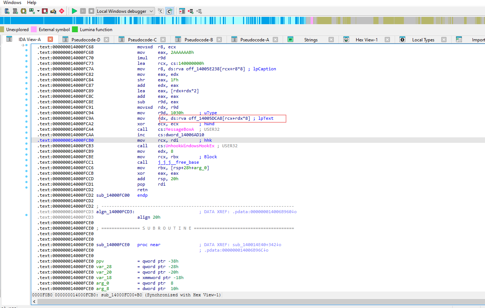

```asm
mov rdx, ds:rva off_14005DCA8[rcx+rdx*8]   ; lpText
```

The text array is `off_14005DCA8`; the caption array is `off_14005E238`.

**Pattern:** the `; lpText` comment IDA adds from the API prototype tells you which table feeds which argument.

---

## Q12 — Address of the MBR overwrite function

**Question:** What is the virtual address of the function responsible for overwriting the Master Boot Record (MBR)?
**Answer:** `0x140011AA0`

**Method:** Imports → `CreateFileW` → `X` → look for `\\.\PhysicalDrive0`.

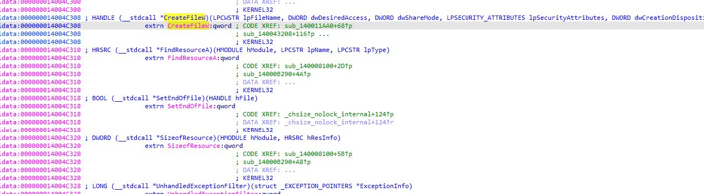
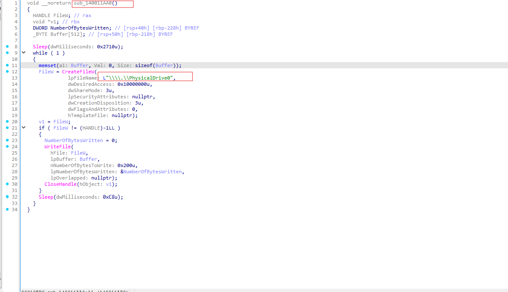

```c
void __noreturn sub_140011AA0() {
    Sleep(0x2710u);                                   // 10 s
    while (1) {
        memset(Buffer, 0, sizeof(Buffer));            // 512 zero bytes
        h = CreateFileW(L"\\\\.\\PhysicalDrive0", 0x10000000u, 3u, 0, 3u, 0, 0);
        if (h != INVALID_HANDLE_VALUE) {
            WriteFile(h, Buffer, 0x200u, &written, 0);   // sector 0
            CloseHandle(h);
        }
        Sleep(0xC8u);
    }
}
```

Opening the raw disk with `GENERIC_ALL` and writing 512 zero bytes at offset 0 destroys the MBR; the loop repeats every 200 ms.

**Pattern:** `CreateFileW(L"\\.\PhysicalDrive0")` + `WriteFile(..., 0x200)` = MBR overwrite.

---

## Q13 — Address of the system-file deletion function

**Question:** What is the virtual address of the function responsible for deleting key Windows system files?
**Answer:** `0x140011650`

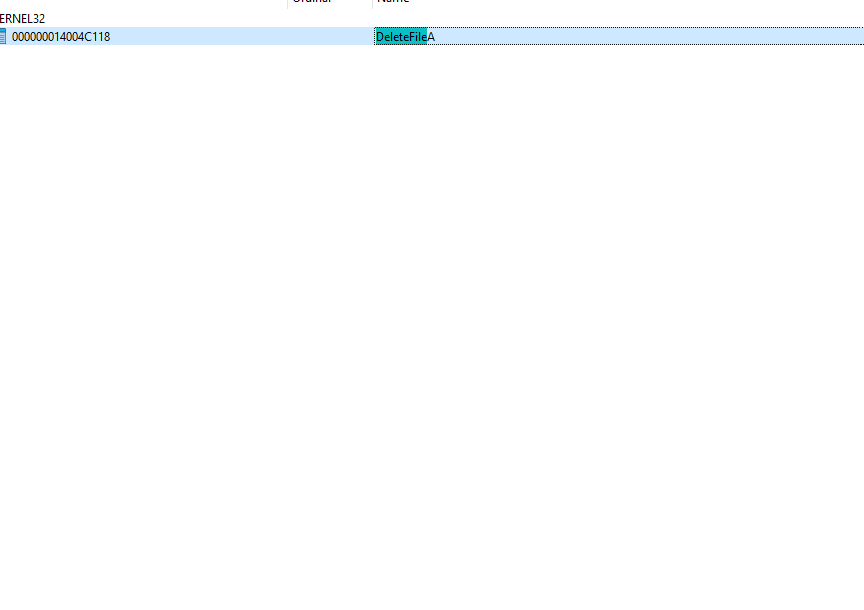
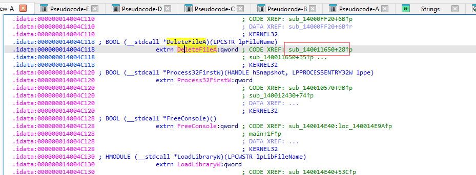
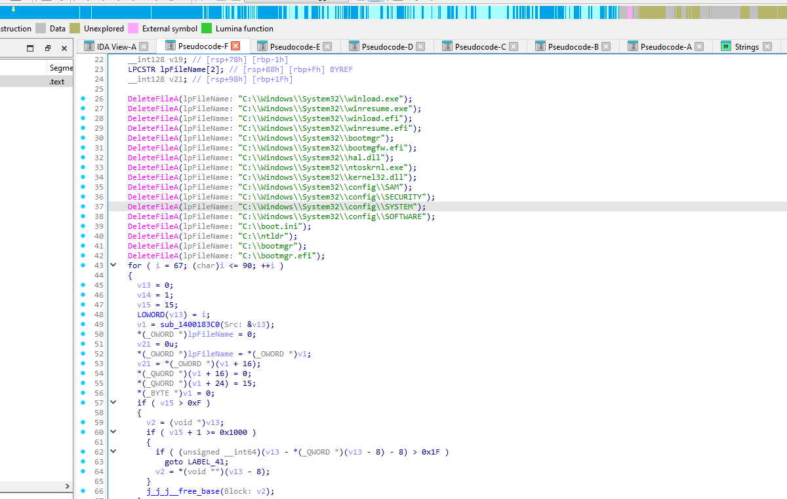

Deleted paths: `winload.exe`, `winresume.exe`, `winload.efi`, `winresume.efi`, `bootmgr`, `bootmgfw.efi`, `hal.dll`, `ntoskrnl.exe`, `kernel32.dll` (all in `C:\Windows\System32\`), the hives `config\SAM`, `SECURITY`, `SYSTEM`, `SOFTWARE`, and `C:\boot.ini`, `C:\ntldr`, `C:\bootmgr`, `C:\bootmgr.efi`. A loop `for (i = 67; i <= 90; ++i)` then builds drive-letter strings (`C`–`Z`); the rest is off-screen.

**Pattern:** `DeleteFileA` on `ntoskrnl.exe`, `hal.dll`, boot manager and registry hives = intent to make the machine unbootable.

---

## Q14 — Native API that triggers the hard error

**Question:** What is the name of the Windows Native API that AuraWiper uses to trigger a hard system error?
**Answer:** `NtRaiseHardError`


It is not in the import table: the code does `LoadLibraryW("ntdll")` then `GetProcAddress(hModule, "NtRaiseHardError")` and calls the returned pointer (`call rbx`).

**Pattern:** a function name stored as a string plus `LoadLibrary`/`GetProcAddress` = dynamic API resolution, used to hide APIs from the import table. Search strings, not imports.

---

## Q15 — ErrorStatus value

**Question:** What hexadecimal value is passed as the ErrorStatus parameter to the native API that triggers the hard system error?
**Answer:** `0xDEADDEAD`


```asm
xor  r9d, r9d
xor  r8d, r8d
xor  edx, edx
mov  ecx, 0DEADDEADh     ; ErrorStatus (first argument)
call rbx                 ; NtRaiseHardError
```

`NtRaiseHardError(ErrorStatus, NumberOfParameters, UnicodeStringParameterMask, Parameters, ValidResponseOption, Response)`: in the x64 calling convention the first argument goes in `ecx`, so `ecx = 0xDEADDEAD`.

**Pattern:** map arguments to registers `rcx, rdx, r8, r9` then the stack; the constant moved into `ecx` before the call is the first parameter.

---

## Answer sheet

| Q | Answer | Evidence |
|---|---|---|
| 1 | `SF-Verif.pdb` | PE-bear / FLOSS strings |
| 2 | `Global\SFV67PayloadLeader, Global\SFVDeployOnce` | `main` |
| 3 | `4` | Registry/persistence evidence (platform-confirmed) |
| 4 | `0x140011BE0` | `sub_140011BE0` |
| 5 | `8` | 5 calls in `sub_140011BE0` + 3 more call sites (platform-confirmed) |
| 6 | `0x140014E40` | `sub_140014E40` |
| 7 | `SeShutdownPrivilege` | `LookupPrivilegeValueW` |
| 8 | `HKCU\Software\Microsoft\Windows\CurrentVersion\Policies\System\DisableTaskMgr` | `sub_140011B50` |
| 9 | `mciSendStringA` | Imports (WINMM) |
| 10 | `0x14000FC00` | `MessageBoxA` caller |
| 11 | `0x14005DCA8` | `off_14005DCA8` |
| 12 | `0x140011AA0` | `\\.\PhysicalDrive0` writer |
| 13 | `0x140011650` | `DeleteFileA` caller |
| 14 | `NtRaiseHardError` | `GetProcAddress` string |
| 15 | `0xDEADDEAD` | `mov ecx, 0DEADDEADh` |

---

## Function map

| Address | Role |
|---|---|
| `main` (`0x1400156F0`) | Threads and the two `Global\` mutexes |
| `sub_140011BE0` | Monitoring-tool killer loop (Q4) |
| `sub_140010570` | Kill-by-name helper (Q5) |
| `sub_140014E40` | Destructive finale: privilege, `NtRaiseHardError`, `clean.bat` (Q6, Q7, Q14, Q15) |
| `sub_140011B50` | `DisableTaskMgr = 1` (Q8) |
| `sub_14000FC00` | Pop-up messages (Q10, Q11) |
| `sub_140011AA0` | MBR overwrite loop (Q12) |
| `sub_140011650` | System/boot file deletion (Q13) |
| `sub_14000F4B0`, `sub_140011C70` | Registry personalization writes; Defender-disable command reference (Q3 evidence) |

## Detection ideas

- **Artifacts:** PDB `Malware-67-main\Release\SF-Verif.pdb`; mutexes `Global\SFV67PayloadLeader`, `Global\SFVDeployOnce`.
- **Behaviour:** raw write handle on `\\.\PhysicalDrive0`; deletion of `ntoskrnl.exe`, `winload.*`, `bootmgr`, `config\SAM|SYSTEM`; `NtRaiseHardError` with `0xDEADDEAD`.
- **Registry:** `HKCU\...\Policies\System\DisableTaskMgr = 1`; Defender policy keys under `HKLM\SOFTWARE\Policies\Microsoft\Windows Defender`.
- **Process/file:** repeated kills of `taskmgr.exe`, `procexp*.exe`, `ProcessHacker.exe`; `C:\Windows\Temp\clean.bat` created.

## Key takeaways

1. Triage first: PDB path, mutexes, imports.
2. For "how many times" questions, count the helper's xrefs, not the calls inside one function.
3. Dynamic API resolution hides APIs from imports; search strings.
4. Register order (`rcx, rdx, r8, r9`) tells you which constant is which parameter.
