# Kernel Shield: MalOps Writeup

> **Platform:** MalOps (Hunt.io) | **Category:** Kernel driver | **Difficulty:** Easy | **Tool:** IDA Pro
> **Sample:** `NSecKrnl` Windows kernel driver (x64) | **Questions:** 17 (170 pts)

## Scenario

An incident response team investigates a ransomware attack that encrypted critical servers. Before encrypting anything, the ransomware loaded a malicious kernel driver, **NSecKrnl**, to blind the endpoint detection and response (EDR) tools. Running in kernel mode, the driver can intercept process-handle operations, strip access rights from security tools, and forcefully terminate protective processes.

The task is to reverse the driver in IDA Pro: how it initializes, how it evades kernel integrity checks, how usermode talks to it over IOCTLs, and how it kills EDR processes.

---

## Table of contents

- [Methodology](#methodology)
- [Core concepts](#core-concepts)
- [Q1 to Q17 walkthrough](#q1--the-name-the-driver-exposes-to-usermode)
- [Putting it together: attack chain](#putting-it-together-attack-chain)
- [Answer summary](#answer-summary)
- [Detection ideas](#detection-ideas)

---

## Methodology

I did not hunt for answers at random. Every function was reached by following the code from a known starting point:

1. **Find the init routine.** `DriverEntry` lives in the `INIT` section. The routine that takes the `DriverObject` and sets everything up is `sub_14000114C`.
2. **Read what init registers.** It assigns `MajorFunction[]` handlers, `DriverUnload`, creates the device and symlink, and calls `PsSetCreateProcessNotifyRoutine`, `PsSetLoadImageNotifyRoutine` and `sub_140001518`.
3. **Follow each registration into its handler.** `MajorFunction[14]` leads to the IOCTL dispatcher; `sub_140001518` leads to `ObRegisterCallbacks` and the callback `sub_1400014B0`.
4. **Follow the dispatcher into its handlers**, then check imports and cross-references (`X`) to confirm what each handler does.
5. **Verify numbers in disassembly** (sizes, offsets, immediates), not only in the decompiler.

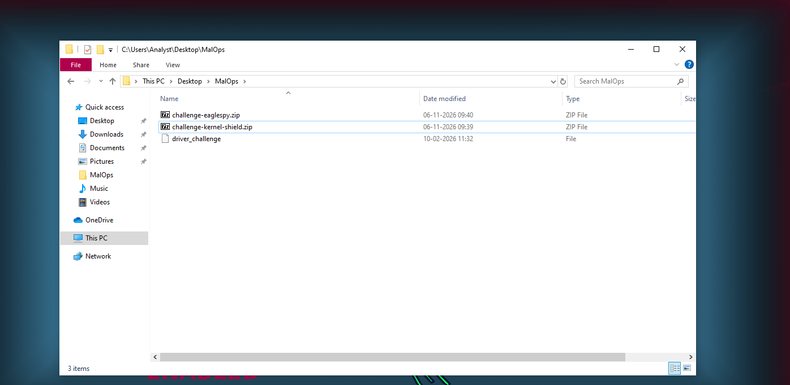

### IDA shortcuts used

| Key | Use |
| --- | --- |
| `Shift+F12` | Strings window |
| `Shift+F3` | Functions window |
| `F5` | Decompile |
| `Tab` | Switch pseudocode / disassembly |
| `X` | Cross-references |
| `G` | Jump to name or address |
| `N` | Rename |

---

## Core concepts

**Device name vs. symbolic link.** A driver creates a device object with `IoCreateDevice` under `\Device\<Name>`. Usermode cannot open `\Device\...` directly, so the driver also calls `IoCreateSymbolicLink` to publish `\DosDevices\<Name>` (reachable as `\\.\<Name>` via `CreateFile`).

**`DriverObject->DriverSection`.** This points at the driver's loader entry (a `KLDR_DATA_TABLE_ENTRY`). Its `Flags` field sits at offset `0x68`. Setting a flag bit here is a known trick for making the kernel treat the image as integrity-checked, which lets a driver call `ObRegisterCallbacks` without being properly signed for it.

**`MajorFunction[]` indexes.** `[0]` = `IRP_MJ_CREATE`, `[2]` = `IRP_MJ_CLOSE`, `[14]` = `IRP_MJ_DEVICE_CONTROL`. Usermode `DeviceIoControl` calls arrive at index 14.

**IOCTL codes.** A code is built with `CTL_CODE(DeviceType, Function, Method, Access)`. Layout: bits 31-16 device type, 15-14 access, 13-2 function, 1-0 method. `0x2248E0` decodes to device type `0x22`, access `FILE_READ_ACCESS`, function `0x238`, method `METHOD_BUFFERED`. Buffered I/O is why the handlers read their input from `Irp->AssociatedIrp.SystemBuffer` (IDA shows it as `MasterIrp` because it is a union).

**Object callbacks (`ObRegisterCallbacks`).** Lets a driver get a callback whenever a handle to a process or thread is created or duplicated, and modify the access mask granted. Security products use it to protect themselves; this driver abuses the same mechanism. The *altitude* is a string that orders callbacks relative to other drivers.

**`Zw` vs. `Ps` termination.** `ZwTerminateProcess` needs a handle. The driver gets one with `ObOpenObjectByPointer`, using `OBJ_KERNEL_HANDLE` (`0x200`) so the handle is invisible to usermode.

**Handle vs. reference.** `ZwClose` closes a handle; `ObfDereferenceObject` drops a pointer reference taken by `PsLookupProcessByProcessId`. They are different cleanups.

---

## Q1 · The name the driver exposes to usermode

**Question:** The driver exposes itself to usermode under a specific name. What is it?

**Approach.** I first searched the Strings window for `Device`. It only listed the API names `IoCreateDevice` / `IoDeleteDevice`. The device-name literals are UTF-16 wide strings, so they are easier to reach by following `IoCreateDevice` into the init routine than through the Strings list.

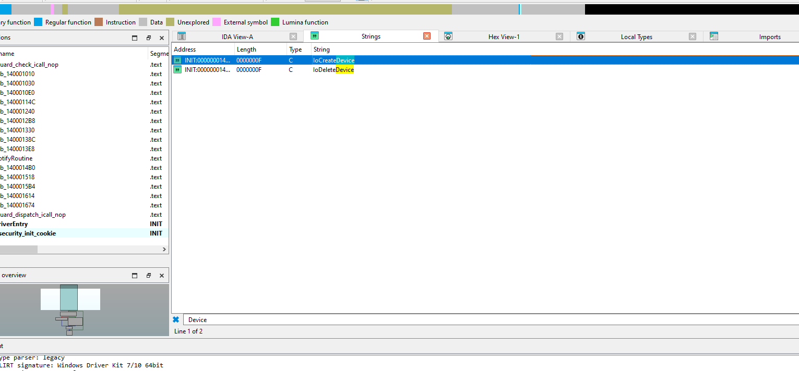

In the init disassembly, the two names are passed to `RtlInitUnicodeString` just before `IoCreateDevice`:

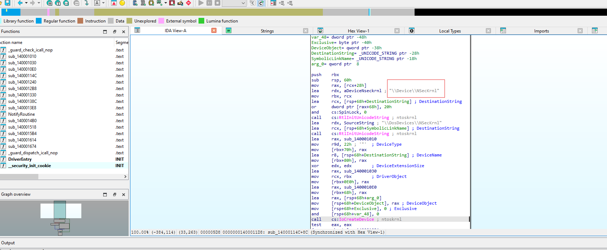

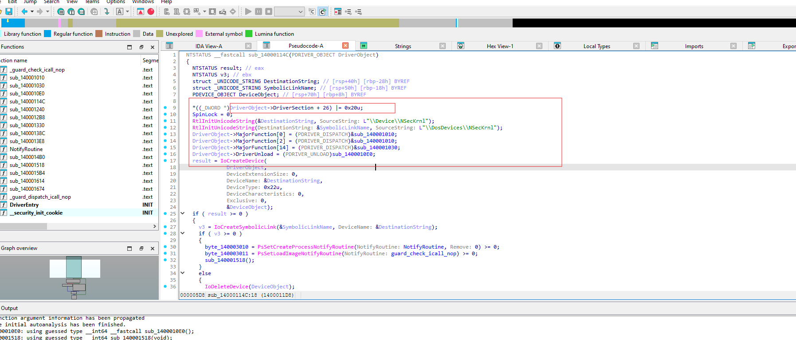

```c
RtlInitUnicodeString(&DestinationString, L"\\Device\\NSecKrnl");
RtlInitUnicodeString(&SymbolicLinkName,  L"\\DosDevices\\NSecKrnl");
...
v3 = IoCreateSymbolicLink(&SymbolicLinkName, &DestinationString);
```

`\Device\NSecKrnl` is the kernel object; `\DosDevices\NSecKrnl` is the link usermode opens.

**Answer: `NSecKrnl`**

---

## Q2 · Value OR'd into the loader entry

**Question:** What hex value is OR'd into the loader entry field?

**Approach.** The very first statement of the init routine touches `DriverObject->DriverSection`:

```c
*((_DWORD *)DriverObject->DriverSection + 26) |= 0x20u;
```

The disassembly confirms it as a single instruction:

```asm
or  dword ptr [rax+68h], 20h
```

![or dword ptr [rax+68h], 20h in disassembly](screenshots/03-q1-q2-q3-q10-init-disassembly.png)


`|=` sets a bit and leaves the rest of the field alone.

**Answer: `0x20`**

---

## Q3 · Byte offset of the tampering

**Question:** At what byte offset from the base of the loader data table entry does it occur?

**Approach.** The pseudocode adds `26` to a `_DWORD*`, so the offset is scaled by 4 bytes: `26 × 4 = 104 = 0x68`. The disassembly shows the same thing directly as `[rax+68h]`, so the two views agree (same screenshots as Q2).

> A pointer cast changes the arithmetic. If this were a `QWORD*`, `+ 26` would mean `0xD0`. Always cross-check against the disassembly.

**Answer: `0x68`**

---

## Q4 · IOCTL that leads to forced process termination

**Question:** Which IOCTL code reaches forced process termination?

**Approach.**
1. `MajorFunction[14]` (device control) is `sub_140001030`, the IOCTL dispatcher.
2. The dispatcher compares the IOCTL against four decimal constants:

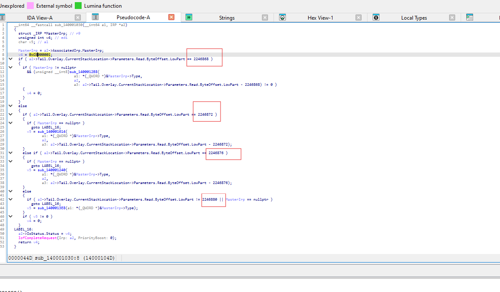

3. To find which one kills processes, I searched the Imports window for `Terminate`. Only `ZwTerminateProcess` is imported:

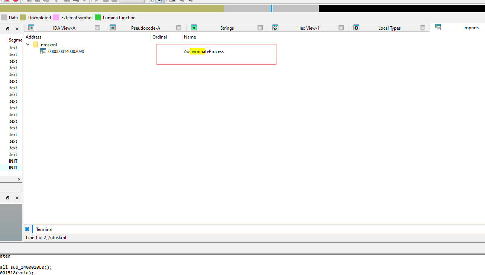

4. Cross-referencing it leads to `sub_1400013E8`:

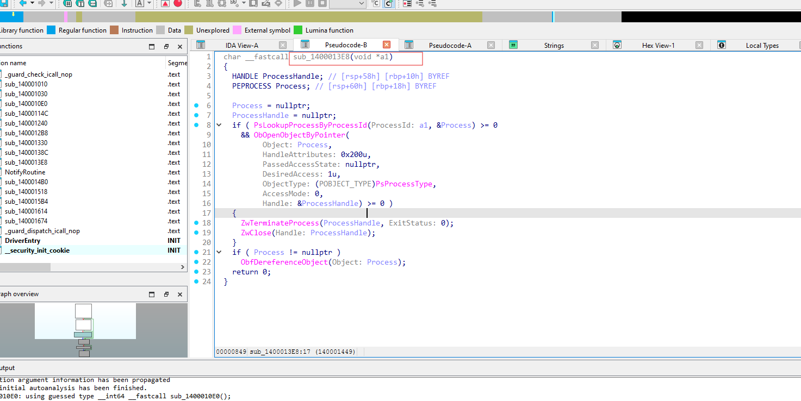

5. Back in the dispatcher, `sub_1400013E8` is called only in the last branch, where the code equals `2246880`:

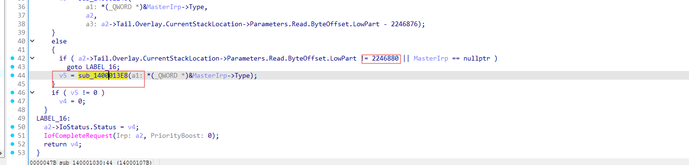

Switching the constant to hex in IDA (`H`) shows it as `0x2248E0`:

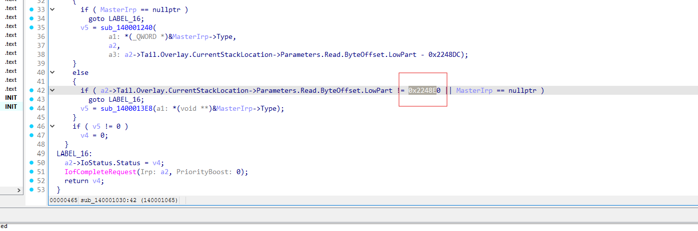

The handler itself is short and does exactly what the scenario describes:

```c
if ( PsLookupProcessByProcessId(a1, &Process) >= 0
  && ObOpenObjectByPointer(Process, 0x200u, nullptr, 1u, PsProcessType, 0, &ProcessHandle) >= 0 )
{
    ZwTerminateProcess(ProcessHandle, 0);
    ZwClose(ProcessHandle);
}
if ( Process != nullptr )
    ObfDereferenceObject(Process);
```

Usermode sends a **PID**; the driver kills that process from kernel mode, which is how it removes EDR processes that would be protected from normal termination.

**Answer: `0x2248E0`**

---

## Q5 · Status for an unknown IOCTL or NULL input buffer

**Question:** What NTSTATUS does the dispatcher return in those cases?

**Approach.** The dispatcher sets its status variable up front and only overwrites it with `0` when a handler reports success. Anything else (an unknown code, or `MasterIrp == nullptr`, which jumps to `LABEL_16`) falls through with the default and completes the IRP with it.

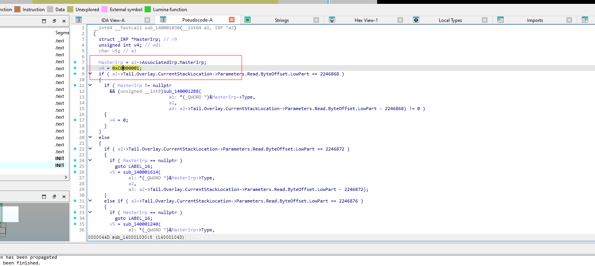

```c
v4 = 0xC0000001;      // shown as -1073741823 before changing the display to hex
...
LABEL_16:
  a2->IoStatus.Status = v4;
  IofCompleteRequest(a2, 0);
  return v4;
```

`0xC0000001` is `STATUS_UNSUCCESSFUL`.

**Answer: `0xC0000001`**

---

## Q6 · Capacity of each tracking array

**Question:** How many entries can each tracking array hold?

**Approach.** Two helpers, `sub_1400015B4` and `sub_140001614`, take a spin lock and linearly scan a global `QWORD` array for a value (a PID), clearing the slot when found. Both stop at the same bound:

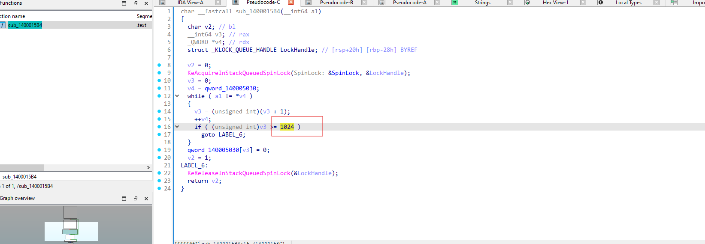

```c
KeAcquireInStackQueuedSpinLock(&SpinLock, &LockHandle);
v4 = qword_140005030;                 // the other helper uses qword_140003030
while ( a1 != *v4 ) {
    v3 = (unsigned int)(v3 + 1);
    ++v4;
    if ( (unsigned int)v3 >= 1024 ) goto LABEL_6;
}
qword_140005030[v3] = 0;
```

To confirm there are two separate arrays guarded by one lock, I cross-referenced `KeAcquireInStackQueuedSpinLock`. Six functions take the lock, including both helpers:

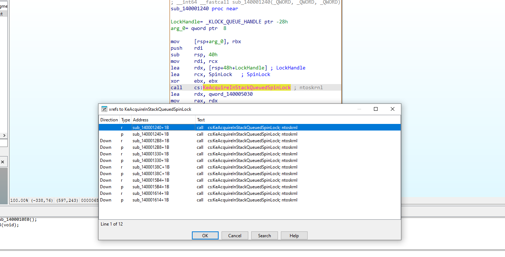

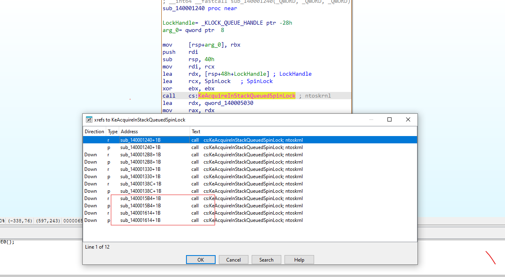

**Sanity check:** the arrays are at `0x140003030` and `0x140005030`, which are `0x2000` apart. That is `1024 entries × 8 bytes`, so each array fills exactly that block.

**Answer: `1024`**

---

## Q7 · Object-callback altitude

**Question:** At what altitude does the driver register its handle-operation callback?

**Approach.** Searching Strings for `ObRegisterCallbacks` finds the import name; its cross-reference leads to the registration function `sub_140001518` (called at the end of init).

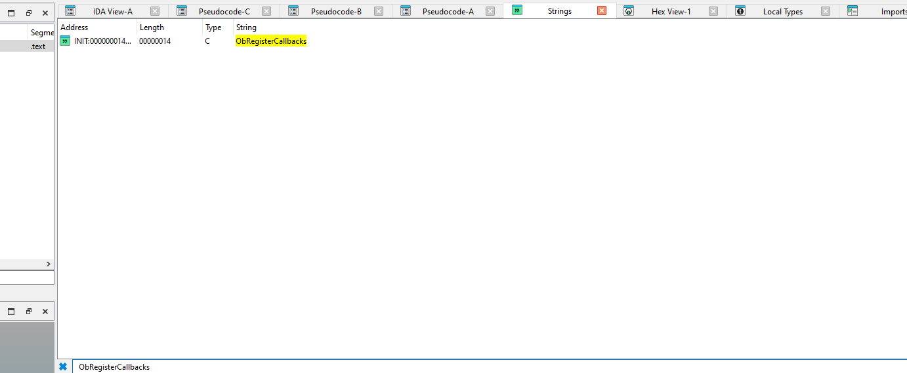

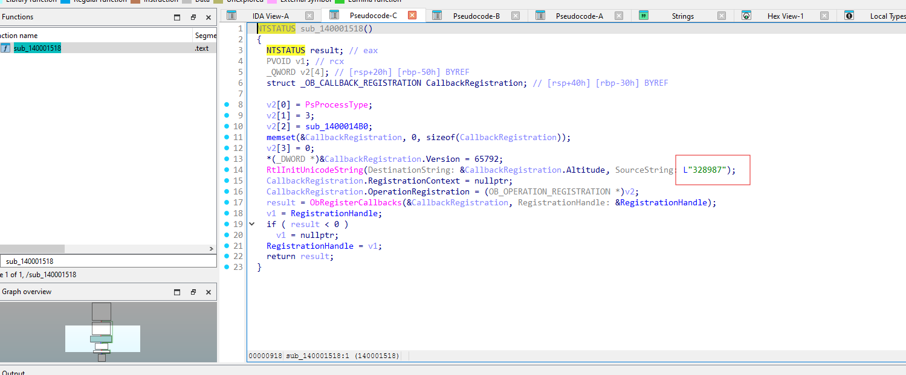

```c
RtlInitUnicodeString(&CallbackRegistration.Altitude, L"328987");
...
result = ObRegisterCallbacks(&CallbackRegistration, &RegistrationHandle);
```

The same value appears in the disassembly right before the call:

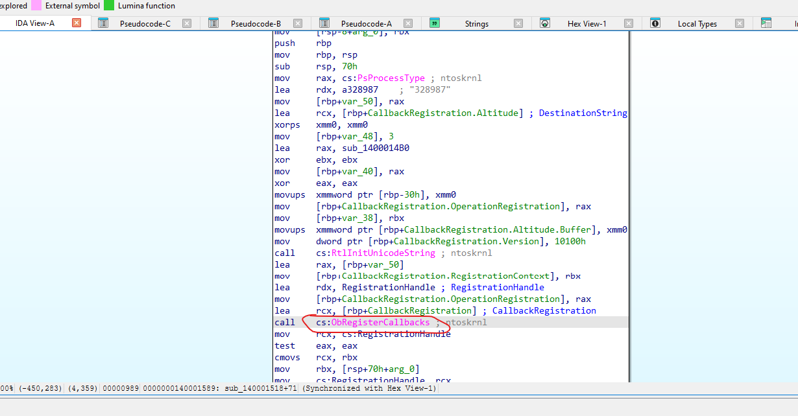

The altitude is a **string**. Keep the digits as they are; do not convert to hex.

**Answer: `328987`**

---

## Q8 · HandleAttributes used when opening the target process

**Question:** What handle-attribute value does the driver request before terminating a process?

**Approach.** In `sub_1400013E8`, the call is `ObOpenObjectByPointer(Object, HandleAttributes, PassedAccessState, DesiredAccess, ...)`. The second argument is the one asked for:

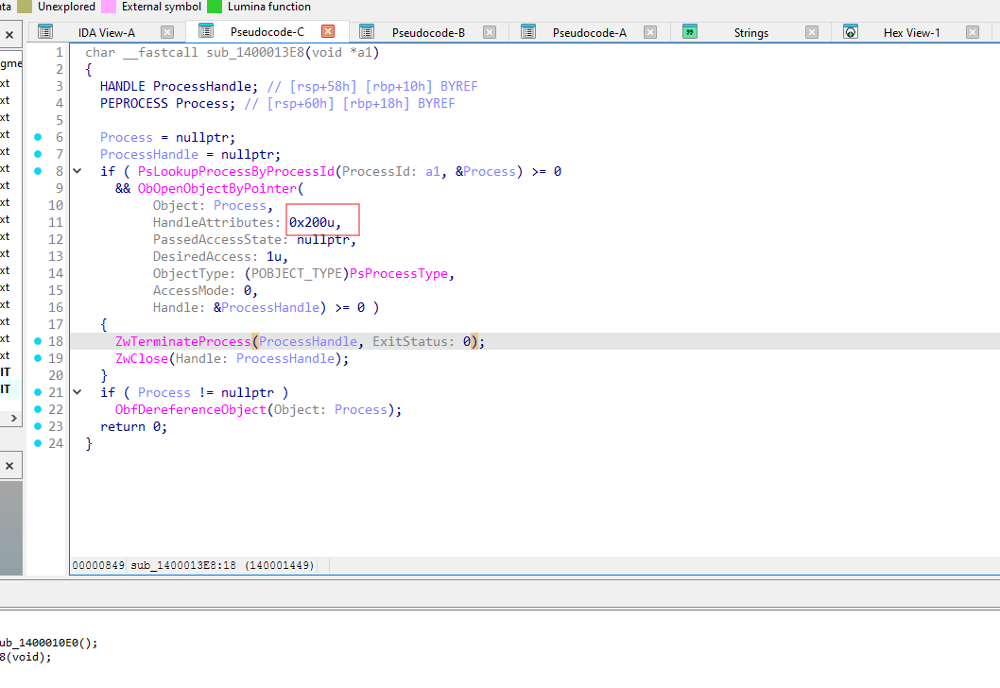

The disassembly shows it loaded into `edx` and labeled by IDA:

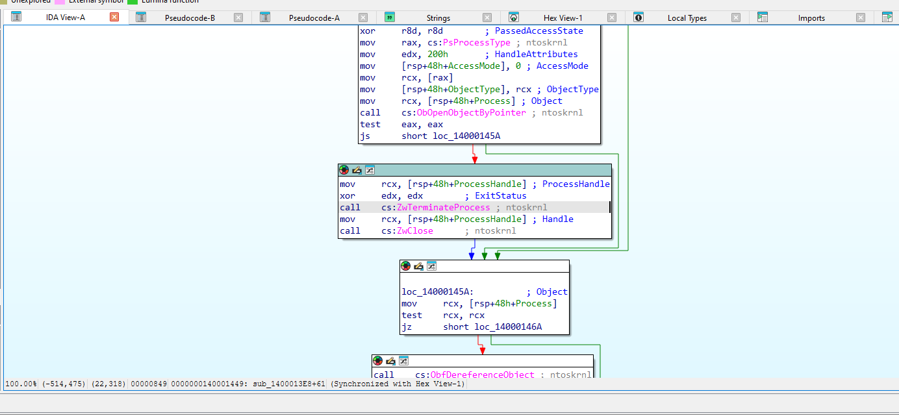

`0x200` is `OBJ_KERNEL_HANDLE`. Do not confuse it with `DesiredAccess = 1` (`PROCESS_TERMINATE`) in the same call.

**Answer: `0x200`**

---

## Q9 · Embedded PDB filename

**Question:** What is the PDB filename embedded in the binary?

**Approach.** IDA prints the PE debug info in the header comment at the top of the disassembly (`PDB File Name`):

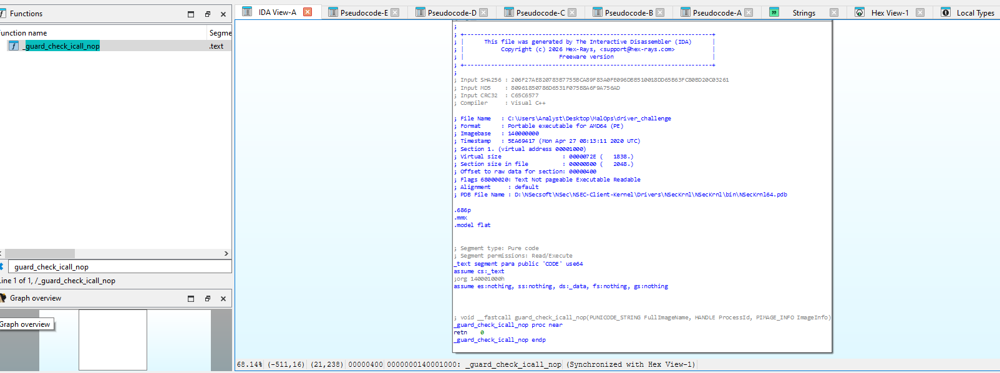

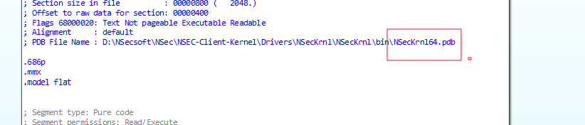

Full path:

```
D:\NSecsoft\NSec\NSEC-Client-Kernel\Drivers\NSecKrnl\NSecKrnl\bin\NSecKrnl64.pdb
```

The question asks for the filename only. The path itself is useful attribution context (project name, build layout).

**Answer: `NSecKrnl64.pdb`**

---

## Q10 · Device type constant

**Question:** What device type does the driver pass when creating its device object?

**Approach.** The fourth argument of `IoCreateDevice` is `DeviceType`; IDA labels it for us in both views (`mov r9d, 22h ; DeviceType` in disassembly).

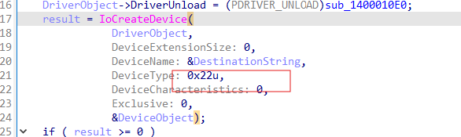

`0x22` is `FILE_DEVICE_UNKNOWN`, the usual choice for software-only drivers.

**Answer: `0x22`**

---

## Q11 · Stride between the IOCTL codes

**Question:** The four IOCTL codes are evenly spaced. What is the stride?

**Approach.** The four constants from the dispatcher:

| Decimal | Hex |
| --- | --- |
| 2246868 | `0x2248D4` |
| 2246872 | `0x2248D8` |
| 2246876 | `0x2248DC` |
| 2246880 | `0x2248E0` |


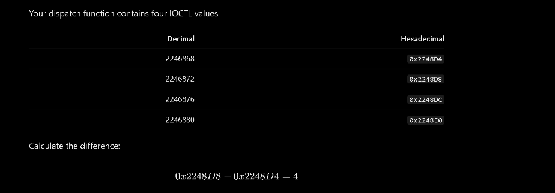

Each differs from the previous by 4. In `CTL_CODE` terms, the function number sits at bit 2, so a step of 4 means consecutive function numbers (`0x235` to `0x238`).

**Answer: `4`**

---

## Q12 · API used for the "is this me?" self-check

**Question:** Before the callback checks its tables, which kernel API gives the current process pointer for the comparison?

**Approach.** The callback registered in `sub_140001518` is `sub_1400014B0` (`v2[2] = sub_1400014B0`). Its condition compares the current process with the target object:

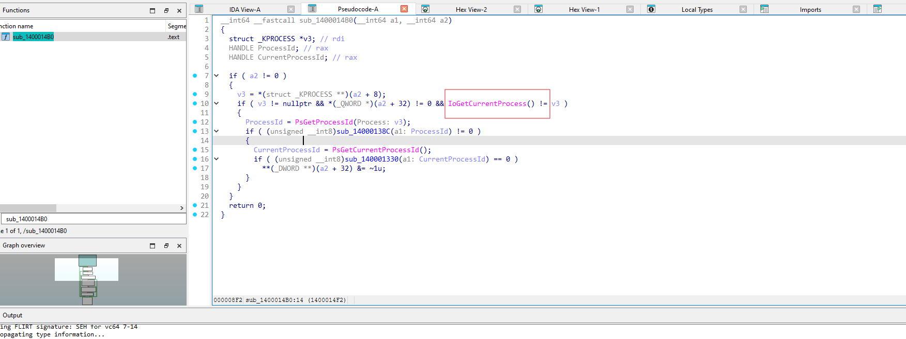

```c
v3 = *(struct _KPROCESS **)(a2 + 8);          // target process object
if ( v3 != nullptr && *(_QWORD *)(a2 + 32) != 0 && IoGetCurrentProcess() != v3 )
{
    ProcessId = PsGetProcessId(v3);
    if ( (unsigned __int8)sub_14000138C(ProcessId) != 0 )
    {
        CurrentProcessId = PsGetCurrentProcessId();
        if ( (unsigned __int8)sub_140001330(CurrentProcessId) == 0 )
            **(_DWORD **)(a2 + 32) &= ~1u;     // strip PROCESS_TERMINATE
    }
}
```

`PsGetProcessId` and `PsGetCurrentProcessId` return **IDs**. Only `IoGetCurrentProcess` returns the current **process pointer**.

Verified in the import table and in the `.idata` cross-reference (used at `sub_1400014B0+22`):

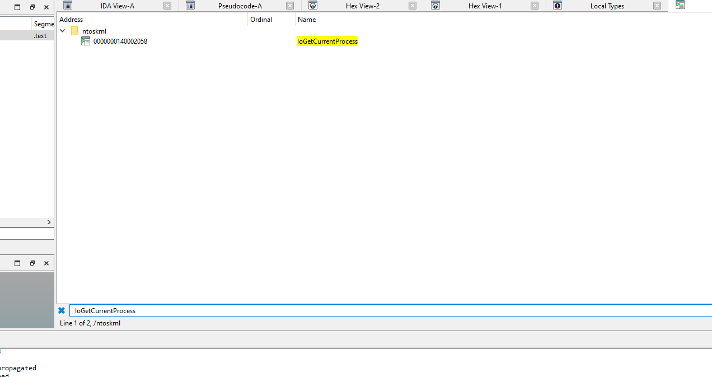

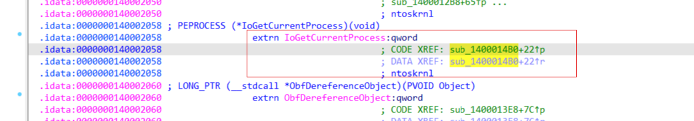

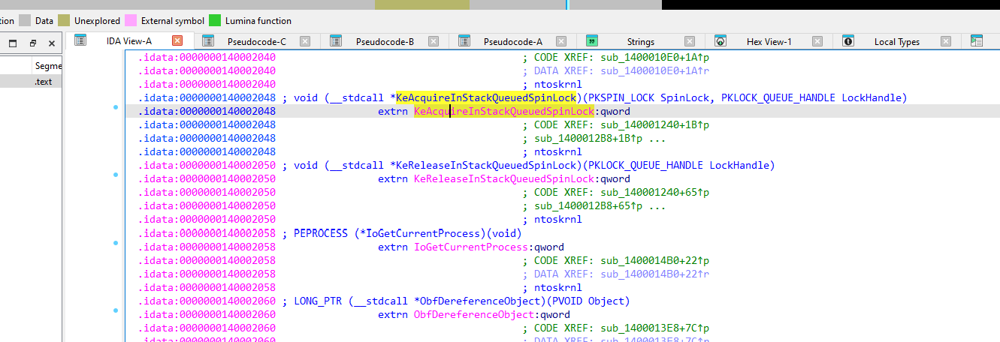

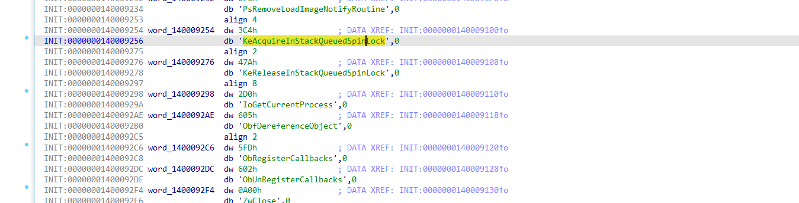

My reading of the callback: when someone opens a handle to a process whose PID is in the protected table, and the caller is not itself, the driver clears bit 0 (`PROCESS_TERMINATE`) from the granted access. That is the "strip access rights" behavior from the scenario. (Note: I only decompiled the two array-removal helpers; the roles of `sub_14000138C` and `sub_140001330` are inferred from how they are used here.)

**Answer: `IoGetCurrentProcess`**

---

## Q13 · RegistrationHandle value after unregistering

**Question:** After the callback is unregistered during teardown, what is the registration-handle global set to?

**Approach.** `sub_140001674` is called from the unload routine:

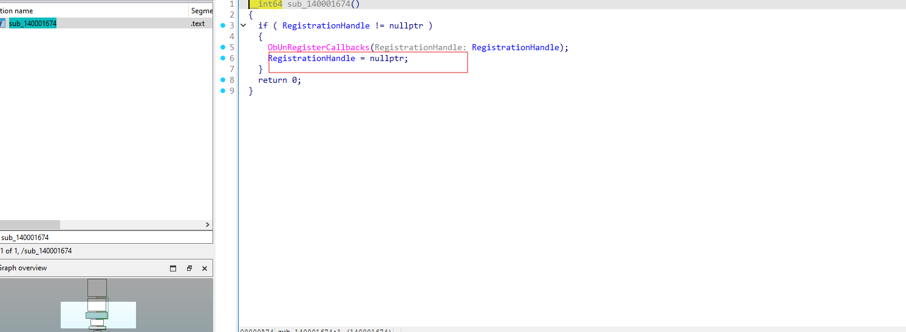

```c
if ( RegistrationHandle != nullptr )
{
    ObUnRegisterCallbacks(RegistrationHandle);
    RegistrationHandle = nullptr;
}
```

`nullptr` is `0`. Clearing it prevents the stale handle from being reused or unregistered twice.

**Answer: `0`**

---

## Q14 · Combined operation flags

**Question:** What is the combined flag value (decimal) in the operation registration structure?

**Approach.** In `sub_140001518`, `v2` is an `OB_OPERATION_REGISTRATION`: `[0]` object type, `[1]` operations, `[2]` pre-operation callback, `[3]` post-operation callback.

![v2[1] = 3](screenshots/18-q14-operations-flag-3.png)

```c
v2[0] = PsProcessType;
v2[1] = 3;               // OB_OPERATION_HANDLE_CREATE (1) | OB_OPERATION_HANDLE_DUPLICATE (2)
v2[2] = sub_1400014B0;   // pre-operation callback
v2[3] = 0;               // no post-operation callback
```

The same constant is visible as `mov [rbp+var_48], 3` in the disassembly (see Q7's disassembly screenshot). Monitoring both create and duplicate matters: an attacker or EDR could otherwise get a handle by duplicating an existing one.

**Answer: `3`**

---

## Q15 · API that releases the process object reference

**Question:** Which kernel API dereferences the process object before the termination function returns?

**Approach.** `PsLookupProcessByProcessId` returns a *referenced* `PEPROCESS`, so the handler must release it at the end:

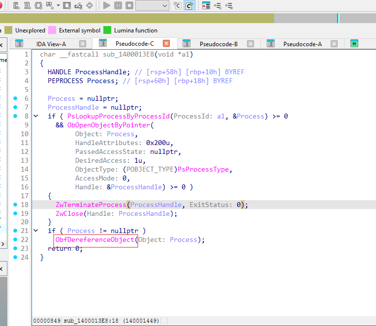


`ZwClose` closes the handle; `ObfDereferenceObject` drops the reference. Both are needed.

**Answer: `ObfDereferenceObject`**

---

## Q16 · Size of the image-load notification routine

**Question:** The registered image-load callback is unusually small. What is its size in bytes (hex)?

**Approach.** Init registers it with `PsSetLoadImageNotifyRoutine(guard_check_icall_nop)`. The decompiler shows an empty body, which says nothing about size, so I checked the disassembly. At the top of the listing it is a single instruction:


```asm
_guard_check_icall_nop proc near
    retn    0
_guard_check_icall_nop endp
```

The key detail is **`retn 0`**, not a plain `retn`:

| Instruction | Encoding | Size |
| --- | --- | --- |
| `retn` | `C3` | 1 byte |
| `retn 0` (`ret imm16`) | `C2 00 00` | **3 bytes** |

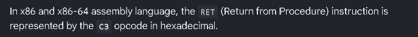

So the routine is only 3 bytes long. It starts at `0x140001000` and the next function (`sub_140001010`) begins at `0x140001010`, with padding in between. Check it yourself with the function's start/end addresses or by selecting the instruction in Hex View.

> Lesson: do not assume `retn` is `C3`. Check the operand: `retn <imm>` is `C2 <imm16>`.

**Answer: `0x3`**

---

## Q17 · DriverUnload handler address

**Question:** What is the address of the function assigned as `DriverUnload`?

**Approach.** In the init pseudocode:

```c
DriverObject->DriverUnload = (PDRIVER_UNLOAD)sub_1400010E0;
```

(`mov [rbx+68h], rax` after `lea rax, sub_1400010E0` in disassembly. `DriverUnload` sits at offset `0x68` of `DRIVER_OBJECT`.)


Jumping to the function confirms the start address (`G`, then `sub_1400010E0`):

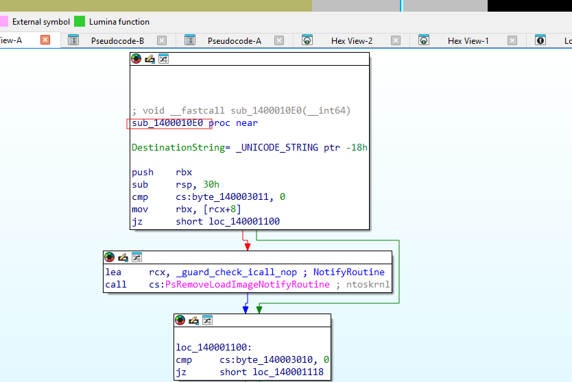

The full routine shows what teardown does:

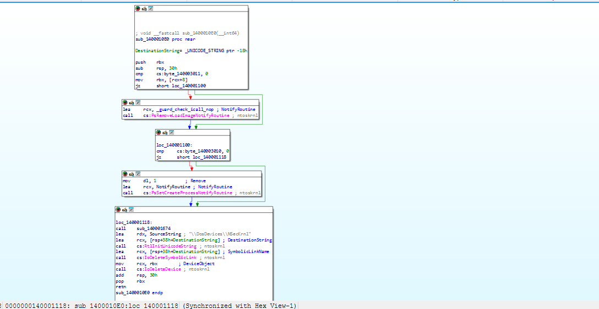

```
sub_1400010E0:
  if load-image notify registered  -> PsRemoveLoadImageNotifyRoutine(guard_check_icall_nop)
  if process notify registered     -> PsSetCreateProcessNotifyRoutine(NotifyRoutine, Remove=1)
  sub_140001674()                  -> ObUnRegisterCallbacks, RegistrationHandle = NULL   (Q13)
  RtlInitUnicodeString("\\DosDevices\\NSecKrnl"); IoDeleteSymbolicLink; IoDeleteDevice
```

IDA names unnamed functions `sub_<address>`, so the name itself carries the address.

**Answer: `0x1400010E0`**

---

## Putting it together: attack chain

```
ransomware (usermode)
   |  CreateFile("\\.\NSecKrnl")           <- \DosDevices\NSecKrnl
   |  DeviceIoControl(0x2248D4..0x2248E0)  <- sub_140001030 (IRP_MJ_DEVICE_CONTROL)
   v
NSecKrnl.sys
   1. sets 0x20 in its loader entry flags (+0x68)       -> passes the ObRegisterCallbacks check
   2. registers ObRegisterCallbacks (altitude 328987)   -> strips PROCESS_TERMINATE from handles
      to protected PIDs held in two 1024-entry arrays      (IoGetCurrentProcess self-check)
   3. IOCTL 0x2248E0 + PID -> ZwTerminateProcess        -> kills the EDR process
   4. unload: unregisters callbacks, removes symlink and device
```

## Answer summary

| # | Question | Answer |
| --- | --- | --- |
| 1 | Name exposed to usermode | `NSecKrnl` |
| 2 | Value OR'd into loader entry | `0x20` |
| 3 | Byte offset of that field | `0x68` |
| 4 | Process-termination IOCTL | `0x2248E0` |
| 5 | NTSTATUS for unknown IOCTL / NULL buffer | `0xC0000001` |
| 6 | Entries per tracking array | `1024` |
| 7 | Callback altitude | `328987` |
| 8 | HandleAttributes value | `0x200` |
| 9 | PDB filename | `NSecKrnl64.pdb` |
| 10 | Device type | `0x22` |
| 11 | IOCTL stride | `4` |
| 12 | Current-process API | `IoGetCurrentProcess` |
| 13 | RegistrationHandle after unregister | `0` |
| 14 | Combined operation flags | `3` |
| 15 | Dereference API | `ObfDereferenceObject` |
| 16 | Image-load callback size | `0x3` |
| 17 | DriverUnload address | `0x1400010E0` |

## Detection ideas

- **Driver load:** alert on kernel driver installs of `NSecKrnl`, or a service whose image path ends in `NSecKrnl64.sys` / carries the PDB string `NSecKrnl64.pdb`.
- **Device object:** a handle opened on `\\.\NSecKrnl` by a non-system process.
- **Object-callback altitude:** an unexpected `ObRegisterCallbacks` registration at altitude `328987`.
- **Behavior:** security-tool processes terminating while a recently loaded, unsigned or revoked-cert driver is present; handle-open requests to the EDR process losing `PROCESS_TERMINATE`.
- **YARA-style strings:** `\Device\NSecKrnl`, `\DosDevices\NSecKrnl`, `NSecKrnl64.pdb`, and the IOCTL constants `0x2248D4`-`0x2248E0`.

---

*Writeup by the analyst. All screenshots are original IDA Pro captures from the analysis session.*
